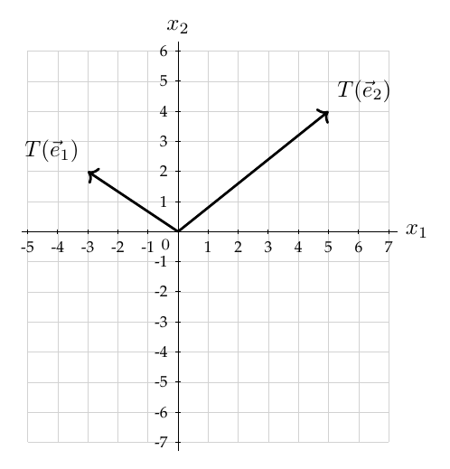



# Midterm 2

<a class="btn btn-info assignment-pdf-button" href="/resources/exams/fa26-mt2/fa26-mt2.pdf" target="_blank">View as PDF ✏️</a>
<a class="btn btn-info assignment-pdf-button" href="/resources/exams/fa26-mt2/fa26-mt2-solutions.pdf" target="_blank">Solutions PDF ✅</a>

*This page is meant to give you quick access to problems and their solutions. Refer to the original exam PDF, linked above, for test-taking instructions and formatting. Note that we’ve kept the problem text identical, which is why you may see things like “write your answer in the box below” despite there not being a box on this page.*

---

## Problems

- [Problem 1](#problem-1-8-pts)
- [Problem 2](#problem-2-12-pts)
- [Problem 3](#problem-3-12-pts)
- [Problem 4](#problem-4-12-pts)
- [Problem 5](#problem-5-10-pts)
- [Problem 6](#problem-6-18-pts)
- [Problem 7](#problem-7-11-pts)
- [Problem 8](#problem-8-17-pts)

---

## Problem 1 (8 pts)

a)

(4 pts) Let

\[C=\begin{bmatrix}4&amp;-2\\-3&amp;5\\6&amp;1\end{bmatrix},\qquad
D=\begin{bmatrix}2&amp;-4&amp;3\\5&amp;1&amp;-2\\-3&amp;6&amp;4\\7&amp;-2&amp;5\end{bmatrix}.\]

Give the shape of each expression (e.g. \(5\times3\)), or write “undefined.”

\[CD\qquad DC\qquad C+C\qquad D(3C).\]

Solution

The shape of \(C\) is \(3\times2\), and the shape of \(D\) is \(4\times3\). For a product, the inner dimensions must agree, and the outer dimensions give its shape. Thus

\[\boxed{CD:\ \text{undefined},\qquad DC:\ 4\times2,\qquad C+C:\ 3\times2,\qquad D(3C):\ 4\times2.}\]

The product \(CD\) is undefined because \(2\ne4\). Adding \(C\) to itself or multiplying it by \(3\) does not change its shape.

b)

(4 pts) Let \(a\) be a real constant, and let

\[A=\begin{bmatrix}a&amp;4\\5&amp;a\\-1&amp;-7\end{bmatrix},\qquad
B=\begin{bmatrix}3&amp;4&amp;2\\-2&amp;5&amp;-1\end{bmatrix}.\]

Suppose the third column of \(AB\) is

\[\begin{bmatrix}2\\m\\5\end{bmatrix}.\]

<strong>i)</strong> (2 pts) Find the value of \(a\). Show your work.

Solution

The third column of \(AB\) is \(A\) times the third column of \(B\):

\[A\begin{bmatrix}2\\-1\end{bmatrix}
=2\begin{bmatrix}a\\5\\-1\end{bmatrix}-\begin{bmatrix}4\\a\\-7\end{bmatrix}
=\begin{bmatrix}2a-4\\10-a\\5\end{bmatrix}.\]

Matching the first entry gives \(2a-4=2\), so \(\boxed{a=3}\).

<strong>ii)</strong> (2 pts) Find the value of \(m\). Show your work.

Solution

The second entry of the third column is \(10-a\). Using \(a=3\) from part (i), we get

\[\boxed{m=10-3=7.}\]

---

## Problem 2 (12 pts)

a)

(8 pts) Suppose a linear transformation \(T:\mathbb R^2\to\mathbb R^3\) satisfies

\[T\!\left(\begin{bmatrix}2\\-1\end{bmatrix}\right)=\begin{bmatrix}4\\2\\-3\end{bmatrix},\quad
T\!\left(\begin{bmatrix}-1\\3\end{bmatrix}\right)=\begin{bmatrix}-2\\5\\1\end{bmatrix}.\]

<strong>i)</strong> (1 pt) What is the shape of the matrix \(A\) where \(T(\vec x)=A\vec x\)?

Solution

The matrix takes a vector with \(2\) entries as input and produces a vector with \(3\) entries. It therefore has \(3\) rows and \(2\) columns, so its shape is \(\boxed{3\times2}\).

<strong>ii)</strong> (7 pts) Find an input vector \(\vec v\in\mathbb R^2\) such that

\[T(\vec v)=\begin{bmatrix}10\\-1\\-7\end{bmatrix}.\]

Solution

We want to write the desired output as a linear combination of the two outputs we know. Suppose

\[\alpha\begin{bmatrix}4\\2\\-3\end{bmatrix}
+\beta\begin{bmatrix}-2\\5\\1\end{bmatrix}
=\begin{bmatrix}10\\-1\\-7\end{bmatrix}.\]

The first two entries give \(4\alpha-2\beta=10\) and \(2\alpha+5\beta=-1\). From the first equation, \(\beta=2\alpha-5\). Substituting into the second gives \(12\alpha=24\), so \(\alpha=2\) and \(\beta=-1\). These values also give the required third entry, since \(2(-3)-1=-7\).

By linearity, we can use the same coefficients on the inputs:

\[T\!\left(2\begin{bmatrix}2\\-1\end{bmatrix}-\begin{bmatrix}-1\\3\end{bmatrix}\right)
=2\begin{bmatrix}4\\2\\-3\end{bmatrix}-\begin{bmatrix}-2\\5\\1\end{bmatrix}
=\begin{bmatrix}10\\-1\\-7\end{bmatrix}.\]

Therefore, \(\boxed{\vec v=\begin{bmatrix}5\\-5\end{bmatrix}}\).

b)

(4 pts) Which of the following transformations from \(\mathbb R^2\) to \(\mathbb R^2\) are linear? <strong>Select all that apply.</strong>

Multiply each vector by its length.
Swap the horizontal and vertical components.
Add \(4\) to the horizontal component and subtract \(2\) from the vertical component.
Send every vector to the zero vector.

Solution

Select <strong>the second and fourth choices</strong>.

<ul><li>Multiplying each vector by its length is not linear. The vector \(\begin{bmatrix}1\\0\end{bmatrix}\) maps to itself, but twice that vector, \(\begin{bmatrix}2\\0\end{bmatrix}\), maps to \(\begin{bmatrix}4\\0\end{bmatrix}\). Doubling the input does not double the output.</li><li>Swapping the components is linear: it is multiplication by \(\begin{bmatrix}0&amp;1\\1&amp;0\end{bmatrix}\).</li><li>Adding \(4\) to one component and subtracting \(2\) from the other is not linear. It sends \(\vec0\) to \(\begin{bmatrix}4\\-2\end{bmatrix}\), but a linear transformation must send \(\vec0\) to \(\vec0\).</li><li>Sending every vector to \(\vec0\) is linear: it is multiplication by the zero matrix.</li></ul>

---

## Problem 3 (12 pts)

a)

(4 pts) Let

\[A=\frac15\begin{bmatrix}1&amp;2\\2&amp;4\end{bmatrix}.\]

This matrix projects vectors orthogonally onto a line \(\ell\) through the origin. Give a nonzero vector \(\vec u\) such that \(\ell=\operatorname{span}(\vec u)\).

Solution

The columns of \(A\) are the projections of the standard basis vectors, so both lie on \(\ell\). The first column is the nonzero vector \(\frac15\begin{bmatrix}1\\2\end{bmatrix}\), which gives the direction of the line. One answer is therefore

\[\boxed{\vec u=\begin{bmatrix}1\\2\end{bmatrix}.}\]

Any nonzero scalar multiple of this vector also works.

b)

(8 pts) The diagram shows \(T(\vec e&#95;1)\) and \(T(\vec e&#95;2)\) for a linear transformation \(T:\mathbb R^2\to\mathbb R^2\), where the standard basis vectors are

\[\vec e_1=\begin{bmatrix}1\\0\end{bmatrix},\qquad \vec e_2=\begin{bmatrix}0\\1\end{bmatrix}.\]

The transformation \(S\) first applies \(T\), <strong>then</strong> rotates the resulting vector \(90^\circ\) <strong>clockwise</strong> about the origin. Find the \(2\times2\) matrix \(B\) corresponding to \(S\) (<strong>not</strong> \(T\)).

Solution

From the diagram,

\[T(\vec e_1)=\begin{bmatrix}-3\\2\end{bmatrix},\qquad
T(\vec e_2)=\begin{bmatrix}5\\4\end{bmatrix}.\]

A \(90^\circ\) clockwise rotation sends \(\begin{bmatrix}r\\s\end{bmatrix}\) to \(\begin{bmatrix}s\\-r\end{bmatrix}\). Therefore,

\[S(\vec e_1)=\begin{bmatrix}2\\3\end{bmatrix},\qquad
S(\vec e_2)=\begin{bmatrix}4\\-5\end{bmatrix}.\]

These outputs are the first and second columns of the matrix for \(S\), so

\[\boxed{B=\begin{bmatrix}2&amp;4\\3&amp;-5\end{bmatrix}.}\]

---

## Problem 4 (12 pts)

a)

(5 pts) Find \(A^{-1}\), where

\[A=\begin{bmatrix}7&amp;-3\\5&amp;-1\end{bmatrix}.\]

Solution

The \(2\times2\) inverse formula gives

\[A^{-1}=\frac{1}{7(-1)-(-3)(5)}\begin{bmatrix}-1&amp;3\\-5&amp;7\end{bmatrix}
=\boxed{\frac18\begin{bmatrix}-1&amp;3\\-5&amp;7\end{bmatrix}.}\]

The denominator is \(-7+15=8\ne0\), so the inverse exists.

b)

(7 pts) Two invertible matrices \(C\) and \(D\) have inverses

\[C^{-1}=\begin{bmatrix}2&amp;3\\-1&amp;4\end{bmatrix},\qquad
D^{-1}=\begin{bmatrix}1&amp;-2\\0&amp;1\end{bmatrix}.\]

A vector \(\vec x\) is first multiplied by \(C\), and the result is then multiplied by \(D\). The final output is

\[\begin{bmatrix}5\\2\end{bmatrix}.\]

Find \(\vec x\).

Solution

The given output is \(DC\vec x\). We need to undo \(D\) first, then undo \(C\). Multiplying the output by \(D^{-1}\) gives

\[C\vec x=D^{-1}\begin{bmatrix}5\\2\end{bmatrix}
=\begin{bmatrix}1&amp;-2\\0&amp;1\end{bmatrix}\begin{bmatrix}5\\2\end{bmatrix}
=\begin{bmatrix}1\\2\end{bmatrix}.\]

Now multiply by \(C^{-1}\):

\[\vec x=\begin{bmatrix}2&amp;3\\-1&amp;4\end{bmatrix}\begin{bmatrix}1\\2\end{bmatrix}
=\boxed{\begin{bmatrix}8\\7\end{bmatrix}.}\]

---

## Problem 5 (10 pts)

Find matrices \(L\) and \(U\) such that \(A=LU\), where

\[A=\begin{bmatrix}5&amp;2&amp;-4\\15&amp;3&amp;-5\\-10&amp;-1&amp;7\end{bmatrix}.\]

Here, \(L\) must be lower triangular with ones on its diagonal, and \(U\) must be upper triangular. No row swaps are necessary.

Solution

Write the factors in the required forms:

\[L=\begin{bmatrix}1&amp;0&amp;0\\\ell_{21}&amp;1&amp;0\\\ell_{31}&amp;\ell_{32}&amp;1\end{bmatrix},\qquad
U=\begin{bmatrix}u_{11}&amp;u_{12}&amp;u_{13}\\0&amp;u_{22}&amp;u_{23}\\0&amp;0&amp;u_{33}\end{bmatrix}.\]

The first row of \(LU\) is the first row of \(U\), so \(u&#95;{11}=5\), \(u&#95;{12}=2\), and \(u&#95;{13}=-4\). Matching the first column gives

\[5\ell_{21}=15,\qquad5\ell_{31}=-10,
\qquad\text{so}\qquad\ell_{21}=3,\quad\ell_{31}=-2.\]

Matching the remaining entries in row 2 gives

\[3(2)+u_{22}=3,\qquad3(-4)+u_{23}=-5,\]

so \(u&#95;{22}=-3\) and \(u&#95;{23}=7\). Entry \((3,2)\) then gives

\[(-2)(2)+\ell_{32}(-3)=-1,
\qquad\text{so}\qquad\ell_{32}=-1.\]

Finally, entry \((3,3)\) gives \((-2)(-4)+(-1)(7)+u&#95;{33}=7\), so \(u&#95;{33}=6\). Thus

\[\boxed{L=\begin{bmatrix}1&amp;0&amp;0\\3&amp;1&amp;0\\-2&amp;-1&amp;1\end{bmatrix},\qquad
U=\begin{bmatrix}5&amp;2&amp;-4\\0&amp;-3&amp;7\\0&amp;0&amp;6\end{bmatrix}.}\]

Multiplying these factors gives \(A\), as required.

---

## Problem 6 (18 pts)

a)

(10 pts) Suppose a \(3\times5\) matrix \(A\) has the factorization \(PA=LU\), where

\[P=\begin{bmatrix}0&amp;1&amp;0\\0&amp;0&amp;1\\1&amp;0&amp;0\end{bmatrix},\quad
L=\begin{bmatrix}1&amp;0&amp;0\\-2&amp;1&amp;0\\3&amp;-1&amp;1\end{bmatrix},\quad
U=\begin{bmatrix}4&amp;-8&amp;3&amp;2&amp;-5\\0&amp;0&amp;5&amp;-10&amp;5\\0&amp;0&amp;0&amp;0&amp;0\end{bmatrix}.\]

Use the given factorization to find all real values of \(c\) for which the following system has no solutions:

\[A\vec x=\begin{bmatrix}c\\4\\7\end{bmatrix}.\]

Solution

Let \(\vec b=\begin{bmatrix}c\\4\\7\end{bmatrix}\). Since \(PA=LU\), we can solve \(L\vec y=P\vec b\) first, then consider \(U\vec x=\vec y\). The permutation changes the order of the entries:

\[P\vec b=\begin{bmatrix}4\\7\\c\end{bmatrix}.\]

Forward substitution in \(L\vec y=P\vec b\) gives

\[\begin{aligned}
y_1&amp;=4,\\
-2y_1+y_2&amp;=7 &amp;&amp;\Longrightarrow\quad y_2=15,\\
3y_1-y_2+y_3&amp;=c &amp;&amp;\Longrightarrow\quad y_3=c+3.
\end{aligned}\]

The last row of \(U\vec x=\vec y\) is therefore \(0=c+3\). If \(c\ne-3\), this is impossible, so there are no solutions.

If \(c=-3\), the last equation is \(0=0\). The second equation determines \(x&#95;3\) after choosing \(x&#95;4,x&#95;5\), and the first determines \(x&#95;1\) after choosing \(x&#95;2\). Thus the system is consistent when \(c=-3\), and the requested values are exactly

\[\boxed{c\ne-3.}\]

b)

(8 pts) Find all solutions of the following system. Give your answer in vector-parametric form.

\[\begin{bmatrix}5&amp;-4&amp;3\\0&amp;6&amp;-12\\0&amp;0&amp;0\\0&amp;0&amp;0\\0&amp;0&amp;0\end{bmatrix}
\begin{bmatrix}x_1\\x_2\\x_3\end{bmatrix}
=\begin{bmatrix}7\\-18\\0\\0\\0\end{bmatrix}.\]

Solution

The only nonzero equations are

\[5x_1-4x_2+3x_3=7,\qquad6x_2-12x_3=-18.\]

The last three rows give \(0=0\), so they add no restrictions. Let the free variable be \(x&#95;3=t\). The second equation gives

\[x_2=-3+2t.\]

Substituting into the first gives \(5x&#95;1-4(-3+2t)+3t=7\), so \(5x&#95;1=-5+5t\) and \(x&#95;1=-1+t\). Therefore all solutions are

\[\boxed{\vec x=\begin{bmatrix}-1\\-3\\0\end{bmatrix}
+t\begin{bmatrix}1\\2\\1\end{bmatrix},\qquad t\in\mathbb R.}\]

---

## Problem 7 (11 pts)

a)

(8 pts) Let \(S\) be the plane \(3x+2y-z=0\) in \(\mathbb R^3\). Which of the following matrices \(A\) satisfy \(\operatorname{colsp}(A)=S\)? <strong>Select all that apply.</strong>

\(A=\begin{bmatrix}2&amp;-1\\-1&amp;3\\4&amp;3\end{bmatrix}\)
\(A=\begin{bmatrix}2&amp;-1&amp;1\\-1&amp;3&amp;2\\4&amp;3&amp;7\end{bmatrix}\)
\(A=\begin{bmatrix}2&amp;6\\-1&amp;-3\\4&amp;12\end{bmatrix}\)
\(A=\begin{bmatrix}2&amp;-1\\-1&amp;3\\4&amp;5\end{bmatrix}\)

Solution

<strong>Select the first and second matrices.</strong> Let

\[\vec u=\begin{bmatrix}2\\-1\\4\end{bmatrix},\qquad
\vec v=\begin{bmatrix}-1\\3\\3\end{bmatrix}.\]

Both vectors belong to \(S\), since

\[3(2)+2(-1)-4=0,\qquad 3(-1)+2(3)-3=0.\]

They are also linearly independent. If \(\vec v=k\vec u\), the first entries would require \(k=-\frac12\), but then the second entry of \(k\vec u\) would be \(\frac12\), not \(3\). Thus they are not scalar multiples of one another.

Since \(S\) is a plane through the origin, it has dimension 2. Two linearly independent vectors in \(S\) form a basis for \(S\), so the first matrix has column space \(S\).

The second matrix has the same first two columns, and its third column is their sum:

\[\begin{bmatrix}1\\2\\7\end{bmatrix}=\vec u+\vec v.\]

This extra column does not change the column space, so the second matrix also works.

The third matrix does not work: its second column is \(3\vec u\), so its column space is only the line spanned by \(\vec u\).

The fourth matrix does not work either. Its second column is not even in \(S\), since

\[3(-1)+2(3)-5=-2\ne0.\]

Therefore the correct choices are \(\boxed{\text{the first and second matrices}}\).

b)

(3 pts) Recall that a subspace contains the zero vector and is closed under addition and scalar multiplication. Consider the set

\[W=\left\{\begin{bmatrix}x\\y\end{bmatrix}\in\mathbb R^2:xy=0\right\}.\]

This set is <strong>not</strong> a subspace of \(\mathbb R^2\), but it still satisfies some of these properties. For each property below, select <strong>yes or no</strong>.

<strong>i)</strong> (1 pt) Does \(W\) contain the zero vector?

Yes
No

<strong>ii)</strong> (1 pt) Is \(W\) closed under addition?

Yes
No

<strong>iii)</strong> (1 pt) Is \(W\) closed under scalar multiplication by any real number?

Yes
No

Solution

<strong>i)</strong> \(\boxed{\text{Yes.}}\) The zero vector belongs to \(W\), since \(0\cdot0=0\).

<strong>ii)</strong> \(\boxed{\text{No.}}\) For example, both \(\begin{bmatrix}1\\0\end{bmatrix}\) and \(\begin{bmatrix}0\\1\end{bmatrix}\) belong to \(W\), but their sum does not:

\[\begin{bmatrix}1\\0\end{bmatrix}+\begin{bmatrix}0\\1\end{bmatrix}=\begin{bmatrix}1\\1\end{bmatrix},\qquad 1\cdot1\ne0.\]

<strong>iii)</strong> \(\boxed{\text{Yes.}}\) If \(\begin{bmatrix}x\\y\end{bmatrix}\in W\), then \(xy=0\). For any real scalar \(a\), the product of the entries of \(a\begin{bmatrix}x\\y\end{bmatrix}\) is

\[(ax)(ay)=a^2xy=0.\]

Thus the scalar multiple also belongs to \(W\).

---

## Problem 8 (17 pts)

a)

(6 pts) Let \(\vec x,\vec y,\vec z\in\mathbb R^5\) be linearly independent, and let \(t\in\mathbb R\). Define

\[A=\begin{bmatrix}|&amp;|\\2\vec x-\vec y&amp;6\vec x+t\vec y\\|&amp;|\end{bmatrix},\qquad
B=\begin{bmatrix}|&amp;|&amp;|\\\vec x+\vec y&amp;\vec y-4\vec z&amp;\vec x+t\vec z\\|&amp;|&amp;|\end{bmatrix}.\]

For each part below, select the <strong>one value of \(t\)</strong> that satisfies the given condition.

<strong>i)</strong> (3 pts) \(\operatorname{rank}(A)=1\)

\(t=-4\)
\(t=-3\)
\(t=0\)
\(t=1\)
\(t=3\)
\(t=4\)

Solution

The first column, \(2\vec x-\vec y\), is nonzero: otherwise \(\vec y=2\vec x\), contradicting linear independence. Therefore \(A\) has rank 1 exactly when its second column is a scalar multiple of its first. Write

\[6\vec x+t\vec y=k(2\vec x-\vec y)=2k\vec x-k\vec y.\]

Because \(\vec x\) and \(\vec y\) are linearly independent, their coefficients on the two sides must match. This gives \(6=2k\) and \(t=-k\), so

\[\boxed{t=-3}.\]

For this value, the second column is three times the first, as required.

<strong>ii)</strong> (3 pts) \(\operatorname{rank}(B)=2\)

\(t=-4\)
\(t=-3\)
\(t=0\)
\(t=1\)
\(t=3\)
\(t=4\)

Solution

Try to write the first column as a scalar multiple of the second:

\[\vec x+\vec y=k(\vec y-4\vec z)
\quad\Longrightarrow\quad
\vec x=(k-1)\vec y-4k\vec z.\]

This is impossible: it writes \(\vec x\) as a linear combination of \(\vec y\) and \(\vec z\). The second column is also nonzero, since otherwise \(\vec y=4\vec z\). Thus the first two columns are linearly independent.

Thus \(B\) has rank 2 exactly when its third column is a linear combination of the first two. Suppose

\[\vec x+t\vec z=a(\vec x+\vec y)+b(\vec y-4\vec z)=a\vec x+(a+b)\vec y-4b\vec z.\]

Matching the coefficients of \(\vec x,\vec y,\vec z\) gives

\[a=1,\qquad a+b=0,\qquad t=-4b.\]

So \(b=-1\) and \(\boxed{t=4}\). For this value, the third column is the first minus the second:

\[\vec x+4\vec z=(\vec x+\vec y)-(\vec y-4\vec z).\]

b)

(2 pts) A matrix \(D\) has rank \(8\). The solutions of \(D\vec x=\vec0\) have \(5\) free variables. How many columns does \(D\) have?

Solution

Rank 8 means there are 8 pivot columns. Each of the 5 free variables corresponds to a non-pivot column. Thus the total number of columns is

\[\boxed{8+5=13}.\]

c)

(6 pts) Suppose \(E\) is a \(3\times3\) matrix such that

\[E\begin{bmatrix}8\\-5\\11\end{bmatrix}=\begin{bmatrix}6\\-8\\13\end{bmatrix},\qquad
E\begin{bmatrix}-3\\7\\4\end{bmatrix}=\begin{bmatrix}0\\0\\0\end{bmatrix}.\]

<strong>i)</strong> (2 pts) True or false: \(E\) is invertible.

True
False

Solution

\(\boxed{\text{False.}}\) The nonzero vector \(\begin{bmatrix}-3\\7\\4\end{bmatrix}\) is mapped to the zero vector. If \(E\) were invertible, multiplying both sides of the given equality by \(E^{-1}\) would give

\[\begin{bmatrix}-3\\7\\4\end{bmatrix}=E^{-1}\begin{bmatrix}0\\0\\0\end{bmatrix}=\begin{bmatrix}0\\0\\0\end{bmatrix}.\]

This is impossible. Thus \(E\) is not invertible.

<strong>ii)</strong> (4 pts) Give a solution of the following system <strong>other than</strong> \(\begin{bmatrix}8\\-5\\11\end{bmatrix}\):

\[E\vec x=\begin{bmatrix}6\\-8\\13\end{bmatrix}.\]

Solution

We can add a vector that \(E\) sends to zero to the given solution without changing the output. In particular,

\[E\!\left(\begin{bmatrix}8\\-5\\11\end{bmatrix}+\begin{bmatrix}-3\\7\\4\end{bmatrix}\right)
=E\begin{bmatrix}8\\-5\\11\end{bmatrix}+E\begin{bmatrix}-3\\7\\4\end{bmatrix}
=\begin{bmatrix}6\\-8\\13\end{bmatrix}+\begin{bmatrix}0\\0\\0\end{bmatrix}.\]

Therefore one valid answer is

\[\boxed{\vec x=\begin{bmatrix}5\\2\\15\end{bmatrix}}.\]

d)

(3 pts) A \(6\times4\) matrix \(G\) has rank \(4\). Is \(G\vec x=\vec b\) guaranteed to have a solution for every \(\vec b\in\mathbb R^6\)? Briefly explain.

Solution

\(\boxed{\text{No.}}\) The column space of \(G\) has dimension 4, while \(\mathbb R^6\) has dimension 6. Thus the columns of \(G\) cannot span all of \(\mathbb R^6\). If \(\vec b\) lies outside the column space, \(G\vec x=\vec b\) has no solution.


