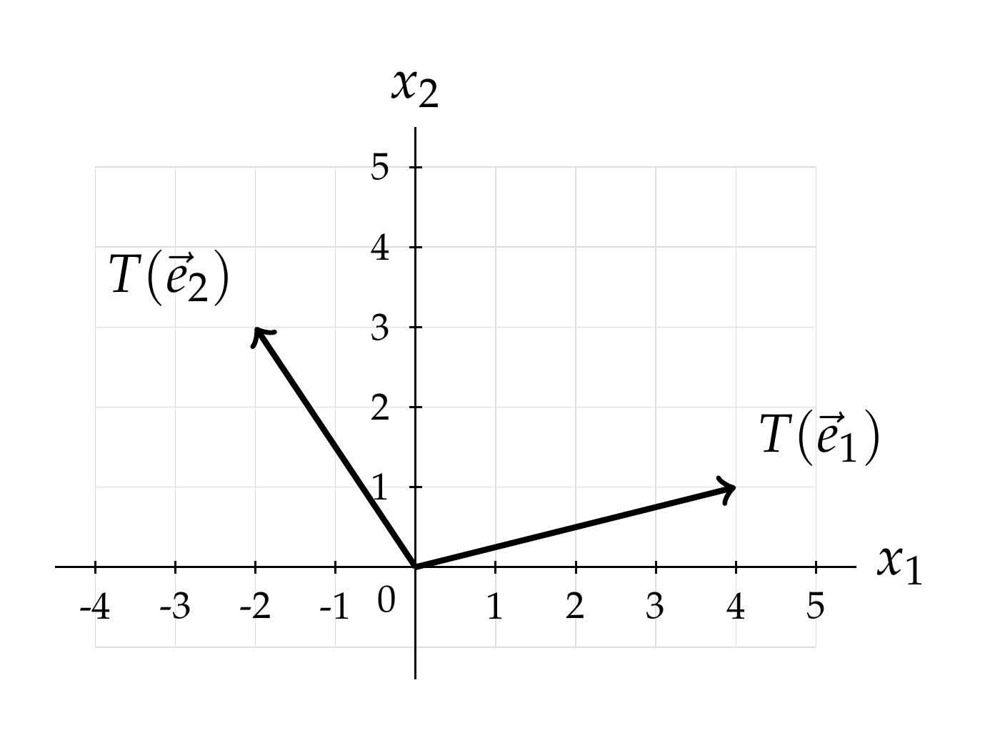



# Practice Midterm 2

<a class="btn btn-info assignment-pdf-button" href="/resources/exams/practice-mt2/practice-mt2.pdf" target="_blank">View as PDF ✏️</a>
<a class="btn btn-info assignment-pdf-button" href="/resources/exams/practice-mt2/practice-mt2-solutions.pdf" target="_blank">Solutions PDF ✅</a>
<a class="btn btn-info assignment-pdf-button" href="https://www.youtube.com/playlist?list=PLWQsSvehReUk" target="_blank" rel="noopener">Video Walkthroughs 🎥</a>

*This page is meant to give you quick access to problems and their solutions. Refer to the original exam PDF, linked above, for test-taking instructions and formatting. Note that we’ve kept the problem text identical, which is why you may see things like “write your answer in the box below” despite there not being a box on this page.*

---

## Problems

- [Problem 1](#problem-1-8-pts)
- [Problem 2](#problem-2-10-pts)
- [Problem 3](#problem-3-10-pts)
- [Problem 4](#problem-4-13-pts)
- [Problem 5](#problem-5-16-pts)
- [Problem 6](#problem-6-16-pts)
- [Problem 7](#problem-7-11-pts)
- [Problem 8](#problem-8-16-pts)

---

<h2 id="problem-1-8-pts" markdown="span">Problem 1 (8 pts) <a class="btn btn-info assignment-pdf-button problem-video-button" href="https://youtu.be/QUz1Sc0KBvY" target="_blank" rel="noopener" aria-label="Walkthrough video for Problem 1">🎥 Walkthrough</a></h2>

Let \\(c\\) be a real constant, and let 

$$
A=\begin{bmatrix}4&-2\\-3&5\\6&1\end{bmatrix},\qquad
B=\begin{bmatrix}7&3&-4\\2&c&5\end{bmatrix}.
$$

a)

(4 pts) Give the shape of each expression (e.g. \\(5\times3\\)), or write "undefined."

$$
AB\qquad BA\qquad A+B\qquad A(BA)
$$

Solution

The shape of \\(A\\) is \\(3\times2\\), and the shape of \\(B\\) is \\(2\times3\\). Therefore, 

$$
\boxed{AB:\ 3\times3,\qquad BA:\ 2\times2,\qquad A+B:\ \text{undefined},\qquad A(BA):\ 3\times2.}
$$

 For a product, the inner dimensions must agree, and the outer dimensions give its shape. Addition requires identical shapes.

b)

(4 pts) Suppose the second column of \\(AB\\) is 

$$
\begin{bmatrix}20\\-29\\14\end{bmatrix}.
$$

 Find the value of \\(c\\).

Solution

The second column of \\(AB\\) is \\(A\\) times the second column of \\(B\\): 

$$
A\begin{bmatrix}3\\c\end{bmatrix}
=3\begin{bmatrix}4\\-3\\6\end{bmatrix}+c\begin{bmatrix}-2\\5\\1\end{bmatrix}
=\begin{bmatrix}12-2c\\-9+5c\\18+c\end{bmatrix}.
$$

 The first entry gives \\(12-2c=20\\), so \\(\boxed{c=-4}\\). This also gives \\(-9+5(-4)=-29\\) and \\(18+(-4)=14\\), as required.

---

<h2 id="problem-2-10-pts" markdown="span">Problem 2 (10 pts) <a class="btn btn-info assignment-pdf-button problem-video-button" href="https://youtu.be/IjBUKvubtS8" target="_blank" rel="noopener" aria-label="Walkthrough video for Problem 2">🎥 Walkthrough</a></h2>

a)

(6 pts) Let \\(T:\mathbb R^3\to\mathbb R^2\\) be a linear transformation, and suppose 

$$
T\!\left(\begin{bmatrix}2\\-1\\4\end{bmatrix}\right)=\begin{bmatrix}6\\-4\end{bmatrix},\qquad
T\!\left(\begin{bmatrix}-3\\5\\2\end{bmatrix}\right)=\begin{bmatrix}-5\\7\end{bmatrix}.
$$

 **i)** (1 pt) What is the shape of the matrix corresponding to \\(T\\), i.e., of the matrix \\(A\\) where \\(T(\vec x)=A\vec x\\)?

Shape:

**ii)** (5 pts) Find \\(T\left(\begin{bmatrix}-4\\\\9\\\\8\end{bmatrix}\right)\\) without finding the matrix of \\(T\\).

Solution

**i)** The domain is \\(\mathbb R^3\\) and the codomain is \\(\mathbb R^2\\), so the matrix has shape \\(\boxed{2\times3}\\).

**ii)** Recall that a linear transformation preserves addition and scalar multiplication: for all vectors \\(\vec u,\vec v\\) in its domain and all scalars \\(c\\),

$$
T(\vec u+\vec v)=T(\vec u)+T(\vec v),\qquad T(c\vec u)=cT(\vec u).
$$

 Because we know \\(T\\) at two inputs, we look for a linear combination of those inputs that equals the requested input. The same coefficients will then combine their outputs. Observe that

$$
\begin{bmatrix}-4\\9\\8\end{bmatrix}
=\begin{bmatrix}2\\-1\\4\end{bmatrix}+2\begin{bmatrix}-3\\5\\2\end{bmatrix}.
$$

 Using the fact that \\(T\\) is a linear transformation, 

$$
T\!\left(\begin{bmatrix}-4\\9\\8\end{bmatrix}\right)
=\begin{bmatrix}6\\-4\end{bmatrix}+2\begin{bmatrix}-5\\7\end{bmatrix}
=\boxed{\begin{bmatrix}-4\\10\end{bmatrix}}.
$$

b)

(4 pts) Which of the following transformations from \\(\mathbb R^2\\) to \\(\mathbb R^2\\) are linear? **Select all that apply.**

 Rotate \\(30^\circ\\) clockwise about the origin, then add \\(1\\) to the horizontal component.

 Reflect across the line \\(y=-2x\\), then multiply the vertical component by \\(4\\).

 Project orthogonally onto the line \\(y=3x\\).

 Replace the vertical component by its square, leaving the horizontal component unchanged.

Solution

**Select the second and third transformations.**

-   The first is not linear: it sends \\(\vec0\\) to \\(\begin{bmatrix}1\\\\0\end{bmatrix}\\).

-   The second is linear: reflection across a line through the origin is linear, and multiplying the vertical component by \\(4\\) is multiplication by \\(\begin{bmatrix}1&amp;0\\\\0&amp;4\end{bmatrix}\\). A composition of linear transformations is linear.

-   The third is linear: projection onto a line through the origin is a linear transformation.

-   The fourth is not linear. If \\(R\left(\begin{bmatrix}x\\\\y\end{bmatrix}\right)=\begin{bmatrix}x\\\\y^2\end{bmatrix}\\), then \\(R\left(2\begin{bmatrix}0\\\\1\end{bmatrix}\right)=\begin{bmatrix}0\\\\4\end{bmatrix}\\), whereas \\(2R\left(\begin{bmatrix}0\\\\1\end{bmatrix}\right)=\begin{bmatrix}0\\\\2\end{bmatrix}\\).

---

<h2 id="problem-3-10-pts" markdown="span">Problem 3 (10 pts) <a class="btn btn-info assignment-pdf-button problem-video-button" href="https://youtu.be/t41Q_LIlh5Q" target="_blank" rel="noopener" aria-label="Walkthrough video for Problem 3">🎥 Walkthrough</a></h2>

a)

(6 pts) Find the \\(2\times2\\) matrix \\(P\\) that projects each vector in \\(\mathbb R^2\\) onto the line spanned by \\(\begin{bmatrix}2\\\\5\end{bmatrix}\\).

Solution

Let \\(\vec v=\begin{bmatrix}2\\\\5\end{bmatrix}\\). The projection of \\(\vec x\\) onto its span is 

$$
\frac{\vec v\cdot\vec x}{\vec v\cdot\vec v}\vec v
=\frac{2x_1+5x_2}{29}\begin{bmatrix}2\\5\end{bmatrix}
=\frac1{29}\begin{bmatrix}4x_1+10x_2\\10x_1+25x_2\end{bmatrix}.
$$

 Thus 

$$
\boxed{P=\frac1{29}\begin{bmatrix}4&10\\10&25\end{bmatrix}.}
$$

b)

(4 pts) The diagram shows \\(T(\vec e&#95;1)\\) and \\(T(\vec e&#95;2)\\) for a linear transformation \\(T:\mathbb R^2\to\mathbb R^2\\), where \\(\vec e&#95;1=\begin{bmatrix}1\\\\0\end{bmatrix}\\) and \\(\vec e&#95;2=\begin{bmatrix}0\\\\1\end{bmatrix}\\). Find the matrix \\(B\\) corresponding to \\(T\\).

Solution

In general, if \\(T(\vec x)=A\vec x\\), then

$$
T(\vec e_1)=A\vec e_1=A\begin{bmatrix}1\\0\end{bmatrix}
=\text{first column of }A.
$$

 Multiplication by \\(\begin{bmatrix}1\\\\0\end{bmatrix}\\) takes one copy of the first column and zero copies of the second. Similarly,

$$
T(\vec e_2)=A\vec e_2=A\begin{bmatrix}0\\1\end{bmatrix}
=\text{second column of }A.
$$

 Here the matrix is called \\(B\\). The diagram gives \\(T(\vec e&#95;1)=\begin{bmatrix}4\\\\1\end{bmatrix}\\) and \\(T(\vec e&#95;2)=\begin{bmatrix}-2\\\\3\end{bmatrix}\\), so placing these outputs in the first and second columns gives

$$
\boxed{B=\begin{bmatrix}4&-2\\1&3\end{bmatrix}.}
$$

---

<h2 id="problem-4-13-pts" markdown="span">Problem 4 (13 pts) <a class="btn btn-info assignment-pdf-button problem-video-button" href="https://youtu.be/WYO4hZ_p3AU" target="_blank" rel="noopener" aria-label="Walkthrough video for Problem 4">🎥 Walkthrough</a></h2>

a)

(4 pts) An invertible \\(3\times3\\) matrix \\(A\\) satisfies 

$$
A\begin{bmatrix}4\\-3\\2\end{bmatrix}=\begin{bmatrix}1\\0\\0\end{bmatrix},\qquad
A\begin{bmatrix}-2\\5\\1\end{bmatrix}=\begin{bmatrix}0\\1\\0\end{bmatrix},\qquad
A\begin{bmatrix}3\\1\\4\end{bmatrix}=\begin{bmatrix}0\\0\\1\end{bmatrix}.
$$

 Find \\(A^{-1}\\) without first finding \\(A\\). Explain how you found your answer.

Solution

Multiplying each given equation by \\(A^{-1}\\) tells us where the matrix \\(A^{-1}\\) sends the standard basis vectors \\(\vec e&#95;1\\), \\(\vec e&#95;2\\), and \\(\vec e&#95;3\\). For example, \\(A^{-1}\vec e&#95;1=\begin{bmatrix}4\\\\-3\\\\2\end{bmatrix}\\).

These three outputs are the columns of \\(A^{-1}\\)! 

$$
\boxed{A^{-1}=\begin{bmatrix}4&-2&3\\-3&5&1\\2&1&4\end{bmatrix}.}
$$

 Equivalently, multiplying \\(A\\) by this matrix produces \\(I&#95;3\\), since the three resulting columns are \\(\vec e&#95;1,\vec e&#95;2,\vec e&#95;3\\).

b)

(4 pts) Find \\(B^{-1}\\), where 

$$
B=\begin{bmatrix}5&4\\6&8\end{bmatrix}.
$$

Solution

Using the two-by-two inverse formula, 

$$
B^{-1}=\frac1{5(8)-4(6)}\begin{bmatrix}8&-4\\-6&5\end{bmatrix}
=\boxed{\frac1{16}\begin{bmatrix}8&-4\\-6&5\end{bmatrix}.}
$$

 The denominator is nonzero, so the inverse exists.

c)

(5 pts) An invertible matrix \\(C\\) has inverse 

$$
C^{-1}=\begin{bmatrix}3&-2\\4&-1\end{bmatrix}.
$$

 Solve for \\(\vec x\\): 

$$
C\left(4\vec x+\begin{bmatrix}5\\-4\end{bmatrix}\right)=\begin{bmatrix}7\\4\end{bmatrix}.
$$

Solution

Multiply both sides by \\(C^{-1}\\): 

$$
4\vec x+\begin{bmatrix}5\\-4\end{bmatrix}
=\begin{bmatrix}3&-2\\4&-1\end{bmatrix}\begin{bmatrix}7\\4\end{bmatrix}
=\begin{bmatrix}13\\24\end{bmatrix}.
$$

 Consequently, 

$$
4\vec x=\begin{bmatrix}8\\28\end{bmatrix},\qquad
\boxed{\vec x=\begin{bmatrix}2\\7\end{bmatrix}.}
$$

---

<h2 id="problem-5-16-pts" markdown="span">Problem 5 (16 pts) <a class="btn btn-info assignment-pdf-button problem-video-button" href="https://youtu.be/mzH1JRxcl-s" target="_blank" rel="noopener" aria-label="Walkthrough video for Problem 5">🎥 Walkthrough</a></h2>

a)

(8 pts) Find a scalar \\(k\\) and matrices \\(P\\), \\(L\\), and \\(U\\) such that \\(PA=LU\\), where 

$$
A=\begin{bmatrix}0&3&-4\\4&-2&6\\-4&8&k\end{bmatrix},\qquad U=\begin{bmatrix}4&a&b\\0&3&c\\0&0&5\end{bmatrix}.
$$

 Here, \\(P\\) is a permutation matrix, and \\(L\\) is lower triangular with ones on its diagonal. Write all entries of \\(P\\), \\(L\\), and \\(U\\) in the labeled boxes.

Solution

The first row of \\(LU\\) equals the first row of \\(U\\). Its first entry is \\(4\\), so put the second row of \\(A\\) first. Choose 

$$
P=\begin{bmatrix}0&1&0\\1&0&0\\0&0&1\end{bmatrix},\qquad
PA=\begin{bmatrix}4&-2&6\\0&3&-4\\-4&8&k\end{bmatrix}.
$$

 Write 

$$
L=\begin{bmatrix}1&0&0\\\ell_{21}&1&0\\\ell_{31}&\ell_{32}&1\end{bmatrix}.
$$

 Matching the first row of \\(LU\\) with \\(PA\\) gives \\(a=-2\\) and \\(b=6\\). Matching the first column gives 

$$
4\ell_{21}=0,\qquad4\ell_{31}=-4,
\qquad\text{so}\qquad\ell_{21}=0,\quad\ell_{31}=-1.
$$

 Entry \\((2,3)\\) gives \\(0(6)+c=-4\\), so \\(c=-4\\). Entry \\((3,2)\\) gives 

$$
(-1)(-2)+3\ell_{32}=8,\qquad\text{so}\qquad\ell_{32}=2.
$$

 Finally, entry \\((3,3)\\) gives \\(k=(-1)(6)+2(-4)+5=-9\\). Therefore, 

$$
\boxed{k=-9,\qquad P=\begin{bmatrix}0&1&0\\1&0&0\\0&0&1\end{bmatrix},}
$$

 

$$
\boxed{L=\begin{bmatrix}1&0&0\\0&1&0\\-1&2&1\end{bmatrix},\qquad
U=\begin{bmatrix}4&-2&6\\0&3&-4\\0&0&5\end{bmatrix}.}
$$

 As a check, \\(LU=\begin{bmatrix}4&amp;-2&amp;6\\\\0&amp;3&amp;-4\\\\-4&amp;8&amp;-9\end{bmatrix}=PA\\).

b)

(8 pts) A different \\(3\times3\\) matrix \\(B\\) has the factorization \\(PB=LU\\), where 

$$
P=\begin{bmatrix}0&1&0\\0&0&1\\1&0&0\end{bmatrix},\qquad L=\begin{bmatrix}1&0&0\\2&1&0\\-1&-2&1\end{bmatrix},\qquad U=\begin{bmatrix}3&4&-2\\0&-5&5\\0&0&4\end{bmatrix}.
$$

 Use these factors to solve 

$$
B\vec x=\begin{bmatrix}26\\8\\1\end{bmatrix}.
$$

 For full credit, solve using two triangular systems; don't find the entries of \\(B\\) directly.

Solution

First reorder the right-hand side: 

$$
P\begin{bmatrix}26\\8\\1\end{bmatrix}=\begin{bmatrix}8\\1\\26\end{bmatrix}.
$$

 Solve \\(L\vec y=P\vec b\\) by forward substitution: 

$$
y_1=8,\qquad2y_1+y_2=1,\qquad-y_1-2y_2+y_3=26.
$$

 Thus \\(y&#95;1=8\\), \\(y&#95;2=-15\\), and \\(y&#95;3=4\\). Next, solve \\(U\vec x=\vec y\\) by back substitution: 

$$
\begin{aligned}
4x_3&=4 &&\Longrightarrow\quad x_3=1,\\
-5x_2+5x_3&=-15 &&\Longrightarrow\quad x_2=4,\\
3x_1+4x_2-2x_3&=8 &&\Longrightarrow\quad x_1=-2.
\end{aligned}
$$

 Therefore \\(\boxed{\vec x=\begin{bmatrix}-2\\\\4\\\\1\end{bmatrix}}\\). The entries are already in the original variable order.

---

<h2 id="problem-6-16-pts" markdown="span">Problem 6 (16 pts) <a class="btn btn-info assignment-pdf-button problem-video-button" href="https://youtu.be/oSgA3kJHb4M" target="_blank" rel="noopener" aria-label="Walkthrough video for Problem 6">🎥 Walkthrough</a></h2>

a)

(8 pts) Let 

$$
A=\begin{bmatrix}2&-4&6&0\\-4&8&-9&6\\6&-12&15&-6\end{bmatrix}.
$$

 Find all real numbers \\(s\\) for which the following system has infinitely many solutions: 

$$
A\vec x=\begin{bmatrix}s\\1\\4\end{bmatrix}.
$$

 If there are multiple such values of \\(s\\), separate them with commas. You do not need to write the solution set.

Solution

Find an LU factorization by matching entries in the product. The first row of \\(U\\) is the first row of \\(A\\). Matching the first column gives \\(\ell&#95;{21}=-2\\) and \\(\ell&#95;{31}=3\\). The second row must then satisfy 

$$
(-2)(-4)+u_{22}=8,\qquad(-2)(6)+u_{23}=-9,\qquad u_{24}=6,
$$

 so its entries are \\(0,0,3,6\\). Matching entry \\((3,3)\\) gives \\(3(6)+3\ell&#95;{32}=15\\), so \\(\ell&#95;{32}=-1\\). The remaining entries of the last row of \\(U\\) are zero. Hence 

$$
A=\underbrace{\begin{bmatrix}1&0&0\\-2&1&0\\3&-1&1\end{bmatrix}}_L
\underbrace{\begin{bmatrix}2&-4&6&0\\0&0&3&6\\0&0&0&0\end{bmatrix}}_U.
$$

 Solve \\(L\vec y=\begin{bmatrix}s\\\\1\\\\4\end{bmatrix}\\): 

$$
y_1=s,\qquad-2y_1+y_2=1,\qquad3y_1-y_2+y_3=4.
$$

 This gives \\(\vec y=\begin{bmatrix}s\\\\1+2s\\\\5-s\end{bmatrix}\\). The last equation of \\(U\vec x=\vec y\\) is \\(0=5-s\\), so consistency requires \\(s=5\\).

When \\(s=5\\), the zero row gives \\(0=0\\). Columns 1 and 3 contain pivots, and \\(x&#95;2,x&#95;4\\) are free: the second equation determines \\(x&#95;3\\) and the first determines \\(x&#95;1\\) for every choice of \\(x&#95;2,x&#95;4\\). Thus there are infinitely many solutions exactly when \\(\boxed{s=5}\\).

**Another approach** is to try to solve directly. The three equations are 

$$
\begin{aligned}
2x_1-4x_2+6x_3&=s,\\
-4x_1+8x_2-9x_3+6x_4&=1,\\
6x_1-12x_2+15x_3-6x_4&=4.
\end{aligned}
$$

 Observe what happens when we add the last two equations:

$$
2x_1-4x_2+6x_3=5.
$$

 For this to be consistent with the first equation, we need \\(\boxed{s=5}\\). Otherwise, there is no solution.

b)

(8 pts) Find all solutions of the following system. Give your answer in vector-parametric form. \\(\boxed{\text{Circle}}\\) your final answer. 

$$
\begin{bmatrix}
2&0&-4&6&0\\
0&3&6&-3&0\\
0&0&0&0&5\\
0&0&0&0&0
\end{bmatrix}
\begin{bmatrix}x_1\\x_2\\x_3\\x_4\\x_5\end{bmatrix}
=\begin{bmatrix}8\\-9\\20\\0\end{bmatrix}.
$$

Solution

The equations are 

$$
2x_1-4x_3+6x_4=8,\qquad3x_2+6x_3-3x_4=-9,\qquad5x_5=20,\qquad0=0.
$$

 The pivot variables are \\(x&#95;1,x&#95;2,x&#95;5\\), and the free variables are \\(x&#95;3,x&#95;4\\). Let \\(x&#95;3=s\\) and \\(x&#95;4=t\\). Then 

$$
x_1=4+2s-3t,\qquad x_2=-3-2s+t,\qquad x_5=4.
$$

 The complete solution set is 

$$
\boxed{\vec x=\begin{bmatrix}4\\-3\\0\\0\\4\end{bmatrix}
+s\begin{bmatrix}2\\-2\\1\\0\\0\end{bmatrix}
+t\begin{bmatrix}-3\\1\\0\\1\\0\end{bmatrix},\qquad s,t\in\mathbb R.}
$$

---

<h2 id="problem-7-11-pts" markdown="span">Problem 7 (11 pts) <a class="btn btn-info assignment-pdf-button problem-video-button" href="https://youtu.be/n46UCNag9_c" target="_blank" rel="noopener" aria-label="Walkthrough video for Problem 7">🎥 Walkthrough</a></h2>

a)

(5 pts) Let 

$$
S=\left\{\begin{bmatrix}3a-2b\\6a-4b\\5a+b\end{bmatrix}:a,b\in\mathbb R\right\}.
$$

 Find a \\(3\times3\\) matrix \\(A\\) such that \\(\operatorname{colsp}(A)=S\\).

Solution

Write each vector in \\(S\\) as 

$$
\begin{bmatrix}3a-2b\\6a-4b\\5a+b\end{bmatrix}
=a\begin{bmatrix}3\\6\\5\end{bmatrix}+b\begin{bmatrix}-2\\-4\\1\end{bmatrix}.
$$

 Use these two vectors as the first two columns of \\(A\\). To get the required \\(3\times3\\) shape, the third column should be any other vector in \\(S\\): any linear combination of these first two columns. An easy choice is \\(\begin{bmatrix}0\\\\0\\\\0\end{bmatrix}\\), obtained by taking both coefficients to be zero. Thus one answer is 

$$
\boxed{A=\begin{bmatrix}3&-2&0\\6&-4&0\\5&1&0\end{bmatrix}.}
$$

 Every linear combination of its columns belongs to \\(S\\), and every vector of \\(S\\) is obtained using coefficients \\(a,b,0\\). The zero column does not change the column space.

b)

(6 pts) For each set below, explain why it is **not** a subspace of \\(\mathbb R^3\\).

**i)** (2 pts) 

$$
W=\left\{\begin{bmatrix}x\\y\\z\end{bmatrix}\in\mathbb R^3:z=1\right\}.
$$

**ii)** (4 pts) 

$$
V=\left\{\begin{bmatrix}x\\y\\z\end{bmatrix}\in\mathbb R^3:y=0,\ z=x^2\right\}.
$$

Solution

**i)** The zero vector does not belong to \\(W\\), because its third entry is \\(0\\), not \\(1\\). Every subspace contains the zero vector, so \\(W\\) is not a subspace.

**ii)** The vector \\(\vec v=\begin{bmatrix}1\\\\0\\\\1\end{bmatrix}\\) belongs to \\(V\\), since \\(1=1^2\\). However, \\(2\vec v=\begin{bmatrix}2\\\\0\\\\2\end{bmatrix}\\) does not belong to \\(V\\), since \\(2\ne2^2\\). Thus \\(V\\) is not closed under scalar multiplication and is not a subspace.

---

<h2 id="problem-8-16-pts" markdown="span">Problem 8 (16 pts) <a class="btn btn-info assignment-pdf-button problem-video-button" href="https://youtu.be/ST9k_UpGHI4" target="_blank" rel="noopener" aria-label="Walkthrough video for Problem 8">🎥 Walkthrough</a></h2>

a)

(8 pts) Let \\(\vec p,\vec q,\vec r\in\mathbb R^7\\) be linearly independent. Find the rank of each matrix.

$$
A=\begin{bmatrix}|&|&|&|\\\vec p+\vec q&\vec q+\vec r&\vec p+\vec r&4\vec r\\|&|&|&|\end{bmatrix}
$$

$$
B=\begin{bmatrix}|&|\\2\vec p-\vec q&8\vec p-4\vec q\\|&|\end{bmatrix}
$$

$$
C=\begin{bmatrix}|&|&|\\\vec p+2\vec q&3\vec q-\vec r&2\vec p+7\vec q-\vec r\\|&|&|\end{bmatrix}
$$

$$
D=\begin{bmatrix}|&|&|&|\\\vec p+\vec q&\vec q+\vec r&\vec p-\vec r&2\vec p+\vec q-\vec r\\|&|&|&|\end{bmatrix}.
$$

Solution

The rank is the number of vectors in a basis for the column space. We will keep linearly independent columns and express the remaining columns as linear combinations of them. Recall that vectors are linearly independent if none can be written as a linear combination of the others.

**\\(A\\): rank 3.** The first column, \\(\vec p+\vec q\\), is nonzero: otherwise \\(\vec p=-\vec q\\), contradicting the independence of \\(\vec p,\vec q,\vec r\\).

The second column cannot be a multiple of the first. If \\(\vec q+\vec r=c(\vec p+\vec q)\\), then

$$
\vec r=c\vec p+(c-1)\vec q,
$$

 which would write \\(\vec r\\) as a linear combination of \\(\vec p\\) and \\(\vec q\\).

The third column cannot be a linear combination of the first two either. Suppose

$$
\vec p+\vec r=a(\vec p+\vec q)+b(\vec q+\vec r)
=a\vec p+(a+b)\vec q+b\vec r.
$$

 The coefficients of \\(\vec p,\vec q,\vec r\\) on the two sides must match: if any coefficient differed, rearranging would express that vector as a linear combination of the other two. The \\(\vec p\\) and \\(\vec r\\) coefficients require \\(a=b=1\\), but then the \\(\vec q\\) coefficient is \\(a+b=2\\), whereas it is \\(0\\) on the left. This is impossible.

Thus the first three columns are linearly independent. The fourth is a linear combination of them:

$$
4\vec r=-2(\vec p+\vec q)+2(\vec q+\vec r)+2(\vec p+\vec r).
$$

 The first three columns therefore form a basis for the column space, so \\(\boxed{\operatorname{rank}(A)=3}\\).

**\\(B\\): rank 1.** The second column is four times the first. The first column, \\(2\vec p-\vec q\\), is nonzero, since otherwise \\(\vec q=2\vec p\\). Thus the first column alone is a basis for the column space, and \\(\boxed{\operatorname{rank}(B)=1}\\).

**\\(C\\): rank 2.** The first column, \\(\vec p+2\vec q\\), is nonzero, since otherwise \\(\vec p=-2\vec q\\). The second column cannot be a multiple of it: if \\(3\vec q-\vec r=c(\vec p+2\vec q)\\), then

$$
\vec r=-c\vec p+(3-2c)\vec q,
$$

 contradicting the independence of \\(\vec p,\vec q,\vec r\\). The first two columns are therefore linearly independent. The third is twice the first plus the second:

$$
2\vec p+7\vec q-\vec r=2(\vec p+2\vec q)+(3\vec q-\vec r).
$$

 Thus the first two columns form a basis for the column space, and \\(\boxed{\operatorname{rank}(C)=2}\\).

**\\(D\\): rank 2.** The first two columns are \\(\vec p+\vec q\\) and \\(\vec q+\vec r\\), which we showed are linearly independent when analyzing \\(A\\). The third and fourth columns are linear combinations of these two:

$$
\vec p-\vec r=(\vec p+\vec q)-(\vec q+\vec r),
$$

$$
2\vec p+\vec q-\vec r=2(\vec p+\vec q)-(\vec q+\vec r).
$$

 Thus the first two columns form a basis for the column space, and \\(\boxed{\operatorname{rank}(D)=2}\\).

b)

(2 pts) A \\(6\times8\\) matrix \\(E\\) has rank \\(3\\). How many free variables does \\(E\vec x=\vec0\\) have?

Number of free variables:

Solution

Rank 3 means that an echelon factor \\(U\\) of \\(E\\) has 3 pivots. For example, one possible arrangement is 

$$
U=\begin{bmatrix}
\boxed{p_1}&*&*&*&*&*&*&*\\
0&0&\boxed{p_2}&*&*&*&*&*\\
0&0&0&0&0&\boxed{p_3}&*&*\\
0&0&0&0&0&0&0&0\\
0&0&0&0&0&0&0&0\\
0&0&0&0&0&0&0&0
\end{bmatrix},\qquad p_1,p_2,p_3\ne0.
$$

 The boxed entries are the pivots; each \\(\ast\\) can be any number. In this example, the variables are grouped as 

$$
\begin{array}{c|cccccccc}
\text{Variable}&x_1&x_2&x_3&x_4&x_5&x_6&x_7&x_8\\ \hline
\text{Type}&\text{pivot}&\text{free}&\text{pivot}&\text{free}&\text{free}&\text{pivot}&\text{free}&\text{free}
\end{array}
$$

 The actual pivot columns may differ, but there must be 3 pivot columns among the 8 columns. The other \\(\boxed{8-3=5}\\) columns give free variables. The homogeneous system is always consistent, so all five free variables can be chosen freely.

c)

(3 pts) A \\(4\times7\\) matrix \\(F\\) has rank \\(4\\). Is every vector in \\(\mathbb R^4\\) a possible output of \\(F\\)? Briefly explain.

Solution

**Yes.** The column space of \\(F\\) is a subspace of \\(\mathbb R^4\\) with dimension 4, so it equals \\(\mathbb R^4\\). Thus every vector in \\(\mathbb R^4\\) is a possible output of \\(F\\).

d)

(3 pts) A \\(6\times4\\) matrix \\(G\\) has rank \\(4\\). Could \\(G\vec x=\vec b\\) have exactly one solution for some \\(\vec b\in\mathbb R^6\\)? Briefly explain.

Solution

**Yes.** Since \\(G\\) has rank 4 and 4 columns, its echelon factor \\(U\\) has a pivot in every column. There are no free variables, so any consistent system has exactly one solution, determined by back substitution.


