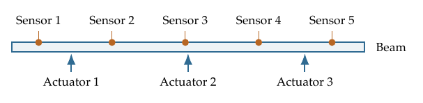
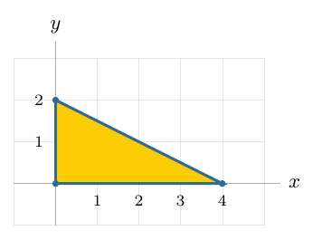
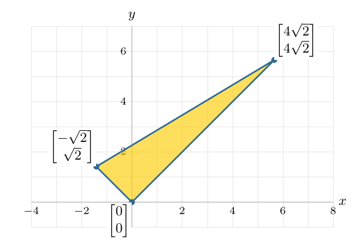
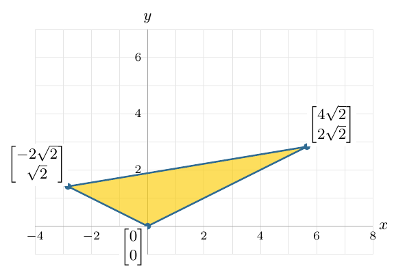
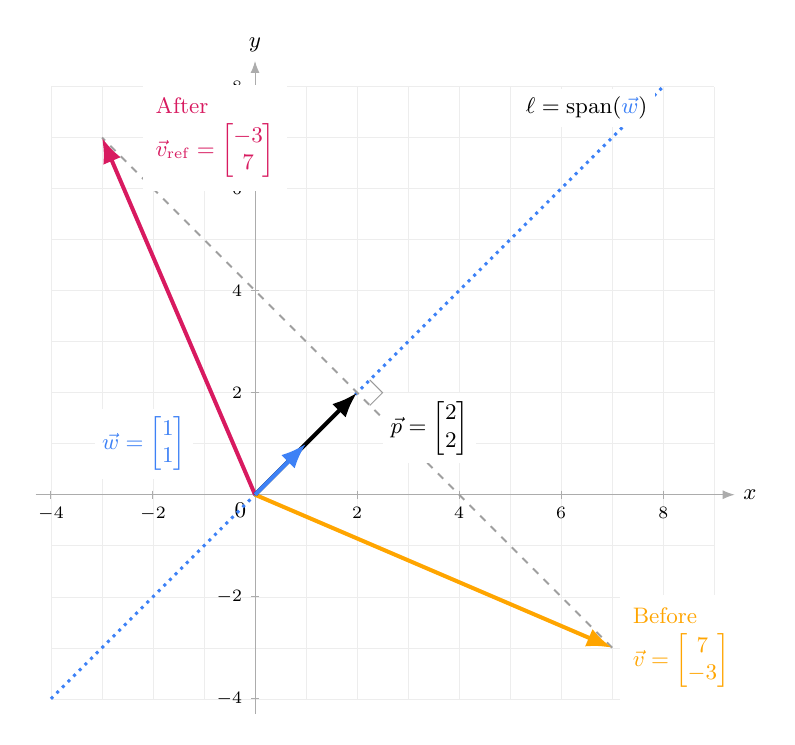
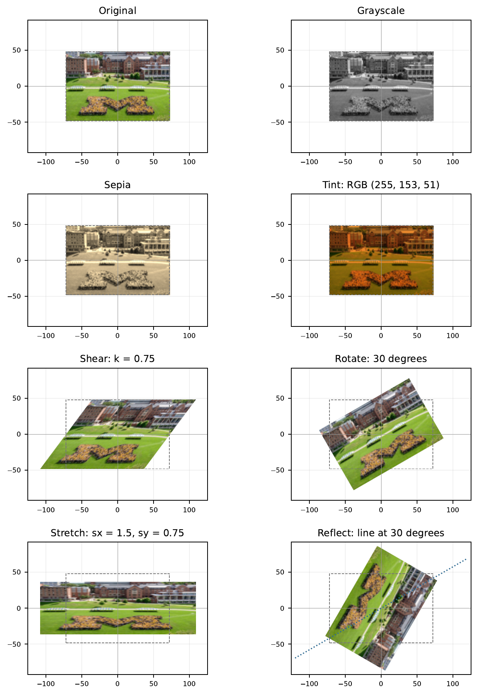



<script>
window.MathJax = {
  tex: {inlineMath: [['$', '$'], ['\\(', '\\)']]},
  options: {ignoreHtmlClass: 'tex2jax_ignore'}
};
</script>
<script src="https://cdn.jsdelivr.net/npm/mathjax@3/es5/tex-mml-chtml.js" async></script>

<style>
.main-content p {
  margin-bottom: 1.15em;
}
.assignment-pdf-button {
  font-size: 0.95rem;
  padding: 0.35rem 0.65rem;
}
.assignment-actions {
  align-items: center;
  display: flex;
  flex-wrap: wrap;
  gap: 0.55rem;
  margin: 0 0 1rem;
}
.assignment-vector-plot {
  max-width: 100%;
  height: auto;
  display: block;
  margin: 1rem auto;
}
.math-display,
mjx-container[jax="CHTML"][display="true"] {
  max-width: 100%;
  overflow-x: auto;
  overflow-y: hidden;
}
.math-display {
  padding-bottom: 0.2rem;
}
.math-display mjx-container[jax="CHTML"][display="true"] {
  padding-bottom: 0.2rem;
}
.answer-blank {
  border-bottom: 1px solid currentColor;
  display: inline-block;
  min-width: 8rem;
  height: 1em;
  vertical-align: baseline;
}
.assignment-parts {
  margin: 1rem 0;
}
.assignment-part {
  align-items: baseline;
  column-gap: 0.55rem;
  display: grid;
  grid-template-columns: 1.4rem minmax(0, 1fr);
  margin-bottom: 1.05rem;
}
.assignment-part-label {
  font-weight: 600;
  text-align: right;
}
.assignment-part-content > :first-child {
  margin-top: 0;
}
.main-content ol.assignment-enumeration {
  padding-left: 0;
  list-style: none;
}
.main-content ol.assignment-enumeration > li {
  display: grid;
  grid-template-columns: 2.5em minmax(0, 1fr);
  align-items: baseline;
  column-gap: 0.5em;
  padding-left: 0;
  margin: 0.8em 0;
}
.main-content ol.assignment-enumeration > li::before {
  content: none;
}
.assignment-enumeration-label {
  text-align: right;
}
.assignment-enumeration-content > :first-child {
  margin-top: 0;
}
.assignment-enumeration-content > :last-child {
  margin-bottom: 0;
}
.mc-options {
  display: flex;
  flex-wrap: wrap;
  gap: 0.9rem 1.6rem;
  margin: 0.9rem 0 1.1rem;
}
.mc-option {
  display: inline-flex;
  align-items: center;
  gap: 0.35rem;
  white-space: nowrap;
}
.mc-bubble,
.mc-square {
  display: inline-block;
  flex: 0 0 auto;
  height: 0.95em;
  width: 0.95em;
  vertical-align: -0.12em;
}
.mc-bubble {
  border: 1.5px solid currentColor;
  border-radius: 50%;
}
.mc-square {
  border: 1.5px solid currentColor;
}
.mc-correct {
  background: currentColor;
}
.main-content table {
  font-size: 0.9rem;
  width: auto;
  max-width: 100%;
}
.main-content table th,
.main-content table td {
  padding: 0.35rem 0.5rem;
  white-space: nowrap;
}
.main-content details table td:last-child {
  white-space: normal;
}
.crossnumber-grid {
  display: grid;
  grid-template-columns: repeat(3, 2.4rem);
  grid-template-rows: repeat(3, 2.4rem);
  margin: 1rem auto;
  width: max-content;
}
.crossnumber-cell {
  align-items: center;
  border: 1.5px solid currentColor;
  display: flex;
  font-size: 1.1rem;
  justify-content: center;
  position: relative;
}
.crossnumber-label {
  font-size: 0.55rem;
  left: 0.15rem;
  line-height: 1;
  position: absolute;
  top: 0.15rem;
}
.crossnumber-missing {
  border: 0;
}
</style>

# Homework 5: Matrices and Linear Transformations

**due** Sunday, October 18th at 11:59PM

<div class="assignment-actions">
<a class="btn btn-info assignment-pdf-button" href="/resources/homeworks/hw05/hw05.pdf" target="_blank">View as PDF ✏️</a>
<a class="btn btn-info assignment-pdf-button" href="/resources/homeworks/hw05/hw05-solutions.pdf" target="_blank">Solutions PDF ✅</a>
</div>

{: .yellow }
<div markdown="1">
Write your solutions to the following problems either by writing them on a piece of paper or on a tablet and scanning your answers as a PDF. Note that you are not allowed to use LaTeX, Google Docs, or any other digital document creation software to type your answers. Homeworks are due to Pensive by 11:59PM on the due date. See the [syllabus](https://math124.org/syllabus/#homework) for details on the slip day policy.

Homework will be evaluated not only on the correctness of your answers, but on your ability to present your ideas clearly and logically. You should always explain and justify your conclusions, using sound reasoning. Your goal should be to convince the reader of your assertions. If a question does not require explanation, it will be explicitly stated.

Before proceeding, make sure you're familiar with the [collaboration policy](https://math124.org/syllabus/#collaboration-and-generative-ai-policy).
</div>

---

## Problems

- [Problem 1: Midterm 1 Solutions Reflection](#problem-1-midterm-1-solutions-reflection-6-pts)
- [Problem 2: Matrix--Vector Practice](#problem-2-matrix--vector-practice-8-pts)
- [Problem 3: Is It Linear?](#problem-3-is-it-linear-9-pts)
- [Problem 4: What Linearity Tells Us](#problem-4-what-linearity-tells-us-8-pts)
- [Problem 5: Finding a Transformation's Matrix](#problem-5-finding-a-transformations-matrix-8-pts)
- [Problem 6: Can We Work Backward?](#problem-6-can-we-work-backward-6-pts)
- [Problem 7: Matrix Products](#problem-7-matrix-products-12-pts)
- [Problem 8: Do the Usual Rules Still Work?](#problem-8-do-the-usual-rules-still-work-6-pts)
- [Problem 9: Transforming a Triangle](#problem-9-transforming-a-triangle-8-pts)
- [Problem 10: From Projection to Reflection](#problem-10-from-projection-to-reflection-9-pts)
- [Problem 11: Programming Activity](#problem-11-programming-activity-20-pts)

---

Total Points: <span class="math-inline">\\(6 + 8 + 9 + 8 + 8 + 6 + 12 + 6 + 8 + 9 + 20 = 100\\)</span>

---

## Problem 1: Midterm 1 Solutions Reflection (6 pts)

Review the solutions to Midterm 1. Pick **two problem parts** in which your solutions have the most room for improvement: for example, where your reasoning was unsound or your presentation could have been clearer or more efficient. Include a screenshot of your solution to each part. For each, explain what was deficient and how to fix it.

Alternatively, if one of your solutions is significantly better than the posted one, include it and explain why. If you did not take Midterm 1, choose two challenging parts and explain the key ideas behind their solutions in your own words.

<details markdown="1"><summary>Solution</summary>

Your answers will depend on the parts you chose. For each part, include your original work and explain what you would change. The goal is to identify what you learned from comparing your reasoning with the posted solution.
</details>

---

## Problem 2: Matrix--Vector Practice (8 pts)

Compute each product, or explain why it is undefined. For each defined product, state the shape of the output. Show your arithmetic.

<div class="assignment-parts" markdown="1">
<div class="assignment-part" markdown="1">
<div class="assignment-part-label">a)</div>
<div class="assignment-part-content" markdown="1">
(2 pts)
<span class="math-inline">\\(\displaystyle \begin{bmatrix}4&amp;-2&amp;0&amp;3\\\\-3&amp;5&amp;2&amp;-1\\\\4&amp;1&amp;-5&amp;2\end{bmatrix} \begin{bmatrix}-2\\\\3\\\\1\\\\-2\end{bmatrix}\\)</span>

</div>
</div>

<div class="assignment-part" markdown="1">
<div class="assignment-part-label">b)</div>
<div class="assignment-part-content" markdown="1">
(2 pts)
<span class="math-inline">\\(\displaystyle \begin{bmatrix}-8&amp;0&amp;0&amp;0&amp;0\\\\0&amp;\frac32&amp;0&amp;0&amp;0\\\\0&amp;0&amp;11&amp;0&amp;0\\\\0&amp;0&amp;0&amp;-5&amp;0\\\\0&amp;0&amp;0&amp;0&amp;7\end{bmatrix} \begin{bmatrix}3\\\\-4\\\\2\\\\6\\\\-3\end{bmatrix}\\)</span>

</div>
</div>

<div class="assignment-part" markdown="1">
<div class="assignment-part-label">c)</div>
<div class="assignment-part-content" markdown="1">
(2 pts)
<span class="math-inline">\\(\displaystyle \begin{bmatrix}12&amp;-7&amp;\frac12&amp;9\end{bmatrix}\begin{bmatrix}3\\\\-2\\\\8\\\\-4\end{bmatrix}\\)</span>

</div>
</div>

<div class="assignment-part" markdown="1">
<div class="assignment-part-label">d)</div>
<div class="assignment-part-content" markdown="1">
(2 pts)
<span class="math-inline">\\(\displaystyle \begin{bmatrix}-5&amp;8&amp;3&amp;12\\\\7&amp;-2&amp;6&amp;-9\end{bmatrix}\begin{bmatrix}4\\\\-1\\\\5\end{bmatrix}\\)</span>

<details markdown="1"><summary>Solution</summary>

**(a)** To find each entry of the product, we multiply corresponding entries in a row of the matrix and the vector, then add:

<div class="math-display">
$$
\begin{bmatrix}
4(-2)-2(3)+0(1)+3(-2)\\
-3(-2)+5(3)+2(1)-1(-2)\\
4(-2)+1(3)-5(1)+2(-2)
\end{bmatrix}
=\boxed{\begin{bmatrix}-20\\25\\-14\end{bmatrix}}
$$
</div>

 The result has shape <span class="math-inline">\\(3\times1\\)</span>.

**(b)** Recall that a diagonal matrix scales each coordinate separately. Here, we get

<div class="math-display">
$$
\begin{bmatrix}-8(3)\\(3/2)(-4)\\11(2)\\-5(6)\\7(-3)\end{bmatrix}
=\boxed{\begin{bmatrix}-24\\-6\\22\\-30\\-21\end{bmatrix}}
$$
</div>

 The result has shape <span class="math-inline">\\(5\times1\\)</span>.

**(c)** Here, we multiply a <span class="math-inline">\\(1\times4\\)</span> row vector by a <span class="math-inline">\\(4\times1\\)</span> vector:

<div class="math-display">
$$
12(3)+(-7)(-2)+\tfrac12(8)+9(-4)=36+14+4-36=\boxed{18}
$$
</div>

 The output has shape <span class="math-inline">\\(1\times1\\)</span> and can be written as a scalar.

**(d)** **Undefined.** The matrix has four columns, but the input has only three entries. We would need one input entry for each of the four columns.
</details>

</div>
</div>

</div>

---

## Problem 3: Is It Linear? (9 pts)

For each transformation, decide whether it is linear. A linear transformation must satisfy both properties below for all vectors <span class="math-inline">\\(\vec u,\vec v\\)</span> in its domain and all scalars <span class="math-inline">\\(c\\)</span>:

-   **Additivity:** <span class="math-inline">\\(T(\vec u+\vec v)=T(\vec u)+T(\vec v)\\)</span>.

-   **Compatibility with scaling:** <span class="math-inline">\\(T(c\vec v)=cT(\vec v)\\)</span>.

For a linear transformation, verify both properties for arbitrary inputs. For a nonlinear transformation, give a specific counterexample to at least one property. State your inputs and show that the two sides are different.

<div class="assignment-parts" markdown="1">
<div class="assignment-part" markdown="1">
<div class="assignment-part-label">a)</div>
<div class="assignment-part-content" markdown="1">
(3 pts)
<span class="math-inline">\\(T:\mathbb R^2\to\mathbb R^2\\)</span>, defined by <span class="math-inline">\\(T\left(\begin{bmatrix}x\\\\y\end{bmatrix}\right) =\begin{bmatrix}(3x+2y)^2-9x^2-4y^2\\\\7x-5y\end{bmatrix}\\)</span>.

<details markdown="1"><summary>Solution</summary>

**Not linear.** Expanding the first entry gives

<div class="math-display">
$$
T\!\left(\begin{bmatrix}x\\y\end{bmatrix}\right)
=\begin{bmatrix}12xy\\7x-5y\end{bmatrix}
$$
</div>

 For <span class="math-inline">\\(\vec u=\begin{bmatrix}1\\\\0\end{bmatrix}\\)</span> and <span class="math-inline">\\(\vec v=\begin{bmatrix}0\\\\1\end{bmatrix}\\)</span>,

<div class="math-display">
$$
T(\vec u+\vec v)=\begin{bmatrix}12\\2\end{bmatrix},\qquad
T(\vec u)+T(\vec v)=\begin{bmatrix}0\\7\end{bmatrix}+\begin{bmatrix}0\\-5\end{bmatrix}
=\begin{bmatrix}0\\2\end{bmatrix}
$$
</div>

 The two outputs are different, so <span class="math-inline">\\(T\\)</span> does not satisfy additivity. One counterexample is enough to show that <span class="math-inline">\\(T\\)</span> is not linear!
</details>

</div>
</div>

<div class="assignment-part" markdown="1">
<div class="assignment-part-label">b)</div>
<div class="assignment-part-content" markdown="1">
(3 pts)
<span class="math-inline">\\(T:\mathbb R^3\to\mathbb R^2\\)</span>, defined by <span class="math-inline">\\(T\left(\begin{bmatrix}x\\\\y\\\\z\end{bmatrix}\right) =\begin{bmatrix}4(x-2y)+3(2y-z)\\\\5(x+z)-2(3x-y)\end{bmatrix}\\)</span>.

<details markdown="1"><summary>Solution</summary>

**Linear.** Let's first simplify the expression for <span class="math-inline">\\(T\\)</span>:

<div class="math-display">
$$
T\!\left(\begin{bmatrix}x\\y\\z\end{bmatrix}\right)
=\begin{bmatrix}4x-2y-3z\\-x+2y+5z\end{bmatrix}
$$
</div>

 Let <span class="math-inline">\\(\vec u=\begin{bmatrix}u&#95;1\\\\u&#95;2\\\\u&#95;3\end{bmatrix}\\)</span> and <span class="math-inline">\\(\vec v=\begin{bmatrix}v&#95;1\\\\v&#95;2\\\\v&#95;3\end{bmatrix}\\)</span> be arbitrary. Then

<div class="math-display">
$$
\begin{align*}
T(\vec u+\vec v)
&=\begin{bmatrix}4(u_1+v_1)-2(u_2+v_2)-3(u_3+v_3)\\-(u_1+v_1)+2(u_2+v_2)+5(u_3+v_3)\end{bmatrix}\\
&=\begin{bmatrix}4u_1-2u_2-3u_3\\-u_1+2u_2+5u_3\end{bmatrix}
+\begin{bmatrix}4v_1-2v_2-3v_3\\-v_1+2v_2+5v_3\end{bmatrix}\\
&=T(\vec u)+T(\vec v)
\end{align*}
$$
</div>

For any scalar <span class="math-inline">\\(c\\)</span>,

<div class="math-display">
$$
T(c\vec v)=\begin{bmatrix}4cv_1-2cv_2-3cv_3\\-cv_1+2cv_2+5cv_3\end{bmatrix}
=c\begin{bmatrix}4v_1-2v_2-3v_3\\-v_1+2v_2+5v_3\end{bmatrix}=cT(\vec v)
$$
</div>

 We've verified both properties for arbitrary vectors and scalars, so <span class="math-inline">\\(T\\)</span> is linear.
</details>

</div>
</div>

<div class="assignment-part" markdown="1">
<div class="assignment-part-label">c)</div>
<div class="assignment-part-content" markdown="1">
(3 pts)
<span class="math-inline">\\(T:\mathbb R^2\to\mathbb R^3\\)</span>, defined by <span class="math-inline">\\(T\left(\begin{bmatrix}x\\\\y\end{bmatrix}\right) =\begin{bmatrix}6x-5y+8\\\\4(x+y)-7\\\\9x+2y-8\end{bmatrix}\\)</span>.

<details markdown="1"><summary>Solution</summary>

**Not linear.** Compatibility with scaling fails when <span class="math-inline">\\(c=0\\)</span>. For example, with <span class="math-inline">\\(\vec v=\begin{bmatrix}1\\\\1\end{bmatrix}\\)</span>,

<div class="math-display">
$$
T(0\vec v)=T(\vec0)=\begin{bmatrix}8\\-7\\-8\end{bmatrix}
\ne\begin{bmatrix}0\\0\\0\end{bmatrix}=0T(\vec v)
$$
</div>

 In particular, a linear transformation must send <span class="math-inline">\\(\vec0\\)</span> to <span class="math-inline">\\(\vec0\\)</span>.
</details>

</div>
</div>

</div>

---

## Problem 4: What Linearity Tells Us (8 pts)

Let <span class="math-inline">\\(T:\mathbb R^3\to\mathbb R^2\\)</span> be a linear transformation, and let

<div class="math-display">
$$
\vec u=\begin{bmatrix}2\\-1\\3\end{bmatrix},\qquad
\vec v=\begin{bmatrix}-1\\2\\1\end{bmatrix}.
$$
</div>

 Suppose we know that

<div class="math-display">
$$
T(3\vec u+\vec v)=\begin{bmatrix}8\\-1\end{bmatrix},\qquad
T(2\vec u-3\vec v)=\begin{bmatrix}9\\-8\end{bmatrix}.
$$
</div>

 Use linearity directly; you do not need to find the matrix of <span class="math-inline">\\(T\\)</span>.

<div class="assignment-parts" markdown="1">
<div class="assignment-part" markdown="1">
<div class="assignment-part-label">a)</div>
<div class="assignment-part-content" markdown="1">
(3 pts) Find <span class="math-inline">\\(T(\vec u)\\)</span> and <span class="math-inline">\\(T(\vec v)\\)</span>. Show how you use the two given outputs.

<details markdown="1"><summary>Solution</summary>

We want to isolate <span class="math-inline">\\(\vec u\\)</span> using the two inputs whose outputs we know. Multiplying the first input by <span class="math-inline">\\(3\\)</span> and adding the second cancels <span class="math-inline">\\(\vec v\\)</span>: <span class="math-inline">\\(3(3\vec u+\vec v)+(2\vec u-3\vec v)=11\vec u\\)</span>. By linearity,

<div class="math-display">
$$
11T(\vec u)=3T(3\vec u+\vec v)+T(2\vec u-3\vec v)
=3\begin{bmatrix}8\\-1\end{bmatrix}+\begin{bmatrix}9\\-8\end{bmatrix}
=\begin{bmatrix}33\\-11\end{bmatrix}
$$
</div>

 Thus <span class="math-inline">\\(\boxed{T(\vec u)=\begin{bmatrix}3\\\\-1\end{bmatrix}}\\)</span>. Since <span class="math-inline">\\(\vec v=(3\vec u+\vec v)-3\vec u\\)</span>,

<div class="math-display">
$$
\boxed{T(\vec v)=\begin{bmatrix}8\\-1\end{bmatrix}-3\begin{bmatrix}3\\-1\end{bmatrix}=\begin{bmatrix}-1\\2\end{bmatrix}}
$$
</div>

</details>

</div>
</div>

<div class="assignment-part" markdown="1">
<div class="assignment-part-label">b)</div>
<div class="assignment-part-content" markdown="1">
(3 pts) Find <span class="math-inline">\\(T\left(\begin{bmatrix}8\\\\-7\\\\7\end{bmatrix}\right)\\)</span>. Explain how you express this input using <span class="math-inline">\\(\vec u\\)</span> and <span class="math-inline">\\(\vec v\\)</span>.

<details markdown="1"><summary>Solution</summary>

Let's write the input as <span class="math-inline">\\(a\vec u+b\vec v\\)</span>. Matching the three entries gives

<div class="math-display">
$$
2a-b=8,\qquad -a+2b=-7,\qquad 3a+b=7
$$
</div>

 The first two equations give <span class="math-inline">\\(a=3\\)</span> and <span class="math-inline">\\(b=-2\\)</span>. These values also satisfy the third equation, so we can use linearity:

<div class="math-display">
$$
T\!\left(\begin{bmatrix}8\\-7\\7\end{bmatrix}\right)
=T(3\vec u-2\vec v)=3\begin{bmatrix}3\\-1\end{bmatrix}-2\begin{bmatrix}-1\\2\end{bmatrix}
=\boxed{\begin{bmatrix}11\\-7\end{bmatrix}}
$$
</div>

</details>

</div>
</div>

<div class="assignment-part" markdown="1">
<div class="assignment-part-label">c)</div>
<div class="assignment-part-content" markdown="1">
(2 pts) A student claims that <span class="math-inline">\\(T\left(\begin{bmatrix}3\\\\0\\\\7\end{bmatrix}\right)=\begin{bmatrix}5\\\\1\end{bmatrix}\\)</span>. Is this consistent? Explain.

<details markdown="1"><summary>Solution</summary>

**No.** The input is <span class="math-inline">\\(2\vec u+\vec v\\)</span>, so linearity requires

<div class="math-display">
$$
T\!\left(\begin{bmatrix}3\\0\\7\end{bmatrix}\right)
=2T(\vec u)+T(\vec v)
=2\begin{bmatrix}3\\-1\end{bmatrix}+\begin{bmatrix}-1\\2\end{bmatrix}
=\boxed{\begin{bmatrix}5\\0\end{bmatrix}}
$$
</div>

 This is different from the claimed output.
</details>

</div>
</div>

</div>

---

## Problem 5: Finding a Transformation's Matrix (8 pts)

Let <span class="math-inline">\\(S:\mathbb R^2\to\mathbb R^2\\)</span> be a linear transformation satisfying

<div class="math-display">
$$
S\!\left(\begin{bmatrix}2\\0\end{bmatrix}\right)=\begin{bmatrix}8\\6\end{bmatrix},\qquad
S\!\left(\begin{bmatrix}0\\3\end{bmatrix}\right)=\begin{bmatrix}-9\\12\end{bmatrix}.
$$
</div>

<div class="assignment-parts" markdown="1">
<div class="assignment-part" markdown="1">
<div class="assignment-part-label">a)</div>
<div class="assignment-part-content" markdown="1">
(3 pts) Find <span class="math-inline">\\(S\left(\begin{bmatrix}1\\\\0\end{bmatrix}\right)\\)</span> and <span class="math-inline">\\(S\left(\begin{bmatrix}0\\\\1\end{bmatrix}\right)\\)</span>, then construct the matrix of <span class="math-inline">\\(S\\)</span>. Explain how you chose its columns.

<details markdown="1"><summary>Solution</summary>

By compatibility with scaling,

<div class="math-display">
$$
S\!\left(\begin{bmatrix}1\\0\end{bmatrix}\right)=\tfrac12\begin{bmatrix}8\\6\end{bmatrix}=\begin{bmatrix}4\\3\end{bmatrix},\qquad
S\!\left(\begin{bmatrix}0\\1\end{bmatrix}\right)=\tfrac13\begin{bmatrix}-9\\12\end{bmatrix}=\begin{bmatrix}-3\\4\end{bmatrix}
$$
</div>

 Recall that the columns of the associated matrix are the outputs for the standard basis vectors, in order. We just found those outputs, so

<div class="math-display">
$$
\boxed{S(\vec x)=\begin{bmatrix}4&-3\\3&4\end{bmatrix}\vec x}
$$
</div>

</details>

</div>
</div>

<div class="assignment-part" markdown="1">
<div class="assignment-part-label">b)</div>
<div class="assignment-part-content" markdown="1">
(2 pts) Use your matrix to find <span class="math-inline">\\(S\left(\begin{bmatrix}3\\\\-2\end{bmatrix}\right)\\)</span>.

<details markdown="1"><summary>Solution</summary>

<div class="math-display">
$$
S\!\left(\begin{bmatrix}3\\-2\end{bmatrix}\right)
=\begin{bmatrix}4&-3\\3&4\end{bmatrix}\begin{bmatrix}3\\-2\end{bmatrix}
=\begin{bmatrix}12+6\\9-8\end{bmatrix}
=\boxed{\begin{bmatrix}18\\1\end{bmatrix}}
$$
</div>

</details>

</div>
</div>

<div class="assignment-part" markdown="1">
<div class="assignment-part-label">c)</div>
<div class="assignment-part-content" markdown="1">
(3 pts) Describe the geometric effect of <span class="math-inline">\\(S\\)</span> in words, using the types of linear transformations we saw in [Chapter 3.2](https://notes.math124.org/ch03/03-02/) and [Chapter 3.4](https://notes.math124.org/ch03/03-04/). Specify any scale factor and, if there is a rotation, its direction and angle. You may specify an angle by giving its sine and cosine.

<details markdown="1"><summary>Solution</summary>

We can recognize this transformation by factoring out <span class="math-inline">\\(5\\)</span>:

<div class="math-display">
$$
\begin{bmatrix}4&-3\\3&4\end{bmatrix}
=5\begin{bmatrix}4/5&-3/5\\3/5&4/5\end{bmatrix}
$$
</div>

 The second matrix is a rotation matrix with <span class="math-inline">\\(\cos\theta=4/5\\)</span> and <span class="math-inline">\\(\sin\theta=3/5\\)</span>. So <span class="math-inline">\\(S\\)</span> rotates vectors counterclockwise by <span class="math-inline">\\(\theta\approx36.87^\circ\\)</span> and scales them by a factor of <span class="math-inline">\\(5\\)</span>. Every length is multiplied by <span class="math-inline">\\(5\\)</span>, and angles stay the same.
</details>

</div>
</div>

</div>

---

## Problem 6: Can We Work Backward? (6 pts)

Let <span class="math-inline">\\(\displaystyle A=\begin{bmatrix}4&amp;-6\\\\-2&amp;3\end{bmatrix}\\)</span>.

<div class="assignment-parts" markdown="1">
<div class="assignment-part" markdown="1">
<div class="assignment-part-label">a)</div>
<div class="assignment-part-content" markdown="1">
(2 pts) Find two different inputs <span class="math-inline">\\(\vec u\\)</span> and <span class="math-inline">\\(\vec v\\)</span> such that <span class="math-inline">\\(A\vec u=A\vec v=\begin{bmatrix}12\\\\-6\end{bmatrix}\\)</span>. Write the system of equations you are solving.

<details markdown="1"><summary>Solution</summary>

The system is

<div class="math-display">
$$
4x-6y=12,\qquad -2x+3y=-6
$$
</div>

 The second equation is <span class="math-inline">\\(-1/2\\)</span> times the first, so it gives us no new information. Solving the first equation for <span class="math-inline">\\(x\\)</span> gives <span class="math-inline">\\(x=3+\tfrac32y\\)</span>. Choosing <span class="math-inline">\\(y=0\\)</span> and <span class="math-inline">\\(y=2\\)</span>, for example, gives

<div class="math-display">
$$
\boxed{\vec u=\begin{bmatrix}3\\0\end{bmatrix},\qquad
\vec v=\begin{bmatrix}6\\2\end{bmatrix}}
$$
</div>

 Indeed, both products are <span class="math-inline">\\(\begin{bmatrix}12\\\\-6\end{bmatrix}\\)</span>.
</details>

</div>
</div>

<div class="assignment-part" markdown="1">
<div class="assignment-part-label">b)</div>
<div class="assignment-part-content" markdown="1">
(2 pts) Is there an input with output <span class="math-inline">\\(\begin{bmatrix}12\\\\-5\end{bmatrix}\\)</span>? Explain using the columns of <span class="math-inline">\\(A\\)</span> and their span.

<details markdown="1"><summary>Solution</summary>

**No.** The second column is <span class="math-inline">\\(-3/2\\)</span> times the first, so every output is in

<div class="math-display">
$$
\operatorname{span}\!\left(\begin{bmatrix}4\\-2\end{bmatrix}\right)
$$
</div>

 Every vector in this span has second entry equal to <span class="math-inline">\\(-1/2\\)</span> times its first entry. An output with first entry <span class="math-inline">\\(12\\)</span> must have second entry <span class="math-inline">\\(-6\\)</span>, not <span class="math-inline">\\(-5\\)</span>.
</details>

</div>
</div>

<div class="assignment-part" markdown="1">
<div class="assignment-part-label">c)</div>
<div class="assignment-part-content" markdown="1">
(2 pts) Using your inputs from part (a), find a nonzero input with output <span class="math-inline">\\(\vec0\\)</span>. Explain why your construction works using linearity.

<details markdown="1"><summary>Solution</summary>

The two inputs from part (a) have the same output. Let's subtract them:

<div class="math-display">
$$
\boxed{\vec v-\vec u=\begin{bmatrix}3\\2\end{bmatrix}}
$$
</div>

 This vector is nonzero, and linearity gives

<div class="math-display">
$$
A(\vec v-\vec u)=A\vec v-A\vec u
=\begin{bmatrix}12\\-6\end{bmatrix}-\begin{bmatrix}12\\-6\end{bmatrix}=\vec0
$$
</div>

</details>

</div>
</div>

</div>

---

{: .yellow }
> **Note: Problems 7--11 require material from Tuesday, October 13th's lecture.**

## Problem 7: Matrix Products (12 pts)

Compute the requested products and state their shapes. Show your arithmetic.

<div class="assignment-parts" markdown="1">
<div class="assignment-part" markdown="1">
<div class="assignment-part-label">a)</div>
<div class="assignment-part-content" markdown="1">
(4 pts) Let

<div class="math-display">
$$
A=\begin{bmatrix}3&-2\\-1&4\\4&1\\2&-3\end{bmatrix},\qquad
B=\begin{bmatrix}2&-3&1&2\\-2&1&4&-1\end{bmatrix}.
$$
</div>

 Compute both <span class="math-inline">\\(AB\\)</span> and <span class="math-inline">\\(BA\\)</span>.

<details markdown="1"><summary>Solution</summary>

The product <span class="math-inline">\\(AB\\)</span> has shape <span class="math-inline">\\(4\times4\\)</span>, while <span class="math-inline">\\(BA\\)</span> has shape <span class="math-inline">\\(2\times2\\)</span>. Multiplying rows of the first matrix by columns of the second gives

<div class="math-display">
$$
\boxed{AB=\begin{bmatrix}10&-11&-5&8\\-10&7&15&-6\\6&-11&8&7\\10&-9&-10&7\end{bmatrix}},\qquad
\boxed{BA=\begin{bmatrix}17&-21\\7&15\end{bmatrix}}
$$
</div>

 For example, two of the entries are

<div class="math-display">
$$
\begin{align*}
(AB)_{1,1}&=3(2)+(-2)(-2)=10\\
(BA)_{1,1}&=2(3)+(-3)(-1)+1(4)+2(2)=17
\end{align*}
$$
</div>

The other entries are computed in the same way.
</details>

</div>
</div>

<div class="assignment-part" markdown="1">
<div class="assignment-part-label">b)</div>
<div class="assignment-part-content" markdown="1">
(4 pts) Let

<div class="math-display">
$$
C=\begin{bmatrix}3&-2&4\\0&5&2\\0&0&-2\end{bmatrix},\qquad
D=\begin{bmatrix}2&4&-3\\5&-2&1\\-4&3&2\end{bmatrix}.
$$
</div>

 Compute both <span class="math-inline">\\(CD\\)</span> and <span class="math-inline">\\(DC\\)</span>.

<details markdown="1"><summary>Solution</summary>

Both products have shape <span class="math-inline">\\(3\times3\\)</span>:

<div class="math-display">
$$
\boxed{CD=\begin{bmatrix}-20&28&-3\\17&-4&9\\8&-6&-4\end{bmatrix}},\qquad
\boxed{DC=\begin{bmatrix}6&16&22\\15&-20&14\\-12&23&-14\end{bmatrix}}
$$
</div>

 For example,

<div class="math-display">
$$
\begin{align*}
(CD)_{1,1}&=3(2)+(-2)(5)+4(-4)=-20\\
(CD)_{2,3}&=0(-3)+5(1)+2(2)=9\\
(DC)_{1,2}&=2(-2)+4(5)+(-3)(0)=16
\end{align*}
$$
</div>

The shapes agree, but the entries show that <span class="math-inline">\\(CD\ne DC\\)</span>.
</details>

</div>
</div>

<div class="assignment-part" markdown="1">
<div class="assignment-part-label">c)</div>
<div class="assignment-part-content" markdown="1">
(4 pts) A mechanical engineer wants to measure how a beam bends when forces are applied at different locations. A **test rig** is a laboratory setup built to test a component under controlled conditions. This rig has three **actuators**, motor-driven devices that push or pull on the beam, and five **sensors**, devices that measure the beam's vertical movement at five locations.

<div style="text-align: center;">

</div>

In a simplified linear model, <span class="math-inline">\\(H\vec u\\)</span> gives the five sensor readings, in millimeters, when <span class="math-inline">\\(\vec u\\)</span> lists the forces applied by the three actuators, in **newtons (N)**. For example, <span class="math-inline">\\(\vec u=\begin{bmatrix}2\\\\-3\\\\4\end{bmatrix}\\)</span> corresponds to the first actuator pushing upward with a force of <span class="math-inline">\\(2\\)</span> N, the second pulling downward with a force of <span class="math-inline">\\(3\\)</span> N, and the third pushing upward with a force of <span class="math-inline">\\(4\\)</span> N. Sensor readings are displacements from the beam's unloaded position; positive readings mean upward movement.

The columns of <span class="math-inline">\\(U\\)</span> give the actuator forces for two separate trials:

<div class="math-display">
$$
H=\begin{bmatrix}
3&-2&4\\-2&4&3\\5&1&-3\\3&-4&2\\-4&3&2
\end{bmatrix},\qquad
U=\begin{bmatrix}2&-3\\-3&4\\4&2\end{bmatrix}.
$$
</div>

 Compute <span class="math-inline">\\(HU\\)</span>. What does the entry in row 4, column 2 of your answer represent? Why is <span class="math-inline">\\(UH\\)</span> undefined? Write a sentence involving the actuators, sensors, and two trials; simply saying that the matrix shapes do not match is not enough.

<details markdown="1"><summary>Solution</summary>

The product has shape <span class="math-inline">\\(5\times2\\)</span>: five sensors, with one column for each trial.

<div class="math-display">
$$
\boxed{HU=\begin{bmatrix}28&-9\\-4&28\\-5&-17\\26&-21\\-9&28\end{bmatrix}}
$$
</div>

 For example,

<div class="math-display">
$$
(HU)_{4,2}=3(-3)+(-4)(4)+2(2)=-9-16+4=\boxed{-21}
$$
</div>

 Thus, in trial 2, sensor 4 reads a displacement of <span class="math-inline">\\(-21\\)</span> mm: the beam moves **21 mm downward** at that sensor.

The columns of <span class="math-inline">\\(U\\)</span> are two trials, each specifying forces for three actuators; the rows of <span class="math-inline">\\(H\\)</span> are five sensors. The reverse product <span class="math-inline">\\(UH\\)</span> would try to pair the two trial entries in a row of <span class="math-inline">\\(U\\)</span> with the five sensor entries in a column of <span class="math-inline">\\(H\\)</span>. Those are different physical quantities and different numbers of entries, so they cannot form the required dot products.
</details>

</div>
</div>

</div>

---

## Problem 8: Do the Usual Rules Still Work? (6 pts)

All matrices in this problem are <span class="math-inline">\\(2\times2\\)</span> and all vectors are in <span class="math-inline">\\(\mathbb R^2\\)</span>. Justify each answer. A counterexample must include specific matrices or vectors and the relevant products.

<em>Hint: It may help to complete Problem 6(c) first, where you find a nonzero vector whose product with a matrix is zero.</em>

<div class="assignment-parts" markdown="1">
<div class="assignment-part" markdown="1">
<div class="assignment-part-label">a)</div>
<div class="assignment-part-content" markdown="1">
(2 pts) If <span class="math-inline">\\(B\vec v=\vec0\\)</span>, must <span class="math-inline">\\(AB\vec v=\vec0\\)</span>? If <span class="math-inline">\\(AB\vec v=\vec0\\)</span>, must <span class="math-inline">\\(B\vec v=\vec0\\)</span>? Address both directions.

<details markdown="1"><summary>Solution</summary>

**Yes to the first question, but no to the second.** If <span class="math-inline">\\(B\vec v=\vec0\\)</span>, then

<div class="math-display">
$$
AB\vec v=A(B\vec v)=A\vec0=\vec0
$$
</div>

 To see why the second statement can fail, we can reuse our example from Problem 6. Let

<div class="math-display">
$$
A=\begin{bmatrix}4&-6\\-2&3\end{bmatrix},\qquad B=I,\qquad
\vec v=\begin{bmatrix}3\\2\end{bmatrix}
$$
</div>

 Then <span class="math-inline">\\(AB\vec v=A\vec v=\vec0\\)</span>, but <span class="math-inline">\\(B\vec v=\vec v\ne\vec0\\)</span>. Multiplication by <span class="math-inline">\\(A\\)</span> can send a nonzero vector to zero.
</details>

</div>
</div>

<div class="assignment-part" markdown="1">
<div class="assignment-part-label">b)</div>
<div class="assignment-part-content" markdown="1">
(2 pts) Can <span class="math-inline">\\(AB=0&#95;{2\times2}\\)</span> even when neither <span class="math-inline">\\(A\\)</span> nor <span class="math-inline">\\(B\\)</span> is the zero matrix? Give an example or explain why it is impossible.

<details markdown="1"><summary>Solution</summary>

**Yes.** Use the nonzero vector from Problem 6(c) as a column of <span class="math-inline">\\(B\\)</span>:

<div class="math-display">
$$
A=\begin{bmatrix}4&-6\\-2&3\end{bmatrix},\qquad
B=\begin{bmatrix}3&6\\2&4\end{bmatrix}
$$
</div>

 Both matrices are nonzero, but

<div class="math-display">
$$
AB=\begin{bmatrix}12-12&24-24\\-6+6&-12+12\end{bmatrix}
=\boxed{\begin{bmatrix}0&0\\0&0\end{bmatrix}}
$$
</div>

 Both columns of <span class="math-inline">\\(B\\)</span> are sent to zero by <span class="math-inline">\\(A\\)</span>.
</details>

</div>
</div>

<div class="assignment-part" markdown="1">
<div class="assignment-part-label">c)</div>
<div class="assignment-part-content" markdown="1">
(2 pts) Expand <span class="math-inline">\\((A+B)^2\\)</span> using distributivity, keeping the factors in their original order. Is it always equal to <span class="math-inline">\\(A^2+2AB+B^2\\)</span>? If not, give a counterexample.

<details markdown="1"><summary>Solution</summary>

We can distribute just as we would with numbers, but we need to keep the order of the matrices:

<div class="math-display">
$$
\boxed{(A+B)^2=A^2+AB+BA+B^2}
$$
</div>

 This equals <span class="math-inline">\\(A^2+2AB+B^2\\)</span> only when <span class="math-inline">\\(BA=AB\\)</span>. For a counterexample, let

<div class="math-display">
$$
A=\begin{bmatrix}0&2\\0&0\end{bmatrix},\qquad
B=\begin{bmatrix}0&0\\3&0\end{bmatrix}
$$
</div>

 Here <span class="math-inline">\\(A^2=B^2=0\\)</span>, <span class="math-inline">\\(AB=\begin{bmatrix}6&amp;0\\\\0&amp;0\end{bmatrix}\\)</span>, and <span class="math-inline">\\(BA=\begin{bmatrix}0&amp;0\\\\0&amp;6\end{bmatrix}\\)</span>. Therefore,

<div class="math-display">
$$
(A+B)^2=\begin{bmatrix}6&0\\0&6\end{bmatrix}
\ne\begin{bmatrix}12&0\\0&0\end{bmatrix}=A^2+2AB+B^2
$$
</div>

</details>

</div>
</div>

</div>

---

## Problem 9: Transforming a Triangle (8 pts)

Consider the triangle with vertices <span class="math-inline">\\(\begin{bmatrix}0\\\\0\end{bmatrix}\\)</span>, <span class="math-inline">\\(\begin{bmatrix}4\\\\0\end{bmatrix}\\)</span>, and <span class="math-inline">\\(\begin{bmatrix}0\\\\2\end{bmatrix}\\)</span>. To transform it, transform its three vertices and connect their images.

<div style="text-align: center;">

</div>

Let <span class="math-inline">\\(D\\)</span> stretch horizontally by a factor of <span class="math-inline">\\(2\\)</span>, leaving vertical coordinates unchanged. Let <span class="math-inline">\\(Q\\)</span> rotate counterclockwise by <span class="math-inline">\\(45^\circ\\)</span> about the origin. Recall that the rotation matrix is

<div class="math-display">
$$
\begin{bmatrix}\cos\theta&-\sin\theta\\\sin\theta&\cos\theta\end{bmatrix}.
$$
</div>

 Give exact matrix entries and vertex coordinates. You may use decimal approximations when drawing.

<div class="assignment-parts" markdown="1">
<div class="assignment-part" markdown="1">
<div class="assignment-part-label">a)</div>
<div class="assignment-part-content" markdown="1">
(2 pts) Write the matrices <span class="math-inline">\\(Q\\)</span> and <span class="math-inline">\\(D\\)</span>.

<details markdown="1"><summary>Solution</summary>

<div class="math-display">
$$
\boxed{Q=\frac1{\sqrt2}\begin{bmatrix}1&-1\\1&1\end{bmatrix}},\qquad
\boxed{D=\begin{bmatrix}2&0\\0&1\end{bmatrix}}
$$
</div>

</details>

</div>
</div>

<div class="assignment-part" markdown="1">
<div class="assignment-part-label">b)</div>
<div class="assignment-part-content" markdown="1">
(3 pts) Find the matrix for stretching first and then rotating. Draw the resulting triangle on a coordinate plane, labeling the coordinates of all three vertices.

<details markdown="1"><summary>Solution</summary>

First, we stretch <span class="math-inline">\\(\vec x\\)</span> to get <span class="math-inline">\\(D\vec x\\)</span>. Then, we rotate that result to get <span class="math-inline">\\(Q(D\vec x)\\)</span>. The matrix for the first transformation goes on the right, so the combined matrix is

<div class="math-display">
$$
\boxed{QD=\frac1{\sqrt2}\begin{bmatrix}2&-1\\2&1\end{bmatrix}}
$$
</div>

 The three vertices become

<div class="math-display">
$$
\begin{bmatrix}0\\0\end{bmatrix}\mapsto\begin{bmatrix}0\\0\end{bmatrix},\quad
\begin{bmatrix}4\\0\end{bmatrix}\mapsto\begin{bmatrix}4\sqrt2\\4\sqrt2\end{bmatrix},\quad
\begin{bmatrix}0\\2\end{bmatrix}\mapsto\begin{bmatrix}-\sqrt2\\\sqrt2\end{bmatrix}
$$
</div>

<div style="text-align: center;">

</div>
</details>

</div>
</div>

<div class="assignment-part" markdown="1">
<div class="assignment-part-label">c)</div>
<div class="assignment-part-content" markdown="1">
(3 pts) Reverse the order, find the new combined matrix, and draw the resulting triangle on a second coordinate plane with the same scale. Label the coordinates of all three vertices. Describe how the two transformed triangles differ.

<details markdown="1"><summary>Solution</summary>

Rotating first and stretching second gives

<div class="math-display">
$$
\boxed{DQ=\frac1{\sqrt2}\begin{bmatrix}2&-2\\1&1\end{bmatrix}}
$$
</div>

 Now the vertices become

<div class="math-display">
$$
\begin{bmatrix}0\\0\end{bmatrix}\mapsto\begin{bmatrix}0\\0\end{bmatrix},\quad
\begin{bmatrix}4\\0\end{bmatrix}\mapsto\begin{bmatrix}4\sqrt2\\2\sqrt2\end{bmatrix},\quad
\begin{bmatrix}0\\2\end{bmatrix}\mapsto\begin{bmatrix}-2\sqrt2\\\sqrt2\end{bmatrix}
$$
</div>

<div style="text-align: center;">

</div>

The first triangle is taller and narrower. It still has a right angle at the origin: stretching along the original coordinate axes preserves that right angle, and rotating preserves all angles. In the second triangle, stretching after rotation changes the angle between the tilted sides, so the angle at the origin is no longer a right angle.
</details>

</div>
</div>

</div>

---

## Problem 10: From Projection to Reflection (9 pts)

In [Homework 4, Problem 9](https://math124.org/resources/homeworks/hw04/), you found that the reflection of a vector <span class="math-inline">\\(\vec v\\)</span> across a line can be written as

<div class="math-display">
$$
\vec v_{\mathrm{ref}}=2\vec p-\vec v,
$$
</div>

 where <span class="math-inline">\\(\vec p\\)</span> is the projection of <span class="math-inline">\\(\vec v\\)</span> onto the line. Here's the same picture again: the tip of <span class="math-inline">\\(\vec p\\)</span> is halfway between the tips of <span class="math-inline">\\(\vec v\\)</span> and <span class="math-inline">\\(\vec v&#95;{\mathrm{ref}}\\)</span>.

<div style="text-align: center;">

</div>

In Lab 6, you used the matrix

<div class="math-display">
$$
P=\begin{bmatrix}w_1^2&w_1w_2\\w_1w_2&w_2^2\end{bmatrix}
$$
</div>

 to project onto a line spanned by a **unit vector** <span class="math-inline">\\(\vec w=\begin{bmatrix}w&#95;1\\\\w&#95;2\end{bmatrix}\\)</span>. Thus <span class="math-inline">\\(\vec p=P\vec v\\)</span>.

<div class="assignment-parts" markdown="1">
<div class="assignment-part" markdown="1">
<div class="assignment-part-label">a)</div>
<div class="assignment-part-content" markdown="1">
(2 pts) Derive a matrix <span class="math-inline">\\(R\\)</span>, expressed in terms of <span class="math-inline">\\(P\\)</span> and the identity matrix <span class="math-inline">\\(I\\)</span>, such that <span class="math-inline">\\(R\vec v=\vec v&#95;{\mathrm{ref}}\\)</span> for every <span class="math-inline">\\(\vec v\\)</span>. Then write all four entries of <span class="math-inline">\\(R\\)</span> in terms of <span class="math-inline">\\(w&#95;1,w&#95;2\\)</span>.

<details markdown="1"><summary>Solution</summary>

We know how to write the projection as a matrix-vector product: <span class="math-inline">\\(\vec p=P\vec v\\)</span>. Substituting this into the reflection formula gives

<div class="math-display">
$$
\vec v_{\mathrm{ref}}=2P\vec v-\vec v=(2P-I)\vec v
$$
</div>

 Since this holds for every input,

<div class="math-display">
$$
\boxed{R=2P-I=\begin{bmatrix}2w_1^2-1&2w_1w_2\\2w_1w_2&2w_2^2-1\end{bmatrix}}
$$
</div>

</details>

</div>
</div>

<div class="assignment-part" markdown="1">
<div class="assignment-part-label">b)</div>
<div class="assignment-part-content" markdown="1">
(3 pts) Now use the line spanned by <span class="math-inline">\\(\vec w=\begin{bmatrix}3/5\\\\4/5\end{bmatrix}\\)</span>. Find <span class="math-inline">\\(P\\)</span>, <span class="math-inline">\\(R\\)</span>, and the reflection of <span class="math-inline">\\(\vec v=\begin{bmatrix}7\\\\1\end{bmatrix}\\)</span> across this line.

<details markdown="1"><summary>Solution</summary>

Here, <span class="math-inline">\\(\vec w\\)</span> is already a unit vector, since <span class="math-inline">\\((3/5)^2+(4/5)^2=1\\)</span>. We can substitute its entries directly into our formulas:

<div class="math-display">
$$
\boxed{P=\frac1{25}\begin{bmatrix}9&12\\12&16\end{bmatrix}},\qquad
\boxed{R=\frac1{25}\begin{bmatrix}-7&24\\24&7\end{bmatrix}}
$$
</div>

 The reflected vector is

<div class="math-display">
$$
R\begin{bmatrix}7\\1\end{bmatrix}
=\frac1{25}\begin{bmatrix}-7(7)+24(1)\\24(7)+7(1)\end{bmatrix}
=\frac1{25}\begin{bmatrix}-25\\175\end{bmatrix}
=\boxed{\begin{bmatrix}-1\\7\end{bmatrix}}
$$
</div>

</details>

</div>
</div>

<div class="assignment-part" markdown="1">
<div class="assignment-part-label">c)</div>
<div class="assignment-part-content" markdown="1">
(2 pts) What does <span class="math-inline">\\(R\\)</span> do to a vector parallel to the line? To a vector perpendicular to it? Explain using projections.

<details markdown="1"><summary>Solution</summary>

A vector parallel to the line is its own projection, so

<div class="math-display">
$$
P\vec v=\vec v\quad\Longrightarrow\quad R\vec v=2\vec v-\vec v=\boxed{\vec v}
$$
</div>

 A vector perpendicular to the line has zero projection, so

<div class="math-display">
$$
P\vec v=\vec0\quad\Longrightarrow\quad R\vec v=2\vec0-\vec v=\boxed{-\vec v}
$$
</div>

 Reflection preserves the parallel component and reverses the perpendicular component.
</details>

</div>
</div>

<div class="assignment-part" markdown="1">
<div class="assignment-part-label">d)</div>
<div class="assignment-part-content" markdown="1">
(2 pts) Explain geometrically why <span class="math-inline">\\(P^2=P\\)</span> and <span class="math-inline">\\(R^2=I\\)</span>. Then use <span class="math-inline">\\(P^2=P\\)</span> and your expression for <span class="math-inline">\\(R\\)</span> to verify <span class="math-inline">\\(R^2=I\\)</span> algebraically.

<details markdown="1"><summary>Solution</summary>

Once a vector has been projected onto the line, projecting it again changes nothing. Therefore <span class="math-inline">\\(P^2\vec v=P\vec v\\)</span> for every <span class="math-inline">\\(\vec v\\)</span>, so <span class="math-inline">\\(P^2=P\\)</span>.

Reflecting across the same line twice returns every vector to its original position, so <span class="math-inline">\\(R^2=I\\)</span>. Algebraically,

<div class="math-display">
$$
R^2=(2P-I)^2=4P^2-2P-2P+I=4P-4P+I=\boxed{I}
$$
</div>

</details>

</div>
</div>

</div>

---

## Problem 11: Programming Activity (20 pts)

Your goal here is to build a very basic image editing app, called **Canva124**, using what you've learned about linear transformations and matrix multiplication.

To open the notebook for Homework 5, click [**this link**](https://colab.research.google.com/github/math-124/fa26-code/blob/main/homeworks/hw05/hw05.ipynb). Instructions on how to use Google Colab are at [math124.org/running-code](https://math124.org/running-code).

You won't need to submit the notebook anywhere. To get credit, complete all five tasks in the notebook and include the requested screenshots in your PDF submission to Homework 5 on Pensive, specifically under **Problem 11**. The notebook specifies what to submit for each task:

<ol class="assignment-enumeration" markdown="1">

<li markdown="1">
<div class="assignment-enumeration-label">1.</div>
<div class="assignment-enumeration-content" markdown="1">

**Task 1 (0 pts; required):** Grayscale.

</div></li>
<li markdown="1">
<div class="assignment-enumeration-label">2.</div>
<div class="assignment-enumeration-content" markdown="1">

**Task 2 (5 pts):** Sepia.

</div></li>
<li markdown="1">
<div class="assignment-enumeration-label">3.</div>
<div class="assignment-enumeration-content" markdown="1">

**Task 3 (5 pts):** Color tint.

</div></li>
<li markdown="1">
<div class="assignment-enumeration-label">4.</div>
<div class="assignment-enumeration-content" markdown="1">

**Task 4 (5 pts):** Stretching and shearing.

</div></li>
<li markdown="1">
<div class="assignment-enumeration-label">5.</div>
<div class="assignment-enumeration-content" markdown="1">

**Task 5 (5 pts):** Rotation.

</div></li>
</ol>

<details markdown="1"><summary>Solution</summary>

**Task 1: Grayscale.** We've already implemented these two functions in the notebook:

```python
def filter_pixel(A, u):
    return A @ u


def grayscale_matrix():
    return np.ones((3, 3)) / 3
```

For the example pixel,

<div class="math-display">
$$
G\begin{bmatrix}60\\120\\210\end{bmatrix}
=\frac13\begin{bmatrix}60+120+210\\60+120+210\\60+120+210\end{bmatrix}
=\boxed{\begin{bmatrix}130\\130\\130\end{bmatrix}}
$$
</div>

 For example, <span class="math-inline">\\(\begin{bmatrix}60\\\\120\\\\210\end{bmatrix}\\)</span> and <span class="math-inline">\\(\begin{bmatrix}90\\\\150\\\\150\end{bmatrix}\\)</span> have the same grayscale output: the entries of each vector add up to <span class="math-inline">\\(390\\)</span>. Knowing the average doesn't tell us the three original color values, so we can't always recover the original pixel.
</details>

<details markdown="1"><summary>Solution</summary>

**Task 2: Sepia.** Each row tells us how to compute one output color. We put the coefficients for red in the first row, green in the second, and blue in the third:

```python
def sepia_matrix():
    return np.array([[0.393, 0.769, 0.189],
                     [0.349, 0.686, 0.168],
                     [0.272, 0.534, 0.131]])
```

The first row says that the new red value is <span class="math-inline">\\(0.393R+0.769G+0.189B\\)</span>. The first column says that one unit of original red contributes <span class="math-inline">\\(0.393\\)</span> units to the new red value, <span class="math-inline">\\(0.349\\)</span> to green, and <span class="math-inline">\\(0.272\\)</span> to blue. These are the values before the app rounds them and limits them to the range from <span class="math-inline">\\(0\\)</span> to <span class="math-inline">\\(255\\)</span>.
</details>

<details markdown="1"><summary>Solution</summary>

**Task 3: Color tint.** We want to scale each color separately, so we use a diagonal matrix:

```python
def tint_matrix(rgb):
    r, g, b = rgb
    return np.array([[r / 255, 0, 0],
                     [0, g / 255, 0],
                     [0, 0, b / 255]])
```

A sample tint is <span class="math-inline">\\((255,153,51)\\)</span>, with matrix <span class="math-inline">\\(\operatorname{diag}(1,0.6,0.2)\\)</span>.

White gives <span class="math-inline">\\(\boxed{I&#95;3}\\)</span>, so the image is unchanged. Black gives <span class="math-inline">\\(\boxed{0&#95;{3\times3}}\\)</span>, so every pixel becomes black. To remove blue while preserving red and green, choose yellow:

<div class="math-display">
$$
\boxed{\text{RGB}=(255,255,0),\qquad A=\begin{bmatrix}1&0&0\\0&1&0\\0&0&0\end{bmatrix}}
$$
</div>

</details>

<details markdown="1"><summary>Solution</summary>

**Task 4: Stretching and shearing.** Each column of <span class="math-inline">\\(X\\)</span> holds one position vector. Multiplying <span class="math-inline">\\(AX\\)</span> transforms all of those vectors at once, which is why we can reuse the same function for stretching, shearing, and rotation:

```python
def transform_points(A, X):
    return A @ X


def scale_matrix(sx, sy):
    return np.array([[sx, 0],
                     [0, sy]])
```

The horizontal shear is

```python
def shear_matrix(k):
    return np.array([[1, k], [0, 1]])
```

For example, <span class="math-inline">\\(k=0.75\\)</span> sends <span class="math-inline">\\(\begin{bmatrix}x\\\\y\end{bmatrix}\\)</span> to <span class="math-inline">\\(\begin{bmatrix}x+0.75y\\\\y\end{bmatrix}\\)</span>. The <span class="math-inline">\\(x\\)</span>-coordinate changes by <span class="math-inline">\\(0.75y\\)</span> and the <span class="math-inline">\\(y\\)</span>-coordinate stays fixed. Every point on the <span class="math-inline">\\(x\\)</span>-axis has <span class="math-inline">\\(y=0\\)</span>, so it remains in place.
</details>

<details markdown="1"><summary>Solution</summary>

**Task 5: Rotation.** Recall the rotation matrix from Lab 6. The app already converts the slider's angle to radians, so we can use `theta` directly:

```python
def rotation_matrix(theta):
    c, s = np.cos(theta), np.sin(theta)
    return np.array([[c, -s], [s, c]])
```

One example uses the Rotate slider at <span class="math-inline">\\(30^\circ\\)</span>, which rotates the image counterclockwise. A stretching example uses <span class="math-inline">\\(s&#95;x=1.5\\)</span> and <span class="math-inline">\\(s&#95;y=0.75\\)</span>: the image becomes <span class="math-inline">\\(50\%\\)</span> wider and <span class="math-inline">\\(25\%\\)</span> shorter. These are separate selections in Canva124.
</details>

<details markdown="1"><summary>Solution</summary>

**Optional connection to Problem 10.** Reflection is not a task in the released notebook, but we can implement it using the matrix <span class="math-inline">\\(R=2P-I\\)</span> we found in Problem 10:

```python
def reflection_matrix(theta):
    w1, w2 = np.cos(theta), np.sin(theta)
    P = np.array([[w1**2, w1*w2], [w1*w2, w2**2]])
    return 2 * P - np.eye(2)
```

For example, consider a line at <span class="math-inline">\\(30^\circ\\)</span> to the positive <span class="math-inline">\\(x\\)</span>-axis. The line has unit direction <span class="math-inline">\\(\vec w=\begin{bmatrix}\sqrt3/2\\\\1/2\end{bmatrix}\\)</span>, and the reflection matrix is

<div class="math-display">
$$
\boxed{R=\begin{bmatrix}1/2&\sqrt3/2\\\sqrt3/2&-1/2\end{bmatrix}}
$$
</div>

 Every point already on this line remains fixed: its projection is itself, so <span class="math-inline">\\(R\vec v=2\vec v-\vec v=\vec v\\)</span>.

Below are example images for the five notebook tasks, along with the optional reflection above. Your images will depend on the picture and settings you chose.
</details>

**Problem 11: Example image outputs**

Each result below starts with the original sample image. Dashed outlines show the original image boundary. The reflection is an optional illustration of Problem 10; it was not required for Problem 11. Its dotted blue line shows the reflection axis.

<div style="text-align: center;">

</div>

---

{: .yellow }
> Additionally, in class on Tuesday, October 13th, we will be visited by staff from the Foundational Course Initiative team, who will ask for your feedback on the course both in-person and through a form -- the [**Mid-Semester Feedback form**](https://umich.qualtrics.com/jfe/form/SV_2fXpWuQGqxoo0Hs). Completing this form will earn you 0.5% of your overall course grade, as part of the 3% of your course grade that is dedicated to course improvement.
>
> The [**Mid-Semester Feedback form**](https://umich.qualtrics.com/jfe/form/SV_2fXpWuQGqxoo0Hs) is due on Friday, October 16th. Homework 5 is due Sunday, October 18th at 11:59PM. Math 124 staff will not see the results of the form directly; instead, the Foundational Course Initiative staff will summarize the results and share them with us.


