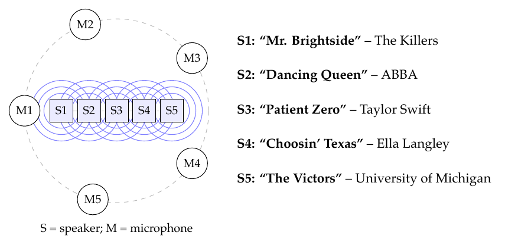



# Homework 6: Inverses and LU Factorization

**due** Friday, October 30th at 11:59PM

{: .yellow }

Write your solutions to the following problems either by writing them on a piece of paper or on a tablet and scanning your answers as a PDF. Note that you are not allowed to use LaTeX, Google Docs, or any other digital document creation software to type your answers. Homeworks are due to Pensive by 11:59PM on the due date. See the [syllabus](https://math124.org/syllabus/#homework) for details on the slip day policy.

Homework will be evaluated not only on the correctness of your answers, but on your ability to present your ideas clearly and logically. You should always explain and justify your conclusions, using sound reasoning. Your goal should be to convince the reader of your assertions. If a question does not require explanation, it will be explicitly stated.

Before proceeding, make sure you're familiar with the [collaboration policy](https://math124.org/syllabus/#collaboration-and-generative-ai-policy).

---

## Problems

- [Problem 1: Homework 5 solutions review](#problem-1-homework-5-solutions-review-6-pts)
- [Problem 2: Finding Inverses](#problem-2-finding-inverses-8-pts)
- [Problem 3: Inverse of a Rotation](#problem-3-inverse-of-a-rotation-8-pts)
- [Problem 4: Inverse of a $3\times3$ Matrix](#problem-4-inverse-of-a-3times3-matrix-12-pts)
- [Problem 5: Inverses in NumPy](#problem-5-inverses-in-numpy-12-pts)
- [Problem 6: LU Factorization of $2\times2$ Matrices](#problem-6-lu-factorization-of-2times2-matrices-16-pts)
- [Problem 7: LU Factorization of a $3\times3$ Matrix](#problem-7-lu-factorization-of-a-3times3-matrix-20-pts)
- [Problem 8: Separating Songs](#problem-8-separating-songs-18-pts)

---

Total Points: \\(6+8+8+12+12+16+20+18=100\\)

---

Remember to look at [Chapter 3.6](https://notes.math124.org/ch03/03-06) and [Chapter 4](https://notes.math124.org/ch04/04-01) of the course notes while working on the homework!

---

## Problem 1: Homework 5 solutions review (6 pts)

Review [the solutions to Homework 5](https://math124.org/resources/homeworks/hw05/). Pick **two problem parts** (for example, Problem 3a) and Problem 5b)) from Homework 5 in which your solutions have the most room for improvement, i.e., where they have unsound reasoning, could be significantly more efficient or clearer, etc. **Include a screenshot of your solution to each problem part**, and in a few sentences, explain what was deficient and how it could be fixed.

Alternatively, if you think one of your solutions is significantly better than the posted one, copy it here and explain why you think it is better. If you didn't do Homework 5, choose two problem parts from it that look challenging to you, and in a few sentences, explain the key ideas behind their solutions in your own words.

---

## Problem 2: Finding Inverses (8 pts)

Suppose \\(A=BC\\), where \\(B\\) is an unknown invertible \\(2\times2\\) matrix and

$$
A=\begin{bmatrix}1&5\\0&3\end{bmatrix},\qquad
C=\begin{bmatrix}1&2\\-1&1\end{bmatrix}
$$

 Find \\(B^{-1}\\). For full credit, you may only use the formula for the inverse of a \\(2\times2\\) matrix **once**; you do not need to find \\(B\\) first.

---

## Problem 3: Inverse of a Rotation (8 pts)

As we've seen, the matrix

$$
R_\theta=\begin{bmatrix}\cos\theta&-\sin\theta\\\sin\theta&\cos\theta\end{bmatrix}
$$

 rotates vectors in \\(\mathbb R^2\\) counterclockwise by \\(\theta\\) radians.

a)

(3 pts) Find \\(R&#95;\theta^{-1}\\).

b)

(2 pts) Now, find \\(R&#95;{-\theta}\\) for a rotation of \\(\theta\\) radians clockwise, i.e. for \\(-\theta\\). What do you notice, and why?

c)

(3 pts) A linear transformation \\(T:\mathbb R^2\to\mathbb R^2\\) first rotates vectors counterclockwise by \\(30^\circ\\), then multiplies their horizontal coordinates by \\(5\\) and their vertical coordinates by \\(\frac12\\). Find the matrix of \\(T^{-1}\\). <em>Hint: While it's possible to do this by first finding the matrix for \\(T\\), that is not necessary!</em>

---

## Problem 4: Inverse of a \\(3\times3\\) Matrix (12 pts)

Let

$$
A=\begin{bmatrix}2&-3&4\\1&-2&3\\3&-5&8\end{bmatrix}
=\begin{bmatrix}|&|&|\\\vec a_1&\vec a_2&\vec a_3\\|&|&|\end{bmatrix}.
$$

a)

(6 pts) For each vector below, find coefficients \\(c&#95;1,c&#95;2,c&#95;3\\) such that \\(c&#95;1\vec a&#95;1+c&#95;2\vec a&#95;2+c&#95;3\vec a&#95;3\\) equals that vector. Show how you find the coefficients, and write each coefficient vector vertically.

$$
\text{(i) }\begin{bmatrix}1\\0\\0\end{bmatrix},\qquad
\text{(ii) }\begin{bmatrix}0\\1\\0\end{bmatrix},\qquad
\text{(iii) }\begin{bmatrix}0\\0\\1\end{bmatrix}.
$$

b)

(3 pts) Place your three coefficient vectors in the columns of a matrix \\(X\\), in the order above. Explain why \\(AX=I&#95;3\\) and why this means \\(X=A^{-1}\\). You may use the fact that for square matrices, \\(AX=I&#95;3\\) also implies \\(XA=I&#95;3\\).

c)

(3 pts) Use your inverse to solve \\(A\vec x=\begin{bmatrix}11\\\\7\\\\19\end{bmatrix}\\). Verify your work by multiplying \\(A\vec x\\) and checking it is equal to \\(\begin{bmatrix}11\\\\7\\\\19\end{bmatrix}\\).

---

## Problem 5: Inverses in NumPy (12 pts)

In this problem, we will investigate several \\(3\times3\\) matrices and see whether they are invertible. Consider the following six matrices:

$$
M_1=\begin{bmatrix}1&2&0\\0&1&1\\1&0&1\end{bmatrix},\qquad
M_2=\begin{bmatrix}1&2&0\\2&4&1\\4&8&-1\end{bmatrix},\qquad
M_3=\begin{bmatrix}2&0&1\\1&1&0\\0&2&1\end{bmatrix},
$$

$$
M_4=\begin{bmatrix}1&0&1\\2&2&4\\-1&1&0\end{bmatrix},\qquad
M_5=\begin{bmatrix}1&0&2\\0&0&1\\2&0&-1\end{bmatrix},\qquad
M_6=\begin{bmatrix}0&1&2\\1&0&1\\2&1&0\end{bmatrix}.
$$

 Before proceeding, open the supplemental Jupyter Notebook. To open the notebook for Homework 6, click [**this link**](https://colab.research.google.com/github/math-124/fa26-code/blob/main/homeworks/hw06/hw06.ipynb). Instructions on how to use Google Colab are at [math124.org/running-code](https://math124.org/running-code).

There, we provide instructions on how to compute a matrix's inverse using `np.linalg.inv`. For the matrices in this problem, if that function call raises the error `LinAlgError: Singular matrix`, then the matrix is not invertible!

a)

(4 pts) For all six matrices, try to compute their inverse. Report which ones are invertible and which are not.

b)

(4 pts) For the matrices that are invertible, multiply their inverse by the original matrix and show that the result is the identity matrix. **In Your PDF:** Include a screenshot that contains this check for all invertible matrices.

c)

(4 pts) For each non-invertible matrix, suppose the columns are named \\(\vec x\\), \\(\vec y\\), and \\(\vec z\\), from left to right. Write one column as a linear combination of the other two. For example, you could write \\(\vec z=a\vec x+b\vec y\\) for specific numbers \\(a\\) and \\(b\\), or express \\(\vec x\\) or \\(\vec y\\) in terms of the other two columns. The coefficients may be zero. What do all the non-invertible matrices have in common?

---

## Problem 6: LU Factorization of \\(2\times2\\) Matrices (16 pts)

For each \\(2\times2\\) matrix \\(A\\) below:

<ol class="assignment-enumeration" markdown="1">
<li markdown="1">

1.

Find an LU factorization with **ones on the diagonal of \\(L\\)**. If necessary, multiply \\(A\\) by a permutation matrix \\(P\\), i.e., find \\(PA=LU\\). If no row swap is needed, use \\(P=I\\).

</li>
<li markdown="1">

2.

Use the same \\(L\\) and \\(U\\) to solve \\(A\vec x=\vec b&#95;1\\) and \\(A\vec x=\vec b&#95;2\\).

</li>
</ol>

a)

(8 pts)

$$
A=\begin{bmatrix}4&3\\8&9\end{bmatrix},\qquad
\vec b_1=\begin{bmatrix}11\\25\end{bmatrix},\qquad
\vec b_2=\begin{bmatrix}5\\19\end{bmatrix}.
$$

b)

(8 pts)

$$
A=\begin{bmatrix}0&5\\6&4\end{bmatrix},\qquad
\vec b_1=\begin{bmatrix}15\\24\end{bmatrix},\qquad
\vec b_2=\begin{bmatrix}-10\\10\end{bmatrix}.
$$

---

## Problem 7: LU Factorization of a \\(3\times3\\) Matrix (20 pts)

For each \\(3\times3\\) matrix below, find an LU factorization as in Problem 6, then use \\(L\\) and \\(U\\) to solve \\(A\vec x=\vec b\\) for the given vector \\(\vec b\\).

a)

(10 pts)

$$
A=\begin{bmatrix}3&4&-2\\6&13&-1\\-3&6&12\end{bmatrix},\qquad
\vec b=\begin{bmatrix}-4\\-4\\24\end{bmatrix}.
$$

b)

(10 pts)

$$
A=\begin{bmatrix}3&3&0\\6&6&5\\3&7&2\end{bmatrix},\qquad
\vec b=\begin{bmatrix}3\\21\\5\end{bmatrix}.
$$

---

## Problem 8: Separating Songs (18 pts)

Five speakers are playing five different songs at the same time, **one song per speaker**. Five microphones record them, but each microphone picks up a different mixture of all five speakers. The speakers stand in a line, with microphones arranged around them in a circle. The diagram shows which song each speaker plays.

Every microphone picks up all five speakers, but not evenly.

We know the song titles, but **do not** have access to the original song files -- all we have are what our microphones recorded. Our goal is to recover the audio originally depicted by each speaker -- i.e., the original songs -- from these mixtures.

A digital audio recording stores a sound's amplitude at regularly spaced instants. Each amplitude is a number that can be positive, negative, or zero. At a sample rate of \\(8{,}000\\) Hz, there are \\(8{,}000\\) amplitude measurements per second. Thus, a four-second clip is a vector of \\(32{,}000\\) numbers.

At a particular instant, let \\(x&#95;1,x&#95;2,x&#95;3,x&#95;4,x&#95;5\\) be the sound amplitudes coming from the five speakers and \\(b&#95;1,b&#95;2,b&#95;3,b&#95;4,b&#95;5\\) be the amplitudes recorded by the five microphones. Each microphone records a weighted sum of the speaker amplitudes, using the known weights below. **Assume these weights stay fixed throughout the problem.**

<table>
<thead>
<tr>
<th style="text-align: center;"></th>
<th style="text-align: center;">Speaker 1 <small>(Song 1)</small></th>
<th style="text-align: center;">Speaker 2 <small>(Song 2)</small></th>
<th style="text-align: center;">Speaker 3 <small>(Song 3)</small></th>
<th style="text-align: center;">Speaker 4 <small>(Song 4)</small></th>
<th style="text-align: center;">Speaker 5 <small>(Song 5)</small></th>
</tr>
</thead>
<tbody>
<tr>
<td style="text-align: center;">Microphone 1</td>
<td style="text-align: center;">\(0.9\)</td>
<td style="text-align: center;">\(0.8\)</td>
<td style="text-align: center;">\(0.6\)</td>
<td style="text-align: center;">\(0.5\)</td>
<td style="text-align: center;">\(0.7\)</td>
</tr>
<tr>
<td style="text-align: center;">Microphone 2</td>
<td style="text-align: center;">\(0.7\)</td>
<td style="text-align: center;">\(0.9\)</td>
<td style="text-align: center;">\(0.8\)</td>
<td style="text-align: center;">\(0.7\)</td>
<td style="text-align: center;">\(0.6\)</td>
</tr>
<tr>
<td style="text-align: center;">Microphone 3</td>
<td style="text-align: center;">\(0.5\)</td>
<td style="text-align: center;">\(0.6\)</td>
<td style="text-align: center;">\(0.8\)</td>
<td style="text-align: center;">\(0.9\)</td>
<td style="text-align: center;">\(0.8\)</td>
</tr>
<tr>
<td style="text-align: center;">Microphone 4</td>
<td style="text-align: center;">\(0.8\)</td>
<td style="text-align: center;">\(0.7\)</td>
<td style="text-align: center;">\(0.9\)</td>
<td style="text-align: center;">\(0.8\)</td>
<td style="text-align: center;">\(0.6\)</td>
</tr>
<tr>
<td style="text-align: center;">Microphone 5</td>
<td style="text-align: center;">\(0.6\)</td>
<td style="text-align: center;">\(0.8\)</td>
<td style="text-align: center;">\(0.7\)</td>
<td style="text-align: center;">\(0.6\)</td>
<td style="text-align: center;">\(0.9\)</td>
</tr>
</tbody>
</table>

For example, Microphone 1 records

$$
b_1=0.9x_1+0.8x_2+0.6x_3+0.5x_4+0.7x_5.
$$

Before proceeding, open the supplemental Jupyter Notebook. To open the notebook for Homework 6, click [**this link**](https://colab.research.google.com/github/math-124/fa26-code/blob/main/homeworks/hw06/hw06.ipynb). Instructions on how to use Google Colab are at [math124.org/running-code](https://math124.org/running-code).

The notebook provides two four-second recording sessions, using different excerpts of the same five songs. We know the microphone recordings and the weights, but must solve for what each speaker was playing.

a)

(4 pts) Write the five equations relating the speaker amplitudes to the microphone amplitudes at one instant. Then write your system as \\(A\vec x=\vec b\\), where

$$
\vec x=\begin{bmatrix}x_1\\x_2\\x_3\\x_4\\x_5\end{bmatrix},\qquad
\vec b=\begin{bmatrix}b_1\\b_2\\b_3\\b_4\\b_5\end{bmatrix}.
$$

 State \\(A\\) and its shape.

b)

(3 pts) In the notebook, enter your matrix \\(A\\) and use `scipy.linalg.lu` to find \\(P,L,U\\) satisfying \\(PA=LU\\). The notebook explains how to use SciPy to do this. Verify that \\(PA=LU\\), and then use \\(L\\) and \\(U\\) to solve for the five speaker amplitudes, i.e., \\(\vec x\\), for the one instant \\(\vec b\\) selected in the notebook.

**In Your PDF:** Include a screenshot of the microphone amplitudes and the recovered speaker amplitudes for the one instant provided.

c)

(3 pts) Recall, in the first four-second clip, there are a total of \\(32{,}000\\) "instants," i.e., \\(32{,}000\\) vectors \\(\vec b\\), each of which describes the amplitude recorded by each of the five microphones.

Using the LU decomposition from part b), follow the notebook's instructions to solve all these systems together and recover the five song clips. Listen to the mixtures and the recovered clips.

**In Your PDF:** Include a screenshot of the code that starts with `X1 =` and of the five audio players that appear afterwards.

d)

(2 pts) In the second session, each speaker plays a different excerpt of its song. Recover these five clips **without computing another LU factorization**. Check your answer and listen to the recovered clips.

**In Your PDF:** Include a screenshot of your code and check for the second recording session.

e)

(6 pts)

<ol class="assignment-enumeration" markdown="1">
<li markdown="1">

i)

(3 pts) Why were we able to use our original \\(P\\), \\(L\\), and \\(U\\) for the second set of recordings without recomputing them?

</li>
<li markdown="1">

ii)

(3 pts) Suppose only Microphone 1 was working. Could you uniquely recover all five speaker amplitudes at a given instant from its recording alone? Why or why not?

</li>
</ol>


