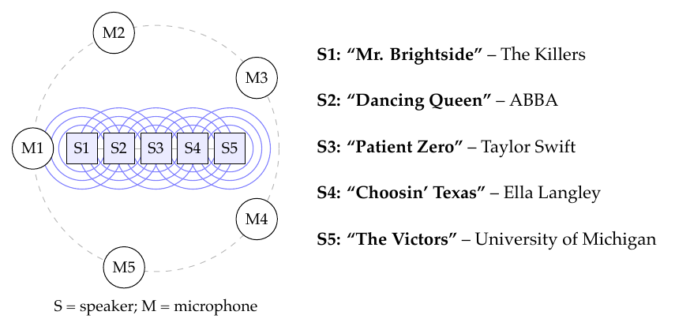



<script>
window.MathJax = {
  tex: {inlineMath: [['$', '$'], ['\\(', '\\)']]},
  options: {ignoreHtmlClass: 'tex2jax_ignore'}
};
</script>
<script src="https://cdn.jsdelivr.net/npm/mathjax@3/es5/tex-mml-chtml.js" async></script>

<style>
.main-content p {
  margin-bottom: 1.15em;
}
.assignment-pdf-button {
  font-size: 0.95rem;
  padding: 0.35rem 0.65rem;
}
.assignment-actions {
  align-items: center;
  display: flex;
  flex-wrap: wrap;
  gap: 0.55rem;
  margin: 0 0 1rem;
}
.assignment-vector-plot {
  max-width: 100%;
  height: auto;
  display: block;
  margin: 1rem auto;
}
.math-display,
mjx-container[jax="CHTML"][display="true"] {
  max-width: 100%;
  overflow-x: auto;
  overflow-y: hidden;
}
.math-display {
  padding-bottom: 0.2rem;
}
.math-display mjx-container[jax="CHTML"][display="true"] {
  padding-bottom: 0.2rem;
}
.answer-blank {
  border-bottom: 1px solid currentColor;
  display: inline-block;
  min-width: 8rem;
  height: 1em;
  vertical-align: baseline;
}
.assignment-parts {
  margin: 1rem 0;
}
.assignment-part {
  align-items: baseline;
  column-gap: 0.55rem;
  display: grid;
  grid-template-columns: 1.4rem minmax(0, 1fr);
  margin-bottom: 1.05rem;
}
.assignment-part-label {
  font-weight: 600;
  text-align: right;
}
.assignment-part-content > :first-child {
  margin-top: 0;
}
.main-content ol.assignment-enumeration {
  padding-left: 0;
  list-style: none;
}
.main-content ol.assignment-enumeration > li {
  display: grid;
  grid-template-columns: 2.5em minmax(0, 1fr);
  align-items: baseline;
  column-gap: 0.5em;
  padding-left: 0;
  margin: 0.8em 0;
}
.main-content ol.assignment-enumeration > li::before {
  content: none;
}
.assignment-enumeration-label {
  text-align: right;
}
.assignment-enumeration-content > :first-child {
  margin-top: 0;
}
.assignment-enumeration-content > :last-child {
  margin-bottom: 0;
}
.mc-options {
  display: flex;
  flex-wrap: wrap;
  gap: 0.9rem 1.6rem;
  margin: 0.9rem 0 1.1rem;
}
.mc-option {
  display: inline-flex;
  align-items: center;
  gap: 0.35rem;
  white-space: nowrap;
}
.mc-bubble,
.mc-square {
  display: inline-block;
  flex: 0 0 auto;
  height: 0.95em;
  width: 0.95em;
  vertical-align: -0.12em;
}
.mc-bubble {
  border: 1.5px solid currentColor;
  border-radius: 50%;
}
.mc-square {
  border: 1.5px solid currentColor;
}
.mc-correct {
  background: currentColor;
}
.main-content table {
  font-size: 0.9rem;
  width: auto;
  max-width: 100%;
}
.main-content table th,
.main-content table td {
  padding: 0.35rem 0.5rem;
  white-space: nowrap;
}
.main-content details table td:last-child {
  white-space: normal;
}
.crossnumber-grid {
  display: grid;
  grid-template-columns: repeat(3, 2.4rem);
  grid-template-rows: repeat(3, 2.4rem);
  margin: 1rem auto;
  width: max-content;
}
.crossnumber-cell {
  align-items: center;
  border: 1.5px solid currentColor;
  display: flex;
  font-size: 1.1rem;
  justify-content: center;
  position: relative;
}
.crossnumber-label {
  font-size: 0.55rem;
  left: 0.15rem;
  line-height: 1;
  position: absolute;
  top: 0.15rem;
}
.crossnumber-missing {
  border: 0;
}
</style>

# Homework 6: Inverses and LU Factorization

**due** Friday, October 30th at 11:59PM

<div class="assignment-actions">
<a class="btn btn-info assignment-pdf-button" href="/resources/homeworks/hw06/hw06.pdf" target="_blank">View as PDF ✏️</a>
<a class="btn btn-info assignment-pdf-button" href="/resources/homeworks/hw06/hw06-solutions.pdf" target="_blank">Solutions PDF ✅</a>
</div>

{: .yellow }
<div markdown="1">
Write your solutions to the following problems either by writing them on a piece of paper or on a tablet and scanning your answers as a PDF. Note that you are not allowed to use LaTeX, Google Docs, or any other digital document creation software to type your answers. Homeworks are due to Pensive by 11:59PM on the due date. See the [syllabus](https://math124.org/syllabus/#homework) for details on the slip day policy.

Homework will be evaluated not only on the correctness of your answers, but on your ability to present your ideas clearly and logically. You should always explain and justify your conclusions, using sound reasoning. Your goal should be to convince the reader of your assertions. If a question does not require explanation, it will be explicitly stated.

Before proceeding, make sure you're familiar with the [collaboration policy](https://math124.org/syllabus/#collaboration-and-generative-ai-policy).
</div>

---

## Problems

- [Problem 1: Homework 5 solutions review](#problem-1-homework-5-solutions-review-6-pts)
- [Problem 2: Finding Inverses](#problem-2-finding-inverses-8-pts)
- [Problem 3: Inverse of a Rotation](#problem-3-inverse-of-a-rotation-8-pts)
- [Problem 4: Inverse of a $3\times3$ Matrix](#problem-4-inverse-of-a-3times3-matrix-12-pts)
- [Problem 5: Inverses in NumPy](#problem-5-inverses-in-numpy-12-pts)
- [Problem 6: LU Factorization of $2\times2$ Matrices](#problem-6-lu-factorization-of-2times2-matrices-16-pts)
- [Problem 7: LU Factorization of a $3\times3$ Matrix](#problem-7-lu-factorization-of-a-3times3-matrix-20-pts)
- [Problem 8: Separating Songs](#problem-8-separating-songs-18-pts)

---

Total Points: <span class="math-inline">\\(6+8+8+12+12+16+20+18=100\\)</span>

---

Remember to look at [Chapter 3.6](https://notes.math124.org/ch03/03-06) and [Chapter 4](https://notes.math124.org/ch04/04-01) of the course notes while working on the homework!

---

## Problem 1: Homework 5 solutions review (6 pts)

Review [the solutions to Homework 5](https://math124.org/resources/homeworks/hw05/). Pick **two problem parts** (for example, Problem 3a) and Problem 5b)) from Homework 5 in which your solutions have the most room for improvement, i.e., where they have unsound reasoning, could be significantly more efficient or clearer, etc. **Include a screenshot of your solution to each problem part**, and in a few sentences, explain what was deficient and how it could be fixed.

Alternatively, if you think one of your solutions is significantly better than the posted one, copy it here and explain why you think it is better. If you didn't do Homework 5, choose two problem parts from it that look challenging to you, and in a few sentences, explain the key ideas behind their solutions in your own words.

<details markdown="1"><summary>Solution</summary>

</details>

---

## Problem 2: Finding Inverses (8 pts)

Suppose <span class="math-inline">\\(A=BC\\)</span>, where <span class="math-inline">\\(B\\)</span> is an unknown invertible <span class="math-inline">\\(2\times2\\)</span> matrix and

<div class="math-display">
$$
A=\begin{bmatrix}1&5\\0&3\end{bmatrix},\qquad
C=\begin{bmatrix}1&2\\-1&1\end{bmatrix}
$$
</div>

 Find <span class="math-inline">\\(B^{-1}\\)</span>. For full credit, you may only use the formula for the inverse of a <span class="math-inline">\\(2\times2\\)</span> matrix **once**; you do not need to find <span class="math-inline">\\(B\\)</span> first.

<details markdown="1"><summary>Solution</summary>

Start with <span class="math-inline">\\(A=BC\\)</span>. Multiplying on the left by <span class="math-inline">\\(B^{-1}\\)</span> gives <span class="math-inline">\\(B^{-1}A=C\\)</span>, and then multiplying on the right by <span class="math-inline">\\(A^{-1}\\)</span> gives

<div class="math-display">
$$
B^{-1}=CA^{-1}.
$$
</div>

 We only need to use the inverse formula for <span class="math-inline">\\(A\\)</span>:

<div class="math-display">
$$
A^{-1}=\frac{1}{1(3)-5(0)}\begin{bmatrix}3&-5\\0&1\end{bmatrix}
=\begin{bmatrix}1&-5/3\\0&1/3\end{bmatrix}.
$$
</div>

 Therefore,

<div class="math-display">
$$
B^{-1}=\begin{bmatrix}1&2\\-1&1\end{bmatrix}
\begin{bmatrix}1&-5/3\\0&1/3\end{bmatrix}
=\boxed{\begin{bmatrix}1&-1\\-1&2\end{bmatrix}}.
$$
</div>

 The order matters: we multiply by <span class="math-inline">\\(A^{-1}\\)</span> on the right so that <span class="math-inline">\\(A\\)</span> and <span class="math-inline">\\(A^{-1}\\)</span> are next to each other.
</details>

---

## Problem 3: Inverse of a Rotation (8 pts)

As we've seen, the matrix

<div class="math-display">
$$
R_\theta=\begin{bmatrix}\cos\theta&-\sin\theta\\\sin\theta&\cos\theta\end{bmatrix}
$$
</div>

 rotates vectors in <span class="math-inline">\\(\mathbb R^2\\)</span> counterclockwise by <span class="math-inline">\\(\theta\\)</span> radians.

<div class="assignment-parts" markdown="1">
<div class="assignment-part" markdown="1">
<div class="assignment-part-label">a)</div>
<div class="assignment-part-content" markdown="1">
(3 pts) Find <span class="math-inline">\\(R&#95;\theta^{-1}\\)</span>.

<details markdown="1"><summary>Solution</summary>

Using the <span class="math-inline">\\(2\times2\\)</span> inverse formula, the denominator is

<div class="math-display">
$$
\cos^2\theta-(-\sin\theta)(\sin\theta)=\cos^2\theta+\sin^2\theta=1.
$$
</div>

 So

<div class="math-display">
$$
\boxed{R_\theta^{-1}=\begin{bmatrix}\cos\theta&\sin\theta\\-\sin\theta&\cos\theta\end{bmatrix}}.
$$
</div>

</details>

</div>
</div>

<div class="assignment-part" markdown="1">
<div class="assignment-part-label">b)</div>
<div class="assignment-part-content" markdown="1">
(2 pts) Now, find <span class="math-inline">\\(R&#95;{-\theta}\\)</span> for a rotation of <span class="math-inline">\\(\theta\\)</span> radians clockwise, i.e. for <span class="math-inline">\\(-\theta\\)</span>. What do you notice, and why?

<details markdown="1"><summary>Solution</summary>

Since <span class="math-inline">\\(\cos(-\theta)=\cos\theta\\)</span> and <span class="math-inline">\\(\sin(-\theta)=-\sin\theta\\)</span>,

<div class="math-display">
$$
R_{-\theta}=\begin{bmatrix}\cos\theta&\sin\theta\\-\sin\theta&\cos\theta\end{bmatrix}=R_\theta^{-1}.
$$
</div>

 This makes sense geometrically: to undo a counterclockwise rotation by <span class="math-inline">\\(\theta\\)</span>, rotate clockwise by the same angle.
</details>

</div>
</div>

<div class="assignment-part" markdown="1">
<div class="assignment-part-label">c)</div>
<div class="assignment-part-content" markdown="1">
(3 pts) A linear transformation <span class="math-inline">\\(T:\mathbb R^2\to\mathbb R^2\\)</span> first rotates vectors counterclockwise by <span class="math-inline">\\(30^\circ\\)</span>, then multiplies their horizontal coordinates by <span class="math-inline">\\(5\\)</span> and their vertical coordinates by <span class="math-inline">\\(\frac12\\)</span>. Find the matrix of <span class="math-inline">\\(T^{-1}\\)</span>. <em>Hint: While it's possible to do this by first finding the matrix for <span class="math-inline">\\(T\\)</span>, that is not necessary!</em>

<details markdown="1"><summary>Solution</summary>

To undo <span class="math-inline">\\(T\\)</span>, we undo its steps in reverse order. First, multiply the horizontal coordinate by <span class="math-inline">\\(1/5\\)</span> and the vertical coordinate by <span class="math-inline">\\(2\\)</span>. Then rotate **clockwise** by <span class="math-inline">\\(30^\circ\\)</span>; remember that regular rotations are counterclockwise, so this is the same as using the rotation matrix for <span class="math-inline">\\(-30^\circ\\)</span>.

The scaling in the inverse transformation acts first --- remember <span class="math-inline">\\((AB)^{-1}=B^{-1}A^{-1}\\)</span> --- so the diagonal matrix goes on the right here:

<div class="math-display">
$$
\begin{bmatrix}\sqrt3/2&1/2\\-1/2&\sqrt3/2\end{bmatrix}
\begin{bmatrix}1/5&0\\0&2\end{bmatrix}
=\boxed{\begin{bmatrix}\sqrt3/10&1\\-1/10&\sqrt3\end{bmatrix}}.
$$
</div>

 Just to illustrate another way of doing this, we could also find the matrix for <span class="math-inline">\\(T\\)</span> and invert it. In <span class="math-inline">\\(T\\)</span>, the rotation acts first, so its matrix goes on the right:

<div class="math-display">
$$
A=\begin{bmatrix}5&0\\0&1/2\end{bmatrix}
\begin{bmatrix}\sqrt3/2&-1/2\\1/2&\sqrt3/2\end{bmatrix}
=\begin{bmatrix}5\sqrt3/2&-5/2\\1/4&\sqrt3/4\end{bmatrix}.
$$
</div>

 Using the <span class="math-inline">\\(2\times2\\)</span> inverse formula, the denominator is

<div class="math-display">
$$
\left(\frac{5\sqrt3}{2}\right)\left(\frac{\sqrt3}{4}\right)
-\left(-\frac52\right)\left(\frac14\right)
=\frac{15}{8}+\frac58=\frac52.
$$
</div>

 Therefore, the matrix for <span class="math-inline">\\(T^{-1}\\)</span> is

<div class="math-display">
$$
A^{-1}=\frac{2}{5}\begin{bmatrix}\sqrt3/4&5/2\\-1/4&5\sqrt3/2\end{bmatrix}
=\boxed{\begin{bmatrix}\sqrt3/10&1\\-1/10&\sqrt3\end{bmatrix}},
$$
</div>

 which agrees with our first approach.
</details>

</div>
</div>

</div>

---

## Problem 4: Inverse of a <span class="math-inline">\\(3\times3\\)</span> Matrix (12 pts)

Let

<div class="math-display">
$$
A=\begin{bmatrix}2&-3&4\\1&-2&3\\3&-5&8\end{bmatrix}
=\begin{bmatrix}|&|&|\\\vec a_1&\vec a_2&\vec a_3\\|&|&|\end{bmatrix}.
$$
</div>

<div class="assignment-parts" markdown="1">
<div class="assignment-part" markdown="1">
<div class="assignment-part-label">a)</div>
<div class="assignment-part-content" markdown="1">
(6 pts) For each vector below, find coefficients <span class="math-inline">\\(c&#95;1,c&#95;2,c&#95;3\\)</span> such that <span class="math-inline">\\(c&#95;1\vec a&#95;1+c&#95;2\vec a&#95;2+c&#95;3\vec a&#95;3\\)</span> equals that vector. Show how you find the coefficients, and write each coefficient vector vertically.

<div class="math-display">
$$
\text{(i) }\begin{bmatrix}1\\0\\0\end{bmatrix},\qquad
\text{(ii) }\begin{bmatrix}0\\1\\0\end{bmatrix},\qquad
\text{(iii) }\begin{bmatrix}0\\0\\1\end{bmatrix}.
$$
</div>

<details markdown="1"><summary>Solution</summary>

We solve a separate system for each of the three vectors.

-   **(i)** The system is

<div class="math-display">
$$
\begin{aligned}
    2c_1-3c_2+4c_3&=1,\\
    c_1-2c_2+3c_3&=0,\\
    3c_1-5c_2+8c_3&=0.
    \end{aligned}
$$
</div>

 Subtract twice the second equation from the first, and three times the second equation from the third:

<div class="math-display">
$$
c_2-2c_3=1,\qquad c_2-c_3=0.
$$
</div>

 Subtracting these two equations gives <span class="math-inline">\\(c&#95;3=-1\\)</span>. Then <span class="math-inline">\\(c&#95;2-(-1)=0\\)</span> gives <span class="math-inline">\\(c&#95;2=-1\\)</span>. Substituting into the original second equation gives <span class="math-inline">\\(c&#95;1-2(-1)+3(-1)=0\\)</span>, so <span class="math-inline">\\(c&#95;1=1\\)</span>. Our coefficient vector is <span class="math-inline">\\(\boxed{\begin{bmatrix}1\\\\-1\\\\-1\end{bmatrix}}\\)</span>.

-   **(ii)** The system is

<div class="math-display">
$$
\begin{aligned}
    2c_1-3c_2+4c_3&=0,\\
    c_1-2c_2+3c_3&=1,\\
    3c_1-5c_2+8c_3&=0.
    \end{aligned}
$$
</div>

 Subtract twice the second equation from the first, and three times the second equation from the third:

<div class="math-display">
$$
c_2-2c_3=-2,\qquad c_2-c_3=-3.
$$
</div>

 Subtracting these two equations gives <span class="math-inline">\\(c&#95;3=-1\\)</span>. Then <span class="math-inline">\\(c&#95;2-(-1)=-3\\)</span> gives <span class="math-inline">\\(c&#95;2=-4\\)</span>. The original second equation becomes <span class="math-inline">\\(c&#95;1-2(-4)+3(-1)=1\\)</span>, so <span class="math-inline">\\(c&#95;1=-4\\)</span>. Our coefficient vector is <span class="math-inline">\\(\boxed{\begin{bmatrix}-4\\\\-4\\\\-1\end{bmatrix}}\\)</span>.

-   **(iii)** The system is

<div class="math-display">
$$
\begin{aligned}
    2c_1-3c_2+4c_3&=0,\\
    c_1-2c_2+3c_3&=0,\\
    3c_1-5c_2+8c_3&=1.
    \end{aligned}
$$
</div>

 Subtract twice the second equation from the first, and three times the second equation from the third:

<div class="math-display">
$$
c_2-2c_3=0,\qquad c_2-c_3=1.
$$
</div>

 Subtracting these two equations gives <span class="math-inline">\\(c&#95;3=1\\)</span>. Then <span class="math-inline">\\(c&#95;2-1=1\\)</span> gives <span class="math-inline">\\(c&#95;2=2\\)</span>. The original second equation becomes <span class="math-inline">\\(c&#95;1-2(2)+3(1)=0\\)</span>, so <span class="math-inline">\\(c&#95;1=1\\)</span>. Our coefficient vector is <span class="math-inline">\\(\boxed{\begin{bmatrix}1\\\\2\\\\1\end{bmatrix}}\\)</span>.
</details>

</div>
</div>

<div class="assignment-part" markdown="1">
<div class="assignment-part-label">b)</div>
<div class="assignment-part-content" markdown="1">
(3 pts) Place your three coefficient vectors in the columns of a matrix <span class="math-inline">\\(X\\)</span>, in the order above. Explain why <span class="math-inline">\\(AX=I&#95;3\\)</span> and why this means <span class="math-inline">\\(X=A^{-1}\\)</span>. You may use the fact that for square matrices, <span class="math-inline">\\(AX=I&#95;3\\)</span> also implies <span class="math-inline">\\(XA=I&#95;3\\)</span>.

<details markdown="1"><summary>Solution</summary>

Putting the coefficient vectors in columns gives

<div class="math-display">
$$
X=\begin{bmatrix}1&-4&1\\-1&-4&2\\-1&-1&1\end{bmatrix}.
$$
</div>

 Recall that each column of <span class="math-inline">\\(AX\\)</span> is <span class="math-inline">\\(A\\)</span> times the corresponding column of <span class="math-inline">\\(X\\)</span>. We chose these columns so that the three products are the three standard basis vectors, in order. Thus <span class="math-inline">\\(AX=I&#95;3\\)</span>.

Since both matrices are square, the given fact also tells us that <span class="math-inline">\\(XA=I&#95;3\\)</span>. These are exactly the two identities in the definition of an inverse, so <span class="math-inline">\\(\boxed{X=A^{-1}}\\)</span>.
</details>

</div>
</div>

<div class="assignment-part" markdown="1">
<div class="assignment-part-label">c)</div>
<div class="assignment-part-content" markdown="1">
(3 pts) Use your inverse to solve <span class="math-inline">\\(A\vec x=\begin{bmatrix}11\\\\7\\\\19\end{bmatrix}\\)</span>. Verify your work by multiplying <span class="math-inline">\\(A\vec x\\)</span> and checking it is equal to <span class="math-inline">\\(\begin{bmatrix}11\\\\7\\\\19\end{bmatrix}\\)</span>.

<details markdown="1"><summary>Solution</summary>

Multiplying on the left by <span class="math-inline">\\(A^{-1}\\)</span> gives

<div class="math-display">
$$
\vec x=A^{-1}\begin{bmatrix}11\\7\\19\end{bmatrix}
=\begin{bmatrix}11-28+19\\-11-28+38\\-11-7+19\end{bmatrix}
=\boxed{\begin{bmatrix}2\\-1\\1\end{bmatrix}}.
$$
</div>

 Checking in the original system,

<div class="math-display">
$$
A\vec x=\begin{bmatrix}2(2)-3(-1)+4(1)\\2-2(-1)+3(1)\\3(2)-5(-1)+8(1)\end{bmatrix}
=\begin{bmatrix}11\\7\\19\end{bmatrix},
$$
</div>

 as required.
</details>

</div>
</div>

</div>

---

## Problem 5: Inverses in NumPy (12 pts)

In this problem, we will investigate several <span class="math-inline">\\(3\times3\\)</span> matrices and see whether they are invertible. Consider the following six matrices:

<div class="math-display">
$$
M_1=\begin{bmatrix}1&2&0\\0&1&1\\1&0&1\end{bmatrix},\qquad
M_2=\begin{bmatrix}1&2&0\\2&4&1\\4&8&-1\end{bmatrix},\qquad
M_3=\begin{bmatrix}2&0&1\\1&1&0\\0&2&1\end{bmatrix},
$$
</div>


<div class="math-display">
$$
M_4=\begin{bmatrix}1&0&1\\2&2&4\\-1&1&0\end{bmatrix},\qquad
M_5=\begin{bmatrix}1&0&2\\0&0&1\\2&0&-1\end{bmatrix},\qquad
M_6=\begin{bmatrix}0&1&2\\1&0&1\\2&1&0\end{bmatrix}.
$$
</div>

 Before proceeding, open the supplemental Jupyter Notebook. To open the notebook for Homework 6, click [**this link**](https://colab.research.google.com/github/math-124/fa26-code/blob/main/homeworks/hw06/hw06.ipynb). Instructions on how to use Google Colab are at [math124.org/running-code](https://math124.org/running-code).

There, we provide instructions on how to compute a matrix's inverse using `np.linalg.inv`. For the matrices in this problem, if that function call raises the error `LinAlgError: Singular matrix`, then the matrix is not invertible!

<div class="assignment-parts" markdown="1">
<div class="assignment-part" markdown="1">
<div class="assignment-part-label">a)</div>
<div class="assignment-part-content" markdown="1">
(4 pts) For all six matrices, try to compute their inverse. Report which ones are invertible and which are not.

<details markdown="1"><summary>Solution</summary>

For each matrix, we can check if it is invertible by running `np.linalg.inv(M)`.

The invertible matrices are <span class="math-inline">\\(\boxed{M&#95;1,M&#95;3,M&#95;6}\\)</span>. The matrices <span class="math-inline">\\(\boxed{M&#95;2,M&#95;4,M&#95;5}\\)</span> are not invertible; each raises `LinAlgError: Singular matrix`.
</details>

</div>
</div>

<div class="assignment-part" markdown="1">
<div class="assignment-part-label">b)</div>
<div class="assignment-part-content" markdown="1">
(4 pts) For the matrices that are invertible, multiply their inverse by the original matrix and show that the result is the identity matrix. <span style="color: #E67E22">**In Your PDF:** Include a screenshot that contains this check for all invertible matrices.</span>

<details markdown="1"><summary>Solution</summary>

For <span class="math-inline">\\(M&#95;1\\)</span>, one of the invertible matrices, we can run

```python
M1 @ np.linalg.inv(M1)
```
and we see the identity matrix:

```python
[[1. 0. 0.]
 [0. 1. 0.]
 [0. 0. 1.]]
```
We get the same result for <span class="math-inline">\\(M&#95;3\\)</span> and <span class="math-inline">\\(M&#95;6\\)</span>.
</details>

</div>
</div>

<div class="assignment-part" markdown="1">
<div class="assignment-part-label">c)</div>
<div class="assignment-part-content" markdown="1">
(4 pts) For each non-invertible matrix, suppose the columns are named <span class="math-inline">\\(\vec x\\)</span>, <span class="math-inline">\\(\vec y\\)</span>, and <span class="math-inline">\\(\vec z\\)</span>, from left to right. Write one column as a linear combination of the other two. For example, you could write <span class="math-inline">\\(\vec z=a\vec x+b\vec y\\)</span> for specific numbers <span class="math-inline">\\(a\\)</span> and <span class="math-inline">\\(b\\)</span>, or express <span class="math-inline">\\(\vec x\\)</span> or <span class="math-inline">\\(\vec y\\)</span> in terms of the other two columns. The coefficients may be zero. What do all the non-invertible matrices have in common?

<details markdown="1"><summary>Solution</summary>

The three non-invertible matrices are

<div class="math-display">
$$
M_2=\begin{bmatrix}1&2&0\\2&4&1\\4&8&-1\end{bmatrix},\qquad
M_4=\begin{bmatrix}1&0&1\\2&2&4\\-1&1&0\end{bmatrix},\qquad
M_5=\begin{bmatrix}1&0&2\\0&0&1\\2&0&-1\end{bmatrix}.
$$
</div>

 We can read the relationships directly from their columns:

-   For <span class="math-inline">\\(M&#95;2\\)</span>, <span class="math-inline">\\(\boxed{\vec y=2\vec x+0\vec z}\\)</span>, since <span class="math-inline">\\(\begin{bmatrix}2\\\\4\\\\8\end{bmatrix}=2\begin{bmatrix}1\\\\2\\\\4\end{bmatrix}\\)</span>.

-   For <span class="math-inline">\\(M&#95;4\\)</span>, <span class="math-inline">\\(\boxed{\vec z=\vec x+\vec y}\\)</span>, since <span class="math-inline">\\(\begin{bmatrix}1\\\\4\\\\0\end{bmatrix}=\begin{bmatrix}1\\\\2\\\\-1\end{bmatrix}+\begin{bmatrix}0\\\\2\\\\1\end{bmatrix}\\)</span>.

-   For <span class="math-inline">\\(M&#95;5\\)</span>, <span class="math-inline">\\(\boxed{\vec y=0\vec x+0\vec z}\\)</span>, since its second column is the zero vector.

In every case, one column can be written as a linear combination of the others. When we can write one vector as a linear combination of others, we say that the collection of vectors is **not linearly independent**. This means two different vectors, <span class="math-inline">\\(\vec u\\)</span> and <span class="math-inline">\\(\vec v\\)</span>, may both have the same output when multiplied by <span class="math-inline">\\(A\\)</span>, so <span class="math-inline">\\(A\\)</span> cannot be inverted.
</details>

</div>
</div>

</div>

---

## Problem 6: LU Factorization of <span class="math-inline">\\(2\times2\\)</span> Matrices (16 pts)

For each <span class="math-inline">\\(2\times2\\)</span> matrix <span class="math-inline">\\(A\\)</span> below:

<ol class="assignment-enumeration" markdown="1">
<li markdown="1">
<div class="assignment-enumeration-label">1.</div>
<div class="assignment-enumeration-content" markdown="1">

Find an LU factorization with **ones on the diagonal of <span class="math-inline">\\(L\\)</span>**. If necessary, multiply <span class="math-inline">\\(A\\)</span> by a permutation matrix <span class="math-inline">\\(P\\)</span>, i.e., find <span class="math-inline">\\(PA=LU\\)</span>. If no row swap is needed, use <span class="math-inline">\\(P=I\\)</span>.

</div></li>
<li markdown="1">
<div class="assignment-enumeration-label">2.</div>
<div class="assignment-enumeration-content" markdown="1">

Use the same <span class="math-inline">\\(L\\)</span> and <span class="math-inline">\\(U\\)</span> to solve <span class="math-inline">\\(A\vec x=\vec b&#95;1\\)</span> and <span class="math-inline">\\(A\vec x=\vec b&#95;2\\)</span>.

</div></li>
</ol>

<div class="assignment-parts" markdown="1">
<div class="assignment-part" markdown="1">
<div class="assignment-part-label">a)</div>
<div class="assignment-part-content" markdown="1">
(8 pts)
<div class="math-display">
$$
A=\begin{bmatrix}4&3\\8&9\end{bmatrix},\qquad
\vec b_1=\begin{bmatrix}11\\25\end{bmatrix},\qquad
\vec b_2=\begin{bmatrix}5\\19\end{bmatrix}.
$$
</div>

<details markdown="1"><summary>Solution</summary>

Write the factors in the required shapes and match entries:

<div class="math-display">
$$
\begin{bmatrix}1&0\\\ell&1\end{bmatrix}
\begin{bmatrix}p&q\\0&r\end{bmatrix}
=\begin{bmatrix}p&q\\\ell p&\ell q+r\end{bmatrix}
=\begin{bmatrix}4&3\\8&9\end{bmatrix}.
$$
</div>

 The first row gives <span class="math-inline">\\(p=4\\)</span>, <span class="math-inline">\\(q=3\\)</span>. Next, <span class="math-inline">\\(4\ell=8\\)</span> gives <span class="math-inline">\\(\ell=2\\)</span>, and <span class="math-inline">\\(2(3)+r=9\\)</span> gives <span class="math-inline">\\(r=3\\)</span>. No row swap is needed, so

<div class="math-display">
$$
\boxed{P=I_2,\qquad L=\begin{bmatrix}1&0\\2&1\end{bmatrix},\qquad
U=\begin{bmatrix}4&3\\0&3\end{bmatrix}}.
$$
</div>

 To solve each system, set <span class="math-inline">\\(\vec y=U\vec x\\)</span>. First solve <span class="math-inline">\\(L\vec y=\vec b\\)</span> by forward substitution, then <span class="math-inline">\\(U\vec x=\vec y\\)</span> by back substitution.

**For <span class="math-inline">\\(\vec b&#95;1\\)</span>:** The equation <span class="math-inline">\\(L\vec y=\vec b&#95;1\\)</span> is

<div class="math-display">
$$
\begin{bmatrix}1&0\\2&1\end{bmatrix}\begin{bmatrix}y_1\\y_2\end{bmatrix}
=\begin{bmatrix}11\\25\end{bmatrix}.
$$
</div>

 Forward substitution gives <span class="math-inline">\\(y&#95;1=11\\)</span> and <span class="math-inline">\\(2(11)+y&#95;2=25\\)</span>, so <span class="math-inline">\\(\vec y=\begin{bmatrix}11\\\\3\end{bmatrix}\\)</span>. Back substitution gives

<div class="math-display">
$$
3x_2=3\ \Longrightarrow\ x_2=1,\qquad
4x_1+3(1)=11\ \Longrightarrow\ x_1=2.
$$
</div>

 Thus <span class="math-inline">\\(\boxed{\vec x=\begin{bmatrix}2\\\\1\end{bmatrix}}\\)</span>.

**For <span class="math-inline">\\(\vec b&#95;2\\)</span>:** Forward substitution gives <span class="math-inline">\\(y&#95;1=5\\)</span> and <span class="math-inline">\\(2(5)+y&#95;2=19\\)</span>, so <span class="math-inline">\\(\vec y=\begin{bmatrix}5\\\\9\end{bmatrix}\\)</span>. Back substitution gives

<div class="math-display">
$$
3x_2=9\ \Longrightarrow\ x_2=3,\qquad
4x_1+3(3)=5\ \Longrightarrow\ x_1=-1.
$$
</div>

 Thus <span class="math-inline">\\(\boxed{\vec x=\begin{bmatrix}-1\\\\3\end{bmatrix}}\\)</span>. As checks,

<div class="math-display">
$$
A\begin{bmatrix}2\\1\end{bmatrix}=\begin{bmatrix}8+3\\16+9\end{bmatrix}=\vec b_1,\qquad
A\begin{bmatrix}-1\\3\end{bmatrix}=\begin{bmatrix}-4+9\\-8+27\end{bmatrix}=\vec b_2.
$$
</div>

</details>

</div>
</div>

<div class="assignment-part" markdown="1">
<div class="assignment-part-label">b)</div>
<div class="assignment-part-content" markdown="1">
(8 pts)
<div class="math-display">
$$
A=\begin{bmatrix}0&5\\6&4\end{bmatrix},\qquad
\vec b_1=\begin{bmatrix}15\\24\end{bmatrix},\qquad
\vec b_2=\begin{bmatrix}-10\\10\end{bmatrix}.
$$
</div>

<details markdown="1"><summary>Solution</summary>

Without a row swap, the first row of <span class="math-inline">\\(U\\)</span> would be <span class="math-inline">\\(\begin{bmatrix}0&amp;5\end{bmatrix}\\)</span>. Then the bottom-left entry of <span class="math-inline">\\(LU\\)</span> would be <span class="math-inline">\\(\ell\cdot0=0\\)</span>, but it needs to be <span class="math-inline">\\(6\\)</span>. So we swap the rows using

<div class="math-display">
$$
P=\begin{bmatrix}0&1\\1&0\end{bmatrix}.
$$
</div>

 The first row of <span class="math-inline">\\(P\\)</span> selects the second row of <span class="math-inline">\\(A\\)</span>, and the second row of <span class="math-inline">\\(P\\)</span> selects the first row of <span class="math-inline">\\(A\\)</span>. Thus multiplying on the left by <span class="math-inline">\\(P\\)</span> swaps the rows:

<div class="math-display">
$$
PA=\begin{bmatrix}0&1\\1&0\end{bmatrix}\begin{bmatrix}0&5\\6&4\end{bmatrix}
=\begin{bmatrix}6&4\\0&5\end{bmatrix}.
$$
</div>

 The matrix <span class="math-inline">\\(PA\\)</span> is already upper triangular, so <span class="math-inline">\\(PA=U\\)</span>, and <span class="math-inline">\\(L\\)</span> is just the identity matrix:

<div class="math-display">
$$
\boxed{L=\begin{bmatrix}1&0\\0&1\end{bmatrix},\qquad U=\begin{bmatrix}6&4\\0&5\end{bmatrix}}.
$$
</div>

 To solve <span class="math-inline">\\(A\vec x=\vec b\\)</span>, multiply both sides by <span class="math-inline">\\(P\\)</span>, giving <span class="math-inline">\\(LU\vec x=P\vec b\\)</span>. Set <span class="math-inline">\\(\vec y=U\vec x\\)</span> and first solve <span class="math-inline">\\(L\vec y=P\vec b\\)</span>. Since <span class="math-inline">\\(L=I&#95;2\\)</span>, this gives <span class="math-inline">\\(\vec y=P\vec b\\)</span>: we swap the entries of the right-hand side too.

**For <span class="math-inline">\\(\vec b&#95;1\\)</span>:**

<div class="math-display">
$$
\vec y=P\vec b_1=\begin{bmatrix}0&1\\1&0\end{bmatrix}\begin{bmatrix}15\\24\end{bmatrix}
=\begin{bmatrix}24\\15\end{bmatrix},\qquad
\begin{bmatrix}6&4\\0&5\end{bmatrix}\begin{bmatrix}x_1\\x_2\end{bmatrix}
=\begin{bmatrix}24\\15\end{bmatrix}.
$$
</div>

 Back substitution in <span class="math-inline">\\(U\vec x=\vec y\\)</span> gives

<div class="math-display">
$$
5x_2=15\ \Longrightarrow\ x_2=3,\qquad
6x_1+4(3)=24\ \Longrightarrow\ x_1=2.
$$
</div>

 Thus <span class="math-inline">\\(\boxed{\vec x=\begin{bmatrix}2\\\\3\end{bmatrix}}\\)</span>.

**For <span class="math-inline">\\(\vec b&#95;2\\)</span>:** Using the same factors,

<div class="math-display">
$$
\vec y=P\vec b_2=\begin{bmatrix}0&1\\1&0\end{bmatrix}\begin{bmatrix}-10\\10\end{bmatrix}
=\begin{bmatrix}10\\-10\end{bmatrix},\qquad
\begin{bmatrix}6&4\\0&5\end{bmatrix}\begin{bmatrix}x_1\\x_2\end{bmatrix}
=\begin{bmatrix}10\\-10\end{bmatrix}.
$$
</div>

 Back substitution gives

<div class="math-display">
$$
5x_2=-10\ \Longrightarrow\ x_2=-2,\qquad
6x_1+4(-2)=10\ \Longrightarrow\ x_1=3.
$$
</div>

 Thus <span class="math-inline">\\(\boxed{\vec x=\begin{bmatrix}3\\\\-2\end{bmatrix}}\\)</span>. Checking in the original row order,

<div class="math-display">
$$
A\begin{bmatrix}2\\3\end{bmatrix}=\begin{bmatrix}15\\12+12\end{bmatrix}=\vec b_1,\qquad
A\begin{bmatrix}3\\-2\end{bmatrix}=\begin{bmatrix}-10\\18-8\end{bmatrix}=\vec b_2.
$$
</div>

 We reordered equations, so the entries of <span class="math-inline">\\(\vec x\\)</span> stay in their original order.
</details>

</div>
</div>

</div>

---

## Problem 7: LU Factorization of a <span class="math-inline">\\(3\times3\\)</span> Matrix (20 pts)

For each <span class="math-inline">\\(3\times3\\)</span> matrix below, find an LU factorization as in Problem 6, then use <span class="math-inline">\\(L\\)</span> and <span class="math-inline">\\(U\\)</span> to solve <span class="math-inline">\\(A\vec x=\vec b\\)</span> for the given vector <span class="math-inline">\\(\vec b\\)</span>.

<div class="assignment-parts" markdown="1">
<div class="assignment-part" markdown="1">
<div class="assignment-part-label">a)</div>
<div class="assignment-part-content" markdown="1">
(10 pts)
<div class="math-display">
$$
A=\begin{bmatrix}3&4&-2\\6&13&-1\\-3&6&12\end{bmatrix},\qquad
\vec b=\begin{bmatrix}-4\\-4\\24\end{bmatrix}.
$$
</div>

<details markdown="1"><summary>Solution</summary>

As in lecture, use a lower triangular <span class="math-inline">\\(L\\)</span> with ones on its diagonal and an upper triangular <span class="math-inline">\\(U\\)</span>. Write placeholders for their unknown entries:

<div class="math-display">
$$
L=\begin{bmatrix}1&0&0\\\ell_{21}&1&0\\\ell_{31}&\ell_{32}&1\end{bmatrix},\qquad
U=\begin{bmatrix}u_{11}&u_{12}&u_{13}\\0&u_{22}&u_{23}\\0&0&u_{33}\end{bmatrix}.
$$
</div>

 Matching the first row of <span class="math-inline">\\(LU\\)</span> to <span class="math-inline">\\(A\\)</span> gives <span class="math-inline">\\(u&#95;{11}=3\\)</span>, <span class="math-inline">\\(u&#95;{12}=4\\)</span>, and <span class="math-inline">\\(u&#95;{13}=-2\\)</span>. Matching the first column next gives <span class="math-inline">\\(3\ell&#95;{21}=6\\)</span>, so <span class="math-inline">\\(\ell&#95;{21}=2\\)</span>, and <span class="math-inline">\\(3\ell&#95;{31}=-3\\)</span>, so <span class="math-inline">\\(\ell&#95;{31}=-1\\)</span>. Now find the second row of <span class="math-inline">\\(U\\)</span>, then the remaining entries:

<div class="math-display">
$$
\begin{aligned}
2(4)+u_{22}=13&\quad\Longrightarrow\quad u_{22}=5,\\
2(-2)+u_{23}=-1&\quad\Longrightarrow\quad u_{23}=3,\\
(-1)(4)+5\ell_{32}=6&\quad\Longrightarrow\quad\ell_{32}=2,\\
(-1)(-2)+2(3)+u_{33}=12&\quad\Longrightarrow\quad u_{33}=4.
\end{aligned}
$$
</div>

 No row swap is needed. Our factors are

<div class="math-display">
$$
\boxed{P=I_3,\qquad L=\begin{bmatrix}1&0&0\\2&1&0\\-1&2&1\end{bmatrix},\qquad
U=\begin{bmatrix}3&4&-2\\0&5&3\\0&0&4\end{bmatrix}}.
$$
</div>

 Multiplying these factors gives <span class="math-inline">\\(LU=A\\)</span>. Set <span class="math-inline">\\(\vec y=U\vec x\\)</span>. Forward substitution in <span class="math-inline">\\(L\vec y=\vec b\\)</span> gives

<div class="math-display">
$$
y_1=-4,\qquad 2(-4)+y_2=-4\ \Longrightarrow\ y_2=4,
$$
</div>


<div class="math-display">
$$
-(-4)+2(4)+y_3=24\ \Longrightarrow\ y_3=12.
$$
</div>

 So <span class="math-inline">\\(\vec y=\begin{bmatrix}-4\\\\4\\\\12\end{bmatrix}\\)</span>. Back substitution in <span class="math-inline">\\(U\vec x=\vec y\\)</span> gives

<div class="math-display">
$$
\begin{aligned}
4x_3=12&\quad\Longrightarrow\quad x_3=3,\\
5x_2+3(3)=4&\quad\Longrightarrow\quad x_2=-1,\\
3x_1+4(-1)-2(3)=-4&\quad\Longrightarrow\quad x_1=2.
\end{aligned}
$$
</div>

 Our solution and its check are

<div class="math-display">
$$
\boxed{\vec x=\begin{bmatrix}2\\-1\\3\end{bmatrix}},\qquad
A\vec x=\begin{bmatrix}6-4-6\\12-13-3\\-6-6+36\end{bmatrix}
=\begin{bmatrix}-4\\-4\\24\end{bmatrix}=\vec b.
$$
</div>

</details>

</div>
</div>

<div class="assignment-part" markdown="1">
<div class="assignment-part-label">b)</div>
<div class="assignment-part-content" markdown="1">
(10 pts)
<div class="math-display">
$$
A=\begin{bmatrix}3&3&0\\6&6&5\\3&7&2\end{bmatrix},\qquad
\vec b=\begin{bmatrix}3\\21\\5\end{bmatrix}.
$$
</div>

<details markdown="1"><summary>Solution</summary>

If we start without swapping rows, the first row of <span class="math-inline">\\(U\\)</span> is <span class="math-inline">\\(\begin{bmatrix}3&amp;3&amp;0\end{bmatrix}\\)</span>, and <span class="math-inline">\\(\ell&#95;{21}=2\\)</span>, <span class="math-inline">\\(\ell&#95;{31}=1\\)</span>. Then <span class="math-inline">\\(2(3)+u&#95;{22}=6\\)</span> gives <span class="math-inline">\\(u&#95;{22}=0\\)</span>. Matching entry <span class="math-inline">\\((3,2)\\)</span> would require <span class="math-inline">\\(1(3)+\ell&#95;{32}(0)=7\\)</span>, which is impossible. Let's swap the second and third rows and restart:

<div class="math-display">
$$
P=\begin{bmatrix}1&0&0\\0&0&1\\0&1&0\end{bmatrix},\qquad
PA=\begin{bmatrix}3&3&0\\3&7&2\\6&6&5\end{bmatrix}.
$$
</div>

 The first row of <span class="math-inline">\\(U\\)</span> is still <span class="math-inline">\\(\begin{bmatrix}3&amp;3&amp;0\end{bmatrix}\\)</span>. Matching the first column now gives <span class="math-inline">\\(\ell&#95;{21}=1\\)</span> and <span class="math-inline">\\(\ell&#95;{31}=2\\)</span>. Continuing,

<div class="math-display">
$$
\begin{aligned}
1(3)+u_{22}=7&\quad\Longrightarrow\quad u_{22}=4,\\
1(0)+u_{23}=2&\quad\Longrightarrow\quad u_{23}=2,\\
2(3)+4\ell_{32}=6&\quad\Longrightarrow\quad\ell_{32}=0,\\
2(0)+0(2)+u_{33}=5&\quad\Longrightarrow\quad u_{33}=5.
\end{aligned}
$$
</div>

 Thus

<div class="math-display">
$$
\boxed{L=\begin{bmatrix}1&0&0\\1&1&0\\2&0&1\end{bmatrix},\qquad
U=\begin{bmatrix}3&3&0\\0&4&2\\0&0&5\end{bmatrix}}.
$$
</div>

 Multiplying these factors gives <span class="math-inline">\\(LU=PA\\)</span>.

The reordered right-hand side is <span class="math-inline">\\(P\vec b=\begin{bmatrix}3\\\\5\\\\21\end{bmatrix}\\)</span>. Forward substitution in <span class="math-inline">\\(L\vec y=P\vec b\\)</span> gives

<div class="math-display">
$$
y_1=3,\qquad 3+y_2=5,\qquad 2(3)+y_3=21,
$$
</div>

 so <span class="math-inline">\\(\vec y=\begin{bmatrix}3\\\\2\\\\15\end{bmatrix}\\)</span>. Back substitution gives

<div class="math-display">
$$
\begin{aligned}
5x_3=15&\quad\Longrightarrow\quad x_3=3,\\
4x_2+2(3)=2&\quad\Longrightarrow\quad x_2=-1,\\
3x_1+3(-1)=3&\quad\Longrightarrow\quad x_1=2.
\end{aligned}
$$
</div>

 Our solution and its check in the original system are

<div class="math-display">
$$
\boxed{\vec x=\begin{bmatrix}2\\-1\\3\end{bmatrix}},\qquad
A\vec x=\begin{bmatrix}6-3\\12-6+15\\6-7+6\end{bmatrix}
=\begin{bmatrix}3\\21\\5\end{bmatrix}=\vec b.
$$
</div>

</details>

</div>
</div>

</div>

---

## Problem 8: Separating Songs (18 pts)

Five speakers are playing five different songs at the same time, **one song per speaker**. Five microphones record them, but each microphone picks up a different mixture of all five speakers. The speakers stand in a line, with microphones arranged around them in a circle. The diagram shows which song each speaker plays.



Every microphone picks up all five speakers, but not evenly.

We know the song titles, but **do not** have access to the original song files -- all we have are what our microphones recorded. Our goal is to recover the audio originally depicted by each speaker -- i.e., the original songs -- from these mixtures.

A digital audio recording stores a sound's amplitude at regularly spaced instants. Each amplitude is a number that can be positive, negative, or zero. At a sample rate of <span class="math-inline">\\(8{,}000\\)</span> Hz, there are <span class="math-inline">\\(8{,}000\\)</span> amplitude measurements per second. Thus, a four-second clip is a vector of <span class="math-inline">\\(32{,}000\\)</span> numbers.

At a particular instant, let <span class="math-inline">\\(x&#95;1,x&#95;2,x&#95;3,x&#95;4,x&#95;5\\)</span> be the sound amplitudes coming from the five speakers and <span class="math-inline">\\(b&#95;1,b&#95;2,b&#95;3,b&#95;4,b&#95;5\\)</span> be the amplitudes recorded by the five microphones. Each microphone records a weighted sum of the speaker amplitudes, using the known weights below. **Assume these weights stay fixed throughout the problem.**

<table>
<thead>
<tr>
<th style="text-align: center;"></th>
<th style="text-align: center;">Speaker 1<br><small><span>(Song 1)</span></small></th>
<th style="text-align: center;">Speaker 2<br><small><span>(Song 2)</span></small></th>
<th style="text-align: center;">Speaker 3<br><small><span>(Song 3)</span></small></th>
<th style="text-align: center;">Speaker 4<br><small><span>(Song 4)</span></small></th>
<th style="text-align: center;">Speaker 5<br><small><span>(Song 5)</span></small></th>
</tr>
</thead>
<tbody>
<tr>
<td style="text-align: center;">Microphone 1</td>
<td style="text-align: center;"><span class="math-inline">\(0.9\)</span></td>
<td style="text-align: center;"><span class="math-inline">\(0.8\)</span></td>
<td style="text-align: center;"><span class="math-inline">\(0.6\)</span></td>
<td style="text-align: center;"><span class="math-inline">\(0.5\)</span></td>
<td style="text-align: center;"><span class="math-inline">\(0.7\)</span></td>
</tr>
<tr>
<td style="text-align: center;">Microphone 2</td>
<td style="text-align: center;"><span class="math-inline">\(0.7\)</span></td>
<td style="text-align: center;"><span class="math-inline">\(0.9\)</span></td>
<td style="text-align: center;"><span class="math-inline">\(0.8\)</span></td>
<td style="text-align: center;"><span class="math-inline">\(0.7\)</span></td>
<td style="text-align: center;"><span class="math-inline">\(0.6\)</span></td>
</tr>
<tr>
<td style="text-align: center;">Microphone 3</td>
<td style="text-align: center;"><span class="math-inline">\(0.5\)</span></td>
<td style="text-align: center;"><span class="math-inline">\(0.6\)</span></td>
<td style="text-align: center;"><span class="math-inline">\(0.8\)</span></td>
<td style="text-align: center;"><span class="math-inline">\(0.9\)</span></td>
<td style="text-align: center;"><span class="math-inline">\(0.8\)</span></td>
</tr>
<tr>
<td style="text-align: center;">Microphone 4</td>
<td style="text-align: center;"><span class="math-inline">\(0.8\)</span></td>
<td style="text-align: center;"><span class="math-inline">\(0.7\)</span></td>
<td style="text-align: center;"><span class="math-inline">\(0.9\)</span></td>
<td style="text-align: center;"><span class="math-inline">\(0.8\)</span></td>
<td style="text-align: center;"><span class="math-inline">\(0.6\)</span></td>
</tr>
<tr>
<td style="text-align: center;">Microphone 5</td>
<td style="text-align: center;"><span class="math-inline">\(0.6\)</span></td>
<td style="text-align: center;"><span class="math-inline">\(0.8\)</span></td>
<td style="text-align: center;"><span class="math-inline">\(0.7\)</span></td>
<td style="text-align: center;"><span class="math-inline">\(0.6\)</span></td>
<td style="text-align: center;"><span class="math-inline">\(0.9\)</span></td>
</tr>
</tbody>
</table>

For example, Microphone 1 records

<div class="math-display">
$$
b_1=0.9x_1+0.8x_2+0.6x_3+0.5x_4+0.7x_5.
$$
</div>

Before proceeding, open the supplemental Jupyter Notebook. To open the notebook for Homework 6, click [**this link**](https://colab.research.google.com/github/math-124/fa26-code/blob/main/homeworks/hw06/hw06.ipynb). Instructions on how to use Google Colab are at [math124.org/running-code](https://math124.org/running-code).

The notebook provides two four-second recording sessions, using different excerpts of the same five songs. We know the microphone recordings and the weights, but must solve for what each speaker was playing.

<div class="assignment-parts" markdown="1">
<div class="assignment-part" markdown="1">
<div class="assignment-part-label">a)</div>
<div class="assignment-part-content" markdown="1">
(4 pts) Write the five equations relating the speaker amplitudes to the microphone amplitudes at one instant. Then write your system as <span class="math-inline">\\(A\vec x=\vec b\\)</span>, where

<div class="math-display">
$$
\vec x=\begin{bmatrix}x_1\\x_2\\x_3\\x_4\\x_5\end{bmatrix},\qquad
\vec b=\begin{bmatrix}b_1\\b_2\\b_3\\b_4\\b_5\end{bmatrix}.
$$
</div>

 State <span class="math-inline">\\(A\\)</span> and its shape.

<details markdown="1"><summary>Solution</summary>

Each row of the table gives one equation:

<div class="math-display">
$$
\begin{aligned}
0.9x_1+0.8x_2+0.6x_3+0.5x_4+0.7x_5&=b_1,\\
0.7x_1+0.9x_2+0.8x_3+0.7x_4+0.6x_5&=b_2,\\
0.5x_1+0.6x_2+0.8x_3+0.9x_4+0.8x_5&=b_3,\\
0.8x_1+0.7x_2+0.9x_3+0.8x_4+0.6x_5&=b_4,\\
0.6x_1+0.8x_2+0.7x_3+0.6x_4+0.9x_5&=b_5.
\end{aligned}
$$
</div>

 These equations are <span class="math-inline">\\(A\vec x=\vec b\\)</span>, with

<div class="math-display">
$$
\boxed{A=\begin{bmatrix}
0.9&0.8&0.6&0.5&0.7\\
0.7&0.9&0.8&0.7&0.6\\
0.5&0.6&0.8&0.9&0.8\\
0.8&0.7&0.9&0.8&0.6\\
0.6&0.8&0.7&0.6&0.9
\end{bmatrix}}.
$$
</div>

 Its shape is <span class="math-inline">\\(5\times5\\)</span>: one row per microphone and one column per speaker.
</details>

</div>
</div>

<div class="assignment-part" markdown="1">
<div class="assignment-part-label">b)</div>
<div class="assignment-part-content" markdown="1">
(3 pts) In the notebook, enter your matrix <span class="math-inline">\\(A\\)</span> and use `scipy.linalg.lu` to find <span class="math-inline">\\(P,L,U\\)</span> satisfying <span class="math-inline">\\(PA=LU\\)</span>. The notebook explains how to use SciPy to do this. Verify that <span class="math-inline">\\(PA=LU\\)</span>, and then use <span class="math-inline">\\(L\\)</span> and <span class="math-inline">\\(U\\)</span> to solve for the five speaker amplitudes, i.e., <span class="math-inline">\\(\vec x\\)</span>, for the one instant <span class="math-inline">\\(\vec b\\)</span> selected in the notebook.

<span style="color: #E67E22">**In Your PDF:** Include a screenshot of the microphone amplitudes and the recovered speaker amplitudes for the one instant provided.</span>

<details markdown="1"><summary>Solution</summary>

Enter the matrix and compute the factors using the notebook's convention:

```python
A = np.array([[0.9, 0.8, 0.6, 0.5, 0.7],
              [0.7, 0.9, 0.8, 0.7, 0.6],
              [0.5, 0.6, 0.8, 0.9, 0.8],
              [0.8, 0.7, 0.9, 0.8, 0.6],
              [0.6, 0.8, 0.7, 0.6, 0.9]])
Q, L, U = lu(A)
P = Q.T
print(P @ A)
print(L @ U)
print(np.allclose(P @ A, L @ U))
```
SciPy returns <span class="math-inline">\\(A=QLU\\)</span>, so we use <span class="math-inline">\\(P=Q^T\\)</span> to get <span class="math-inline">\\(PA=LU\\)</span>. Both displayed products are

<div class="math-display">
$$
\begin{bmatrix}
0.9&0.8&0.6&0.5&0.7\\
0.7&0.9&0.8&0.7&0.6\\
0.8&0.7&0.9&0.8&0.6\\
0.5&0.6&0.8&0.9&0.8\\
0.6&0.8&0.7&0.6&0.9
\end{bmatrix},
$$
</div>

 and the check returns `True`. Now solve <span class="math-inline">\\(L\vec y=P\vec b\\)</span>, followed by <span class="math-inline">\\(U\vec x=\vec y\\)</span>:

```python
sample_index = 12345
b = B1[:, sample_index]
y = solve_triangular(L, P @ b, lower=True)
x = solve_triangular(U, y, lower=False)
print(b)
print(x)
```
At this instant, the amplitudes are approximately

<div class="math-display">
$$
\vec b=\begin{bmatrix}-0.055508\\-0.048642\\-0.080100\\-0.072407\\-0.067431\end{bmatrix},\qquad
\boxed{\vec x=\begin{bmatrix}-0.028620\\0.071907\\-0.057106\\-0.008108\\-0.069940\end{bmatrix}}.
$$
</div>

 The notebook displays these values rounded to three decimal places.
</details>

</div>
</div>

<div class="assignment-part" markdown="1">
<div class="assignment-part-label">c)</div>
<div class="assignment-part-content" markdown="1">
(3 pts) Recall, in the first four-second clip, there are a total of <span class="math-inline">\\(32{,}000\\)</span> "instants," i.e., <span class="math-inline">\\(32{,}000\\)</span> vectors <span class="math-inline">\\(\vec b\\)</span>, each of which describes the amplitude recorded by each of the five microphones.

Using the LU decomposition from part b), follow the notebook's instructions to solve all these systems together and recover the five song clips. Listen to the mixtures and the recovered clips.

<span style="color: #E67E22">**In Your PDF:** Include a screenshot of the code that starts with `X1 =` and of the five audio players that appear afterwards.</span>

<details markdown="1"><summary>Solution</summary>

Pass all of `B1` to the supplied function, using the same factors:

```python
X1 = solve_with_factors(P, L, U, B1)
print("Recovered recordings shape:", X1.shape)
play_channels(X1, "Session 1: recovered speaker")
```
The shape is `(5, 32000)`. We are solving <span class="math-inline">\\(AX&#95;1=B&#95;1\\)</span>, one column at a time: each column contains the five speaker amplitudes at one instant. Each row of <span class="math-inline">\\(X&#95;1\\)</span> is one recovered song clip, in the speaker order given in the problem. The call to `play_channels` displays five audio players.
</details>

</div>
</div>

<div class="assignment-part" markdown="1">
<div class="assignment-part-label">d)</div>
<div class="assignment-part-content" markdown="1">
(2 pts) In the second session, each speaker plays a different excerpt of its song. Recover these five clips **without computing another LU factorization**. Check your answer and listen to the recovered clips.

<span style="color: #E67E22">**In Your PDF:** Include a screenshot of your code and check for the second recording session.</span>

<details markdown="1"><summary>Solution</summary>

Use the same function with `B2`:

```python
X2 = solve_with_factors(P, L, U, B2)
print(np.allclose(A @ X2, B2))
play_channels(X2, "Session 2: recovered speaker")
```
The check returns `True`: mixing the recovered clips with the original weights reproduces the second set of microphone recordings, up to rounding error. Again, <span class="math-inline">\\(X&#95;2\\)</span> has shape <span class="math-inline">\\(5\times32000\\)</span>, with one recovered clip in each row.
</details>

</div>
</div>

<div class="assignment-part" markdown="1">
<div class="assignment-part-label">e)</div>
<div class="assignment-part-content" markdown="1">
(6 pts)

<ol class="assignment-enumeration" markdown="1">
<li markdown="1">
<div class="assignment-enumeration-label">i)</div>
<div class="assignment-enumeration-content" markdown="1">

(3 pts) Why were we able to use our original <span class="math-inline">\\(P\\)</span>, <span class="math-inline">\\(L\\)</span>, and <span class="math-inline">\\(U\\)</span> for the second set of recordings without recomputing them?

</div></li>
<li markdown="1">
<div class="assignment-enumeration-label">ii)</div>
<div class="assignment-enumeration-content" markdown="1">

(3 pts) Suppose only Microphone 1 was working. Could you uniquely recover all five speaker amplitudes at a given instant from its recording alone? Why or why not?

</div></li>
</ol>

<details markdown="1"><summary>Solution</summary>

**i)** The weights stayed fixed, so the coefficient matrix <span class="math-inline">\\(A\\)</span> stayed fixed. The factors <span class="math-inline">\\(P\\)</span>, <span class="math-inline">\\(L\\)</span>, and <span class="math-inline">\\(U\\)</span> depend on <span class="math-inline">\\(A\\)</span>, not on the right-hand side. The second recording session changes the microphone amplitudes, so we have new right-hand sides but can reuse the same two triangular solves.

**ii)** No. One microphone gives just one equation:

<div class="math-display">
$$
0.9x_1+0.8x_2+0.6x_3+0.5x_4+0.7x_5=b_1.
$$
</div>

 We can choose <span class="math-inline">\\(x&#95;2,x&#95;3,x&#95;4,x&#95;5\\)</span> freely and then set

<div class="math-display">
$$
x_1=\frac{b_1-0.8x_2-0.6x_3-0.5x_4-0.7x_5}{0.9}.
$$
</div>

 So there are infinitely many sets of speaker amplitudes with the same microphone recording. For example, increasing <span class="math-inline">\\(x&#95;1\\)</span> by <span class="math-inline">\\(0.8\\)</span> and decreasing <span class="math-inline">\\(x&#95;2\\)</span> by <span class="math-inline">\\(0.9\\)</span> changes the recorded amplitude by <span class="math-inline">\\(0.9(0.8)-0.8(0.9)=0\\)</span>. There isn't enough information to recover all five amplitudes uniquely.
</details>
</div>
</div>

</div>


