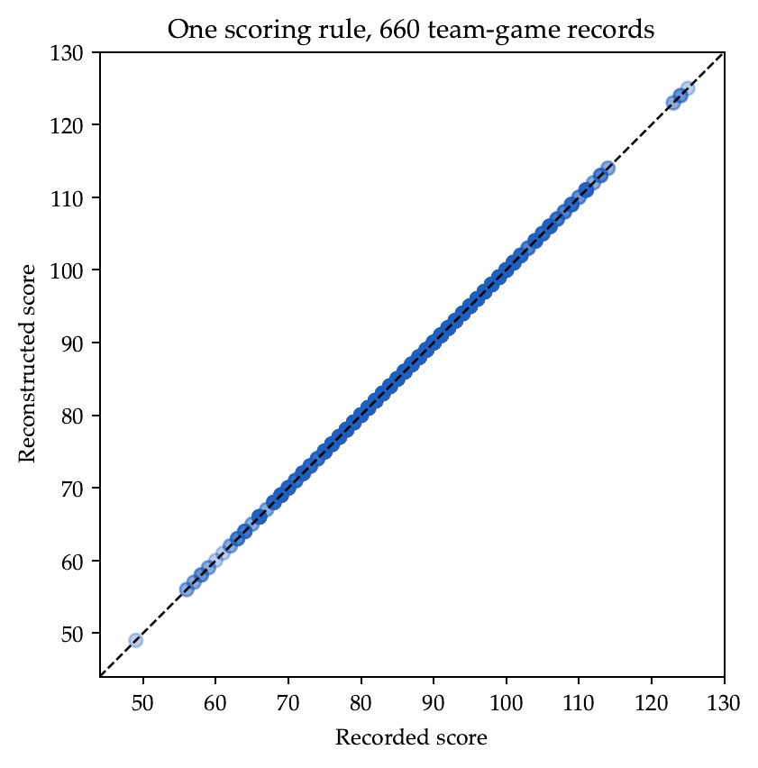



<script>
window.MathJax = {
  tex: {inlineMath: [['$', '$'], ['\\(', '\\)']]},
  options: {ignoreHtmlClass: 'tex2jax_ignore'}
};
</script>
<script src="https://cdn.jsdelivr.net/npm/mathjax@3/es5/tex-mml-chtml.js" async></script>

<style>
.main-content p {
  margin-bottom: 1.15em;
}
.assignment-pdf-button {
  font-size: 0.95rem;
  padding: 0.35rem 0.65rem;
}
.assignment-actions {
  align-items: center;
  display: flex;
  flex-wrap: wrap;
  gap: 0.55rem;
  margin: 0 0 1rem;
}
.assignment-vector-plot {
  max-width: 100%;
  height: auto;
  display: block;
  margin: 1rem auto;
}
.math-display,
mjx-container[jax="CHTML"][display="true"] {
  max-width: 100%;
  overflow-x: auto;
  overflow-y: hidden;
}
.math-display {
  padding-bottom: 0.2rem;
}
.math-display mjx-container[jax="CHTML"][display="true"] {
  padding-bottom: 0.2rem;
}
.answer-blank {
  border-bottom: 1px solid currentColor;
  display: inline-block;
  min-width: 8rem;
  height: 1em;
  vertical-align: baseline;
}
.assignment-parts {
  margin: 1rem 0;
}
.assignment-part {
  align-items: baseline;
  column-gap: 0.55rem;
  display: grid;
  grid-template-columns: 1.4rem minmax(0, 1fr);
  margin-bottom: 1.05rem;
}
.assignment-part-label {
  font-weight: 600;
  text-align: right;
}
.assignment-part-content > :first-child {
  margin-top: 0;
}
.main-content ol.assignment-enumeration {
  padding-left: 0;
  list-style: none;
}
.main-content ol.assignment-enumeration > li {
  display: grid;
  grid-template-columns: 2.5em minmax(0, 1fr);
  align-items: baseline;
  column-gap: 0.5em;
  padding-left: 0;
  margin: 0.8em 0;
}
.main-content ol.assignment-enumeration > li::before {
  content: none;
}
.assignment-enumeration-label {
  text-align: right;
}
.assignment-enumeration-content > :first-child {
  margin-top: 0;
}
.assignment-enumeration-content > :last-child {
  margin-bottom: 0;
}
.mc-options {
  display: flex;
  flex-wrap: wrap;
  gap: 0.9rem 1.6rem;
  margin: 0.9rem 0 1.1rem;
}
.mc-option {
  display: inline-flex;
  align-items: center;
  gap: 0.35rem;
  white-space: nowrap;
}
.mc-bubble,
.mc-square {
  display: inline-block;
  flex: 0 0 auto;
  height: 0.95em;
  width: 0.95em;
  vertical-align: -0.12em;
}
.mc-bubble {
  border: 1.5px solid currentColor;
  border-radius: 50%;
}
.mc-square {
  border: 1.5px solid currentColor;
}
.mc-correct {
  background: currentColor;
}
.main-content table {
  font-size: 0.9rem;
  width: auto;
  max-width: 100%;
}
.main-content table th,
.main-content table td {
  padding: 0.35rem 0.5rem;
  white-space: nowrap;
}
.main-content details table td:last-child {
  white-space: normal;
}
.crossnumber-grid {
  display: grid;
  grid-template-columns: repeat(3, 2.4rem);
  grid-template-rows: repeat(3, 2.4rem);
  margin: 1rem auto;
  width: max-content;
}
.crossnumber-cell {
  align-items: center;
  border: 1.5px solid currentColor;
  display: flex;
  font-size: 1.1rem;
  justify-content: center;
  position: relative;
}
.crossnumber-label {
  font-size: 0.55rem;
  left: 0.15rem;
  line-height: 1;
  position: absolute;
  top: 0.15rem;
}
.crossnumber-missing {
  border: 0;
}
</style>

# Homework 7: Linear Systems

**due** Sunday, November 8th at 11:59PM

<div class="assignment-actions">
<a class="btn btn-info assignment-pdf-button" href="/resources/homeworks/hw07/hw07.pdf" target="_blank">View as PDF ✏️</a>
<a class="btn btn-info assignment-pdf-button" href="/resources/homeworks/hw07/hw07-solutions.pdf" target="_blank">Solutions PDF ✅</a>
<a class="btn btn-info assignment-pdf-button colab-btn" href="https://colab.research.google.com/github/math-124/fa26-code/blob/main/homeworks/hw07/hw07.ipynb" target="_blank"> Google Colab</a>
</div>

{: .yellow }
<div markdown="1">
Write your solutions to the following problems either by writing them on a piece of paper or on a tablet and scanning your answers as a PDF. Note that you are not allowed to use LaTeX, Google Docs, or any other digital document creation software to type your answers. Homeworks are due to Pensive by 11:59PM on the due date. See the [syllabus](https://math124.org/syllabus/#homework) for details on the slip day policy.

Homework will be evaluated not only on the correctness of your answers, but on your ability to present your ideas clearly and logically. You should always explain and justify your conclusions, using sound reasoning. Your goal should be to convince the reader of your assertions. If a question does not require explanation, it will be explicitly stated.

Before proceeding, make sure you're familiar with the [collaboration policy](https://math124.org/syllabus/#collaboration-and-generative-ai-policy).
</div>

---

## Problems

- [Problem 1: Homework 6 Solutions Review](#problem-1-homework-6-solutions-review-6-pts)
- [Problem 2: When a Pivot Goes Missing](#problem-2-when-a-pivot-goes-missing-15-pts)
- [Problem 3: Factoring a Rectangular Matrix](#problem-3-factoring-a-rectangular-matrix-20-pts)
- [Problem 4: Working Backward](#problem-4-working-backward-15-pts)
- [Problem 5: A Plane of Possibilities](#problem-5-a-plane-of-possibilities-26-pts)
- [Problem 6: The Score Adds Up](#problem-6-the-score-adds-up-18-pts)

---

Total Points: <span class="math-inline">\\(6+15+20+15+26+18=100\\)</span>

---

## Problem 1: Homework 6 Solutions Review (6 pts)

Review [the solutions to Homework 6](https://math124.org/resources/homeworks/hw06/). Pick **two problem parts** (for example, Problem 3a and Problem 5b) from Homework 6 in which your solutions have the most room for improvement, i.e., where they have unsound reasoning, could be significantly more efficient or clearer, etc. **Include a screenshot of your solution to each problem part**, and in a few sentences, explain what was deficient and how it could be fixed.

Alternatively, if you think one of your solutions is significantly better than the posted one, copy it here and explain why you think it is better. If you didn't do Homework 6, choose two problem parts from it that look challenging to you, and in a few sentences, explain the key ideas behind their solutions in your own words.

---

## Problem 2: When a Pivot Goes Missing (15 pts)

Let

<div class="math-display">
$$
A=\begin{bmatrix}1&-2&1\\-2&4&0\\3&-6&1\end{bmatrix}.
$$
</div>

<div class="assignment-parts" markdown="1">
<div class="assignment-part" markdown="1">
<div class="assignment-part-label">a)</div>
<div class="assignment-part-content" markdown="1">
(7 pts) Find a factorization <span class="math-inline">\\(A=LU\\)</span>, where <span class="math-inline">\\(L\\)</span> is lower triangular with ones on its diagonal and <span class="math-inline">\\(U\\)</span> is in row echelon form. Identify the pivot columns of <span class="math-inline">\\(U\\)</span>.

<em>Hint: Don't forget about the requirement that <span class="math-inline">\\(U\\)</span> is in row echelon form!</em>

<details markdown="1"><summary>Solution</summary>

We start by writing the entries we need to find explicitly:

<div class="math-display">
$$
\underbrace{\begin{bmatrix}1&-2&1\\-2&4&0\\3&-6&1\end{bmatrix}}_A
=
\underbrace{\begin{bmatrix}1&0&0\\\ell_{21}&1&0\\\ell_{31}&\ell_{32}&1\end{bmatrix}}_L
\underbrace{\begin{bmatrix}u_{11}&u_{12}&u_{13}\\0&u_{22}&u_{23}\\0&0&u_{33}\end{bmatrix}}_U.
$$
</div>

 The zeros below the diagonal of <span class="math-inline">\\(U\\)</span> are required by echelon form. We will also check that its pivots move strictly to the right and that its zero rows come last.

**Step 1: Find the first row of <span class="math-inline">\\(U\\)</span>.** The first row of <span class="math-inline">\\(L\\)</span> is <span class="math-inline">\\(\begin{bmatrix}1&amp;0&amp;0\end{bmatrix}\\)</span>, so the first row of <span class="math-inline">\\(LU\\)</span> is exactly the first row of <span class="math-inline">\\(U\\)</span>. Matching it with the first row of <span class="math-inline">\\(A\\)</span> gives

<div class="math-display">
$$
u_{11}=1,\qquad u_{12}=-2,\qquad u_{13}=1.
$$
</div>

 **Step 2: Find the first column of <span class="math-inline">\\(L\\)</span>.** Matching entries <span class="math-inline">\\((2,1)\\)</span> and <span class="math-inline">\\((3,1)\\)</span> gives

<div class="math-display">
$$
\ell_{21}(1)=-2\ \Longrightarrow\ \ell_{21}=-2,
\qquad
\ell_{31}(1)=3\ \Longrightarrow\ \ell_{31}=3.
$$
</div>

 Our partially completed factorization is now

<div class="math-display">
$$
A=\begin{bmatrix}1&0&0\\-2&1&0\\3&\ell_{32}&1\end{bmatrix}
\begin{bmatrix}1&-2&1\\0&u_{22}&u_{23}\\0&0&u_{33}\end{bmatrix}.
$$
</div>

 **Step 3: Find the second row of <span class="math-inline">\\(U\\)</span>.** The second row of <span class="math-inline">\\(LU\\)</span> is <span class="math-inline">\\(-2\\)</span> times the first row of <span class="math-inline">\\(U\\)</span>, plus the second row of <span class="math-inline">\\(U\\)</span>. Matching entries <span class="math-inline">\\((2,2)\\)</span> and <span class="math-inline">\\((2,3)\\)</span> therefore gives

<div class="math-display">
$$
\begin{aligned}
(-2)(-2)+u_{22}=4&\quad\Longrightarrow\quad u_{22}=0,\\
(-2)(1)+u_{23}=0&\quad\Longrightarrow\quad u_{23}=2.
\end{aligned}
$$
</div>

 The second row is <span class="math-inline">\\(\begin{bmatrix}0&amp;0&amp;2\end{bmatrix}\\)</span>, with its pivot in column 3. There is no column to its right, so echelon form forces the third row to be zero: <span class="math-inline">\\(u&#95;{33}=0\\)</span>.

**Step 4: Find <span class="math-inline">\\(\ell&#95;{32}\\)</span> using the pivot in column 3.** First check the skipped column 2: entry <span class="math-inline">\\((3,2)\\)</span> gives <span class="math-inline">\\(3(-2)+\ell&#95;{32}(0)=-6\\)</span>, which already holds. It does not determine <span class="math-inline">\\(\ell&#95;{32}\\)</span>. Entry <span class="math-inline">\\((3,3)\\)</span> gives

<div class="math-display">
$$
3(1)+\ell_{32}(2)+0=1
\quad\Longrightarrow\quad \ell_{32}=-1.
$$
</div>

 Thus

<div class="math-display">
$$
\boxed{A=\underbrace{\begin{bmatrix}1&0&0\\-2&1&0\\3&-1&1\end{bmatrix}}_L
\underbrace{\begin{bmatrix}1&-2&1\\0&0&2\\0&0&0\end{bmatrix}}_U.}
$$
</div>

 Multiplication verifies the last two rows: they are <span class="math-inline">\\(\begin{bmatrix}-2&amp;4&amp;-2+2\end{bmatrix}\\)</span> and <span class="math-inline">\\(\begin{bmatrix}3&amp;-6&amp;3-2\end{bmatrix}\\)</span>, exactly as in <span class="math-inline">\\(A\\)</span>. The pivot columns of <span class="math-inline">\\(U\\)</span> are **1 and 3**.
</details>

</div>
</div>

<div class="assignment-part" markdown="1">
<div class="assignment-part-label">b)</div>
<div class="assignment-part-content" markdown="1">
(8 pts) Use your factors to find all solutions of each system:

<div class="math-display">
$$
A\vec x=\begin{bmatrix}3\\-2\\5\end{bmatrix},\qquad
A\vec x=\begin{bmatrix}3\\-2\\6\end{bmatrix}.
$$
</div>

 If there are infinitely many solutions, give a vector-parametric description of the solution set. If there is no solution, explain why.

<details markdown="1"><summary>Solution</summary>

Once we know <span class="math-inline">\\(A=LU\\)</span>, the system <span class="math-inline">\\(A\vec x=\vec b\\)</span> becomes

<div class="math-display">
$$
L(U\vec x)=\vec b.
$$
</div>

 Introduce the intermediate vector <span class="math-inline">\\(\vec y=U\vec x\\)</span>. We can now solve two simpler systems in order:

<div class="math-display">
$$
\text{First solve }L\vec y=\vec b,\qquad\text{then solve }U\vec x=\vec y.
$$
</div>

 **First system: <span class="math-inline">\\(\vec b=\begin{bmatrix}3\\\\-2\\\\5\end{bmatrix}\\)</span>.**

**Step 1: Solve for <span class="math-inline">\\(\vec y\\)</span> by forward substitution.** Using the factors from part a), write

<div class="math-display">
$$
\begin{bmatrix}1&0&0\\-2&1&0\\3&-1&1\end{bmatrix}
\begin{bmatrix}y_1\\y_2\\y_3\end{bmatrix}
=\begin{bmatrix}3\\-2\\5\end{bmatrix}.
$$
</div>

 Read the equations from top to bottom:

<div class="math-display">
$$
\begin{aligned}
y_1&=3,\\
-2y_1+y_2=-2&\quad\Longrightarrow\quad -6+y_2=-2
\quad\Longrightarrow\quad y_2=4,\\
3y_1-y_2+y_3=5&\quad\Longrightarrow\quad 9-4+y_3=5
\quad\Longrightarrow\quad y_3=0.
\end{aligned}
$$
</div>

 Thus <span class="math-inline">\\(\vec y=\begin{bmatrix}3\\\\4\\\\0\end{bmatrix}\\)</span>. This is the intermediate vector, not yet the solution <span class="math-inline">\\(\vec x\\)</span>.

**Step 2: Solve for <span class="math-inline">\\(\vec x\\)</span> in <span class="math-inline">\\(U\vec x=\vec y\\)</span> using back substitution.** The second system is

<div class="math-display">
$$
\begin{bmatrix}1&-2&1\\0&0&2\\0&0&0\end{bmatrix}
\begin{bmatrix}x_1\\x_2\\x_3\end{bmatrix}
=\begin{bmatrix}3\\4\\0\end{bmatrix},
$$
</div>

 which gives

<div class="math-display">
$$
x_1-2x_2+x_3=3,\qquad 2x_3=4,\qquad 0=0.
$$
</div>

 The zero row gives a true equation, so the system is consistent. The pivot columns are 1 and 3, so <span class="math-inline">\\(x&#95;1,x&#95;3\\)</span> are pivot variables and <span class="math-inline">\\(x&#95;2\\)</span> is free. Set <span class="math-inline">\\(x&#95;2=t\\)</span>, where <span class="math-inline">\\(t\\)</span> can be any real number. Starting with the last nonzero equation gives

<div class="math-display">
$$
2x_3=4\quad\Longrightarrow\quad x_3=2.
$$
</div>

 Substitute <span class="math-inline">\\(x&#95;2=t\\)</span> and <span class="math-inline">\\(x&#95;3=2\\)</span> into the first equation:

<div class="math-display">
$$
x_1-2t+2=3\quad\Longrightarrow\quad x_1=1+2t.
$$
</div>

 Therefore

<div class="math-display">
$$
\boxed{\vec x=\begin{bmatrix}1+2t\\t\\2\end{bmatrix}
=\begin{bmatrix}1\\0\\2\end{bmatrix}
+t\begin{bmatrix}2\\1\\0\end{bmatrix},\qquad t\in\mathbb R.}
$$
</div>

 There are infinitely many solutions <span class="math-inline">\\(\vec x\\)</span>, one for each value of <span class="math-inline">\\(t\in\mathbb{R}\\)</span>.

**Second system: <span class="math-inline">\\(\vec b=\begin{bmatrix}3\\\\-2\\\\6\end{bmatrix}\\)</span>.** The coefficient matrix has not changed, so we reuse the same <span class="math-inline">\\(L\\)</span> and <span class="math-inline">\\(U\\)</span>. Only the right-hand side in the first triangular solve changes:

<div class="math-display">
$$
\begin{bmatrix}1&0&0\\-2&1&0\\3&-1&1\end{bmatrix}
\begin{bmatrix}y_1\\y_2\\y_3\end{bmatrix}
=\begin{bmatrix}3\\-2\\6\end{bmatrix}.
$$
</div>

 The first two equations are unchanged, giving <span class="math-inline">\\(y&#95;1=3\\)</span> and <span class="math-inline">\\(y&#95;2=4\\)</span>. The last equation now gives

<div class="math-display">
$$
3(3)-4+y_3=6\quad\Longrightarrow\quad y_3=1.
$$
</div>

 Thus the second triangular solve would have to satisfy

<div class="math-display">
$$
\begin{bmatrix}1&-2&1\\0&0&2\\0&0&0\end{bmatrix}
\begin{bmatrix}x_1\\x_2\\x_3\end{bmatrix}
=\begin{bmatrix}3\\4\\1\end{bmatrix}.
$$
</div>

 Its last row says <span class="math-inline">\\(0=1\\)</span>, which is impossible. No choices of <span class="math-inline">\\(x&#95;1,x&#95;2,x&#95;3\\)</span> can satisfy this equation, even though column 2 has no pivot. Therefore the second system has **no solution**.
</details>

</div>
</div>

</div>

---

## Problem 3: Factoring a Rectangular Matrix (20 pts)

Let

<div class="math-display">
$$
B=\begin{bmatrix}2&-2&1&3\\6&-6&3&9\\-2&2&3&1\end{bmatrix}.
$$
</div>

<div class="assignment-parts" markdown="1">
<div class="assignment-part" markdown="1">
<div class="assignment-part-label">a)</div>
<div class="assignment-part-content" markdown="1">
(5 pts) Attempt to find a factorization <span class="math-inline">\\(B=LU\\)</span> without reordering the rows, where <span class="math-inline">\\(L\\)</span> has ones on its diagonal and <span class="math-inline">\\(U\\)</span> is in row echelon form. Explain why a row exchange is necessary.

<details markdown="1"><summary>Solution</summary>

Without changing the row order, the required shapes give

<div class="math-display">
$$
\underbrace{\begin{bmatrix}2&-2&1&3\\6&-6&3&9\\-2&2&3&1\end{bmatrix}}_B
=\underbrace{\begin{bmatrix}1&0&0\\\ell_{21}&1&0\\\ell_{31}&\ell_{32}&1\end{bmatrix}}_L
\underbrace{\begin{bmatrix}u_{11}&u_{12}&u_{13}&u_{14}\\0&u_{22}&u_{23}&u_{24}\\0&0&u_{33}&u_{34}\end{bmatrix}}_U.
$$
</div>

**First row and first column.** The first row of <span class="math-inline">\\(LU\\)</span> equals the first row of <span class="math-inline">\\(U\\)</span>, so it must be <span class="math-inline">\\(\begin{bmatrix}2&amp;-2&amp;1&amp;3\end{bmatrix}\\)</span>. Matching the first column then gives

<div class="math-display">
$$
2\ell_{21}=6\ \Longrightarrow\ \ell_{21}=3,
\qquad 2\ell_{31}=-2\ \Longrightarrow\ \ell_{31}=-1.
$$
</div>

 **Second row.** Match the remaining entries of row 2:

<div class="math-display">
$$
\begin{aligned}
3(-2)+u_{22}=-6&\quad\Longrightarrow\quad u_{22}=0,\\
3(1)+u_{23}=3&\quad\Longrightarrow\quad u_{23}=0,\\
3(3)+u_{24}=9&\quad\Longrightarrow\quad u_{24}=0.
\end{aligned}
$$
</div>

 Thus row 2 of <span class="math-inline">\\(U\\)</span> is entirely zero. Echelon form requires every row below it to be zero too, forcing <span class="math-inline">\\(u&#95;{33}=u&#95;{34}=0\\)</span>. The only possible product would therefore have the form

<div class="math-display">
$$
LU=\begin{bmatrix}1&0&0\\3&1&0\\-1&\ell_{32}&1\end{bmatrix}
\begin{bmatrix}2&-2&1&3\\0&0&0&0\\0&0&0&0\end{bmatrix}.
$$
</div>

 Its third row is <span class="math-inline">\\(\begin{bmatrix}-2&amp;2&amp;-1&amp;-3\end{bmatrix}\\)</span>, whereas the third row of <span class="math-inline">\\(B\\)</span> is <span class="math-inline">\\(\begin{bmatrix}-2&amp;2&amp;3&amp;1\end{bmatrix}\\)</span>. No value of <span class="math-inline">\\(\ell&#95;{32}\\)</span> can fix this, because it multiplies a zero row of <span class="math-inline">\\(U\\)</span>. Hence **a row exchange is necessary**.
</details>

</div>
</div>

<div class="assignment-part" markdown="1">
<div class="assignment-part-label">b)</div>
<div class="assignment-part-content" markdown="1">
(8 pts) Find a permutation matrix <span class="math-inline">\\(P\\)</span> and factors <span class="math-inline">\\(L,U\\)</span> such that <span class="math-inline">\\(PB=LU\\)</span>, with <span class="math-inline">\\(L\\)</span> square and lower triangular with ones on its diagonal and <span class="math-inline">\\(U\\)</span> in row echelon form. Identify the pivot columns of <span class="math-inline">\\(U\\)</span>, and verify your factorization by multiplying <span class="math-inline">\\(LU\\)</span> and showing it is equal to <span class="math-inline">\\(PB\\)</span>.

<details markdown="1"><summary>Solution</summary>

Swap rows 2 and 3 using

<div class="math-display">
$$
P=\begin{bmatrix}1&0&0\\0&0&1\\0&1&0\end{bmatrix}.
$$
</div>

 We now match entries in

<div class="math-display">
$$
\underbrace{\begin{bmatrix}2&-2&1&3\\-2&2&3&1\\6&-6&3&9\end{bmatrix}}_{PB}
=\underbrace{\begin{bmatrix}1&0&0\\\ell_{21}&1&0\\\ell_{31}&\ell_{32}&1\end{bmatrix}}_L
\underbrace{\begin{bmatrix}u_{11}&u_{12}&u_{13}&u_{14}\\0&u_{22}&u_{23}&u_{24}\\0&0&u_{33}&u_{34}\end{bmatrix}}_U.
$$
</div>

 **Step 1: First row of <span class="math-inline">\\(U\\)</span>, then first column of <span class="math-inline">\\(L\\)</span>.** The first row of <span class="math-inline">\\(U\\)</span> is <span class="math-inline">\\(\begin{bmatrix}2&amp;-2&amp;1&amp;3\end{bmatrix}\\)</span>. The first column gives

<div class="math-display">
$$
2\ell_{21}=-2\ \Longrightarrow\ \ell_{21}=-1,
\qquad 2\ell_{31}=6\ \Longrightarrow\ \ell_{31}=3.
$$
</div>

 **Step 2: Second row of <span class="math-inline">\\(U\\)</span>.** Matching row 2 gives

<div class="math-display">
$$
\begin{aligned}
(-1)(-2)+u_{22}=2&\quad\Longrightarrow\quad u_{22}=0,\\
(-1)(1)+u_{23}=3&\quad\Longrightarrow\quad u_{23}=4,\\
(-1)(3)+u_{24}=1&\quad\Longrightarrow\quad u_{24}=4.
\end{aligned}
$$
</div>

 The second pivot is in column 3. The next pivot, if any, must be to its right, so <span class="math-inline">\\(u&#95;{33}=0\\)</span>. At this stage,

<div class="math-display">
$$
PB=\begin{bmatrix}1&0&0\\-1&1&0\\3&\ell_{32}&1\end{bmatrix}
\begin{bmatrix}2&-2&1&3\\0&0&4&4\\0&0&0&u_{34}\end{bmatrix}.
$$
</div>

 **Step 3: Second column of <span class="math-inline">\\(L\\)</span>, then the last entry of <span class="math-inline">\\(U\\)</span>.** The skipped column 2 checks: <span class="math-inline">\\(3(-2)+\ell&#95;{32}(0)=-6\\)</span>. Use the pivot in column 3 to find <span class="math-inline">\\(\ell&#95;{32}\\)</span>, then match column 4:

<div class="math-display">
$$
\begin{aligned}
3(1)+4\ell_{32}=3&\quad\Longrightarrow\quad\ell_{32}=0,\\
3(3)+0(4)+u_{34}=9&\quad\Longrightarrow\quad u_{34}=0.
\end{aligned}
$$
</div>

 Therefore

<div class="math-display">
$$
\boxed{PB=\underbrace{\begin{bmatrix}1&0&0\\-1&1&0\\3&0&1\end{bmatrix}}_L
\underbrace{\begin{bmatrix}2&-2&1&3\\0&0&4&4\\0&0&0&0\end{bmatrix}}_U.}
$$
</div>

 Verification by multiplication gives

<div class="math-display">
$$
LU=\begin{bmatrix}2&-2&1&3\\-2&2&-1+4&-3+4\\6&-6&3&9\end{bmatrix}
=PB.
$$
</div>

 The pivot columns of <span class="math-inline">\\(U\\)</span> are **1 and 3**.
</details>

</div>
</div>

<div class="assignment-part" markdown="1">
<div class="assignment-part-label">c)</div>
<div class="assignment-part-content" markdown="1">
(7 pts) Use your factors to find all solutions of

<div class="math-display">
$$
B\vec x=\begin{bmatrix}6\\18\\2\end{bmatrix}.
$$
</div>

 Give a vector-parametric description of the solution set.

<details markdown="1"><summary>Solution</summary>

First reorder the right-hand side:

<div class="math-display">
$$
P\vec b=\begin{bmatrix}6\\2\\18\end{bmatrix}.
$$
</div>

 Forward substitution gives <span class="math-inline">\\(y&#95;1=6\\)</span>, <span class="math-inline">\\(-y&#95;1+y&#95;2=2\\)</span>, and <span class="math-inline">\\(3y&#95;1+y&#95;3=18\\)</span>, so <span class="math-inline">\\(\vec y=\begin{bmatrix}6\\\\8\\\\0\end{bmatrix}\\)</span>. The remaining equations are

<div class="math-display">
$$
2x_1-2x_2+x_3+3x_4=6,\qquad4x_3+4x_4=8,\qquad0=0.
$$
</div>

 The free variables are <span class="math-inline">\\(x&#95;2\\)</span> and <span class="math-inline">\\(x&#95;4\\)</span>. Set <span class="math-inline">\\(x&#95;2=s\\)</span>, <span class="math-inline">\\(x&#95;4=t\\)</span>. Then <span class="math-inline">\\(x&#95;3=2-t\\)</span> and <span class="math-inline">\\(x&#95;1=2+s-t\\)</span>, giving

<div class="math-display">
$$
\boxed{\vec x=\begin{bmatrix}2\\0\\2\\0\end{bmatrix}
+s\begin{bmatrix}1\\1\\0\\0\end{bmatrix}
+t\begin{bmatrix}-1\\0\\-1\\1\end{bmatrix},\qquad s,t\in\mathbb R.}
$$
</div>

 The zero row is consistent, and each choice of <span class="math-inline">\\(s,t\\)</span> uniquely determines the pivot variables, so these are all solutions.
</details>

</div>
</div>

</div>

---

## Problem 4: Working Backward (15 pts)

For each part, give a matrix <span class="math-inline">\\(U\\)</span> in row echelon form and a vector <span class="math-inline">\\(\vec y\\)</span> such that the system <span class="math-inline">\\(U\vec x=\vec y\\)</span> has the stated properties. Write your system as a matrix equation, and give a vector-parametric description of the solution set, or explain why it has no solution. Each part may use a different matrix.

<div class="assignment-parts" markdown="1">
<div class="assignment-part" markdown="1">
<div class="assignment-part-label">a)</div>
<div class="assignment-part-content" markdown="1">
(3 pts)
<span class="math-inline">\\(U\\)</span> is <span class="math-inline">\\(3\times3\\)</span>, and the system has a unique solution.

<details markdown="1"><summary>Solution</summary>

One example is

<div class="math-display">
$$
\begin{bmatrix}1&0&0\\0&1&0\\0&0&1\end{bmatrix}
\begin{bmatrix}x_1\\x_2\\x_3\end{bmatrix}
=\begin{bmatrix}1\\2\\3\end{bmatrix}.
$$
</div>

 Every variable is a pivot variable, and the unique solution is <span class="math-inline">\\(\vec x=\begin{bmatrix}1\\\\2\\\\3\end{bmatrix}\\)</span>.
</details>

</div>
</div>

<div class="assignment-part" markdown="1">
<div class="assignment-part-label">b)</div>
<div class="assignment-part-content" markdown="1">
(3 pts)
<span class="math-inline">\\(U\\)</span> is <span class="math-inline">\\(3\times3\\)</span>, and the solution set is a line in <span class="math-inline">\\(\mathbb R^3\\)</span> that does not pass through the origin.

<details markdown="1"><summary>Solution</summary>

One example is

<div class="math-display">
$$
\begin{bmatrix}1&0&0\\0&1&0\\0&0&0\end{bmatrix}
\begin{bmatrix}x_1\\x_2\\x_3\end{bmatrix}
=\begin{bmatrix}1\\0\\0\end{bmatrix}.
$$
</div>

 The equations fix <span class="math-inline">\\(x&#95;1=1\\)</span>, <span class="math-inline">\\(x&#95;2=0\\)</span>, while <span class="math-inline">\\(x&#95;3=t\\)</span> is free:

<div class="math-display">
$$
\vec x=\begin{bmatrix}1\\0\\0\end{bmatrix}
+t\begin{bmatrix}0\\0\\1\end{bmatrix},\qquad t\in\mathbb R.
$$
</div>

 This is a line in <span class="math-inline">\\(\mathbb R^3\\)</span>. It does not contain the origin because every solution has first coordinate <span class="math-inline">\\(1\\)</span>.
</details>

</div>
</div>

<div class="assignment-part" markdown="1">
<div class="assignment-part-label">c)</div>
<div class="assignment-part-content" markdown="1">
(3 pts)
<span class="math-inline">\\(U\\)</span> is <span class="math-inline">\\(3\times4\\)</span>, and the solution set is a plane through the origin in <span class="math-inline">\\(\mathbb R^4\\)</span>.

<details markdown="1"><summary>Solution</summary>

One example is

<div class="math-display">
$$
\begin{bmatrix}1&0&0&0\\0&1&0&0\\0&0&0&0\end{bmatrix}
\begin{bmatrix}x_1\\x_2\\x_3\\x_4\end{bmatrix}
=\begin{bmatrix}0\\0\\0\end{bmatrix}.
$$
</div>

 Here <span class="math-inline">\\(x&#95;1=x&#95;2=0\\)</span>, while <span class="math-inline">\\(x&#95;3=s\\)</span> and <span class="math-inline">\\(x&#95;4=t\\)</span> can be chosen freely:

<div class="math-display">
$$
\vec x=s\begin{bmatrix}0\\0\\1\\0\end{bmatrix}
+t\begin{bmatrix}0\\0\\0\\1\end{bmatrix},\qquad s,t\in\mathbb R.
$$
</div>

 The two parameters vary the third and fourth coordinates independently, giving a plane in <span class="math-inline">\\(\mathbb R^4\\)</span>. Taking <span class="math-inline">\\(s=t=0\\)</span> gives the origin.
</details>

</div>
</div>

<div class="assignment-part" markdown="1">
<div class="assignment-part-label">d)</div>
<div class="assignment-part-content" markdown="1">
(3 pts)
<span class="math-inline">\\(U\\)</span> is <span class="math-inline">\\(4\times3\\)</span>, and the system has no solution.

<details markdown="1"><summary>Solution</summary>

One example is

<div class="math-display">
$$
\begin{bmatrix}1&0&0\\0&1&0\\0&0&1\\0&0&0\end{bmatrix}
\begin{bmatrix}x_1\\x_2\\x_3\end{bmatrix}
=\begin{bmatrix}0\\0\\0\\1\end{bmatrix}.
$$
</div>

 The fourth equation is <span class="math-inline">\\(0=1\\)</span>, so there is no solution.
</details>

</div>
</div>

<div class="assignment-part" markdown="1">
<div class="assignment-part-label">e)</div>
<div class="assignment-part-content" markdown="1">
(3 pts)
<span class="math-inline">\\(U\\)</span> is <span class="math-inline">\\(4\times2\\)</span>, and the system has a unique solution.

<details markdown="1"><summary>Solution</summary>

One example is

<div class="math-display">
$$
\begin{bmatrix}1&0\\0&1\\0&0\\0&0\end{bmatrix}
\begin{bmatrix}x_1\\x_2\end{bmatrix}
=\begin{bmatrix}2\\3\\0\\0\end{bmatrix}.
$$
</div>

 Both zero rows give <span class="math-inline">\\(0=0\\)</span>, so the system is consistent. Both columns have pivots, so there are no free variables. The unique solution is <span class="math-inline">\\(\vec x=\begin{bmatrix}2\\\\3\end{bmatrix}\\)</span>.
</details>

</div>
</div>

</div>

---

## Problem 5: A Plane of Possibilities (26 pts)

Suppose <span class="math-inline">\\(\vec v=\begin{bmatrix}1\\\\1\\\\1\end{bmatrix}\\)</span> and <span class="math-inline">\\(\vec w=\begin{bmatrix}1\\\\2\\\\3\end{bmatrix}\\)</span>, and let <span class="math-inline">\\(C\\)</span> be the <span class="math-inline">\\(3\times2\\)</span> matrix whose columns are <span class="math-inline">\\(\vec v\\)</span> and <span class="math-inline">\\(\vec w\\)</span>:

<div class="math-display">
$$
C=\begin{bmatrix}|&|\\\vec v&\vec w\\|&|\end{bmatrix}
=\begin{bmatrix}1&1\\1&2\\1&3\end{bmatrix}.
$$
</div>

 A possible output of a matrix is any vector that can be produced by multiplying that matrix by a vector. For example, <span class="math-inline">\\(\begin{bmatrix}5\\\\9\\\\13\end{bmatrix}\\)</span> is a possible output of <span class="math-inline">\\(C\\)</span>, since

<div class="math-display">
$$
\begin{bmatrix}5\\9\\13\end{bmatrix}=C\begin{bmatrix}1\\4\end{bmatrix}.
$$
</div>

<div class="assignment-parts" markdown="1">
<div class="assignment-part" markdown="1">
<div class="assignment-part-label">a)</div>
<div class="assignment-part-content" markdown="1">
(4 pts) Find a factorization <span class="math-inline">\\(C=LU\\)</span>, where <span class="math-inline">\\(L\\)</span> is square and lower triangular with ones on its diagonal and <span class="math-inline">\\(U\\)</span> is in row echelon form.

<details markdown="1"><summary>Solution</summary>

Here <span class="math-inline">\\(C\\)</span> has shape <span class="math-inline">\\(3\times2\\)</span>, so <span class="math-inline">\\(L\\)</span> must be <span class="math-inline">\\(3\times3\\)</span> and <span class="math-inline">\\(U\\)</span> must be <span class="math-inline">\\(3\times2\\)</span>. An echelon matrix with only two columns can have at most two nonzero rows, so its third row must be zero. Start with

<div class="math-display">
$$
\underbrace{\begin{bmatrix}1&1\\1&2\\1&3\end{bmatrix}}_C
=\underbrace{\begin{bmatrix}1&0&0\\\ell_{21}&1&0\\\ell_{31}&\ell_{32}&1\end{bmatrix}}_L
\underbrace{\begin{bmatrix}u_{11}&u_{12}\\0&u_{22}\\0&0\end{bmatrix}}_U.
$$
</div>

 **Step 1: First row of <span class="math-inline">\\(U\\)</span>.** Matching the first row gives <span class="math-inline">\\(u&#95;{11}=1\\)</span> and <span class="math-inline">\\(u&#95;{12}=1\\)</span>.

**Step 2: First column of <span class="math-inline">\\(L\\)</span>.** Matching the first column gives

<div class="math-display">
$$
\ell_{21}(1)=1\ \Longrightarrow\ \ell_{21}=1,
\qquad \ell_{31}(1)=1\ \Longrightarrow\ \ell_{31}=1.
$$
</div>

 We have now determined

<div class="math-display">
$$
C=\begin{bmatrix}1&0&0\\1&1&0\\1&\ell_{32}&1\end{bmatrix}
\begin{bmatrix}1&1\\0&u_{22}\\0&0\end{bmatrix}.
$$
</div>

 **Step 3: Second row of <span class="math-inline">\\(U\\)</span>.** Entry <span class="math-inline">\\((2,2)\\)</span> gives

<div class="math-display">
$$
1(1)+u_{22}=2\quad\Longrightarrow\quad u_{22}=1.
$$
</div>

 **Step 4: Second column of <span class="math-inline">\\(L\\)</span>.** Entry <span class="math-inline">\\((3,2)\\)</span> gives

<div class="math-display">
$$
1(1)+\ell_{32}(1)+0=3\quad\Longrightarrow\quad\ell_{32}=2.
$$
</div>

 Thus

<div class="math-display">
$$
\boxed{C=\underbrace{\begin{bmatrix}1&0&0\\1&1&0\\1&2&1\end{bmatrix}}_L
\underbrace{\begin{bmatrix}1&1\\0&1\\0&0\end{bmatrix}}_U.}
$$
</div>

 The product is <span class="math-inline">\\(LU=\begin{bmatrix}1&amp;1\\\\1&amp;1+1\\\\1&amp;1+2\end{bmatrix}=C\\)</span>. The two nonzero rows of <span class="math-inline">\\(U\\)</span> have pivots in columns 1 and 2, and its zero row comes last, as required.
</details>

</div>
</div>

<div class="assignment-part" markdown="1">
<div class="assignment-part-label">b)</div>
<div class="assignment-part-content" markdown="1">
(6 pts) What are all possible outputs of <span class="math-inline">\\(C\\)</span>? Using your factorization <span class="math-inline">\\(C=LU\\)</span>, determine the conditions on <span class="math-inline">\\(x\\)</span>, <span class="math-inline">\\(y\\)</span>, and <span class="math-inline">\\(z\\)</span> such that

<div class="math-display">
$$
C\vec u=\begin{bmatrix}x\\y\\z\end{bmatrix}
$$
</div>

 has a solution <span class="math-inline">\\(\vec u\\)</span>. The condition you find should be a single equation involving <span class="math-inline">\\(x\\)</span>, <span class="math-inline">\\(y\\)</span>, and <span class="math-inline">\\(z\\)</span>.

<details markdown="1"><summary>Solution</summary>

From part a), the factors in <span class="math-inline">\\(C=LU\\)</span> are

<div class="math-display">
$$
L=\begin{bmatrix}1&0&0\\1&1&0\\1&2&1\end{bmatrix},\qquad
U=\begin{bmatrix}1&1\\0&1\\0&0\end{bmatrix}.
$$
</div>

 To solve <span class="math-inline">\\(C\vec u=\begin{bmatrix}x\\\\y\\\\z\end{bmatrix}\\)</span>, first solve <span class="math-inline">\\(L\vec t=\begin{bmatrix}x\\\\y\\\\z\end{bmatrix}\\)</span>:

<div class="math-display">
$$
\begin{bmatrix}1&0&0\\1&1&0\\1&2&1\end{bmatrix}
\begin{bmatrix}t_1\\t_2\\t_3\end{bmatrix}
=\begin{bmatrix}x\\y\\z\end{bmatrix}.
$$
</div>

 Forward substitution gives

<div class="math-display">
$$
\begin{aligned}
t_1&=x,\\
t_1+t_2=y&\quad\Longrightarrow\quad t_2=y-x,\\
t_1+2t_2+t_3=z&\quad\Longrightarrow\quad
x+2(y-x)+t_3=z\\
&\quad\Longrightarrow\quad t_3=z+x-2y.
\end{aligned}
$$
</div>

 Thus <span class="math-inline">\\(\vec t=\begin{bmatrix}x\\\\y-x\\\\z+x-2y\end{bmatrix}\\)</span>. Next, solve <span class="math-inline">\\(U\vec u=\vec t\\)</span>:

<div class="math-display">
$$
\begin{bmatrix}1&1\\0&1\\0&0\end{bmatrix}
\begin{bmatrix}u_1\\u_2\end{bmatrix}
=\begin{bmatrix}x\\y-x\\z+x-2y\end{bmatrix}.
$$
</div>

 The equations are

<div class="math-display">
$$
u_1+u_2=x,\qquad u_2=y-x,\qquad 0=z+x-2y.
$$
</div>

 The last equation can hold only if <span class="math-inline">\\(z+x-2y=0\\)</span>. When it does, the second equation determines <span class="math-inline">\\(u&#95;2\\)</span>, and the first determines <span class="math-inline">\\(u&#95;1\\)</span>. Therefore the system is consistent exactly when

<div class="math-display">
$$
\boxed{x-2y+z=0.}
$$
</div>

</details>

</div>
</div>

<div class="assignment-part" markdown="1">
<div class="assignment-part-label">c)</div>
<div class="assignment-part-content" markdown="1">
(4 pts) Under the condition you found in part b), find the solution for the vector <span class="math-inline">\\(\vec u\in\mathbb R^2\\)</span> in terms of <span class="math-inline">\\(x\\)</span>, <span class="math-inline">\\(y\\)</span>, and <span class="math-inline">\\(z\\)</span>. Is the solution unique?

<details markdown="1"><summary>Solution</summary>

Suppose <span class="math-inline">\\(x-2y+z=0\\)</span>. Part b) then gives <span class="math-inline">\\(\vec t=\begin{bmatrix}x\\\\y-x\\\\0\end{bmatrix}\\)</span>. Using <span class="math-inline">\\(U\\)</span> from part a), solve <span class="math-inline">\\(U\vec u=\vec t\\)</span>:

<div class="math-display">
$$
\begin{bmatrix}1&1\\0&1\\0&0\end{bmatrix}
\begin{bmatrix}u_1\\u_2\end{bmatrix}
=\begin{bmatrix}x\\y-x\\0\end{bmatrix}.
$$
</div>

 The last row gives <span class="math-inline">\\(0=0\\)</span>. The second row gives <span class="math-inline">\\(u&#95;2=y-x\\)</span>. Substitute this into the first row:

<div class="math-display">
$$
u_1+u_2=x\quad\Longrightarrow\quad u_1+(y-x)=x
\quad\Longrightarrow\quad u_1=2x-y.
$$
</div>

 Thus

<div class="math-display">
$$
\boxed{\vec u=\begin{bmatrix}2x-y\\y-x\end{bmatrix}.}
$$
</div>

 Both columns of <span class="math-inline">\\(U\\)</span> have pivots, so there are no free variables: the solution is unique whenever it exists.
</details>

</div>
</div>

<div class="assignment-part" markdown="1">
<div class="assignment-part-label">d)</div>
<div class="assignment-part-content" markdown="1">
(8 pts) Using your understanding of geometry and span from earlier in the semester, find the equation of the plane spanned by <span class="math-inline">\\(\vec v\\)</span> and <span class="math-inline">\\(\vec w\\)</span>. Why do you get the same answer as in part b)?

<details markdown="1"><summary>Solution</summary>

The combinations are

<div class="math-display">
$$
s\vec v+t\vec w
=s\begin{bmatrix}1\\1\\1\end{bmatrix}
+t\begin{bmatrix}1\\2\\3\end{bmatrix}
=\begin{bmatrix}s+t\\s+2t\\s+3t\end{bmatrix}.
$$
</div>

 Their coordinates satisfy <span class="math-inline">\\((s+t)-2(s+2t)+(s+3t)=0\\)</span>. Conversely, if <span class="math-inline">\\(\begin{bmatrix}x\\\\y\\\\z\end{bmatrix}\\)</span> satisfies <span class="math-inline">\\(x-2y+z=0\\)</span>, choose <span class="math-inline">\\(s=2x-y\\)</span> and <span class="math-inline">\\(t=y-x\\)</span>. Then

<div class="math-display">
$$
s\vec v+t\vec w=\begin{bmatrix}x\\y\\2y-x\end{bmatrix}
=\begin{bmatrix}x\\y\\z\end{bmatrix}.
$$
</div>

 Thus the set is exactly the plane <span class="math-inline">\\(x-2y+z=0\\)</span> through the origin in <span class="math-inline">\\(\mathbb R^3\\)</span>, with normal vector <span class="math-inline">\\(\begin{bmatrix}1\\\\-2\\\\1\end{bmatrix}\\)</span>.
</details>

</div>
</div>

<div class="assignment-part" markdown="1">
<div class="assignment-part-label">e)</div>
<div class="assignment-part-content" markdown="1">
(4 pts) Consider the matrix

<div class="math-display">
$$
F=\begin{bmatrix}|&|&|\\\vec v&\vec w&\vec v+\vec w\\|&|&|\end{bmatrix}
=\begin{bmatrix}1&1&2\\1&2&3\\1&3&4\end{bmatrix}.
$$
</div>

 Does <span class="math-inline">\\(F\\)</span> have the same possible outputs as <span class="math-inline">\\(C\\)</span>? Explain. Then, find two different inputs that <span class="math-inline">\\(F\\)</span> sends to

<div class="math-display">
$$
2\vec v+3\vec w=\begin{bmatrix}5\\8\\11\end{bmatrix}.
$$
</div>

<details markdown="1"><summary>Solution</summary>

Yes. For any input <span class="math-inline">\\(\begin{bmatrix}a\\\\b\\\\c\end{bmatrix}\\)</span>,

<div class="math-display">
$$
F\begin{bmatrix}a\\b\\c\end{bmatrix}
=a\vec v+b\vec w+c(\vec v+\vec w)
=(a+c)\vec v+(b+c)\vec w
=C\begin{bmatrix}a+c\\b+c\end{bmatrix}.
$$
</div>

 So every output of <span class="math-inline">\\(F\\)</span> is an output of <span class="math-inline">\\(C\\)</span>. Conversely, <span class="math-inline">\\(C\begin{bmatrix}s\\\\t\end{bmatrix}=F\begin{bmatrix}s\\\\t\\\\0\end{bmatrix}\\)</span>, so every output of <span class="math-inline">\\(C\\)</span> is an output of <span class="math-inline">\\(F\\)</span>. Two different inputs producing <span class="math-inline">\\(2\vec v+3\vec w=\begin{bmatrix}5\\\\8\\\\11\end{bmatrix}\\)</span> are

<div class="math-display">
$$
\boxed{\begin{bmatrix}2\\3\\0\end{bmatrix}\quad\text{and}\quad
\begin{bmatrix}1\\2\\1\end{bmatrix}.}
$$
</div>

</details>

</div>
</div>

</div>

---

## Problem 6: The Score Adds Up (18 pts)

Before proceeding, open the supplemental Jupyter Notebook. To open the notebook for Homework 7, click [**this link**](https://colab.research.google.com/github/math-124/fa26-code/blob/main/homeworks/hw07/hw07.ipynb). Instructions on how to use Google Colab are at [math124.org/running-code](https://math124.org/running-code).

Complete Problem 6 in the notebook. Tasks 1--8 are worth <span class="math-inline">\\(1+1+2+5+1+2+1+5=18\\)</span> points, respectively. Follow its orange instructions for what to include in your PDF submission to Pensive.

<details markdown="1"><summary>Solution</summary>

**a)** The first row gives

<div class="math-display">
$$
\boxed{32w_1+4w_2+7w_3=75.}
$$
</div>

 The vector <span class="math-inline">\\(\vec w\\)</span> has shape <span class="math-inline">\\(3\times1\\)</span>. Since <span class="math-inline">\\(A\\)</span> has shape <span class="math-inline">\\(660\times3\\)</span>, <span class="math-inline">\\(A\vec w\\)</span> has shape <span class="math-inline">\\(660\times1\\)</span>; each entry is the score predicted for one team in one game. There are **three unknown coefficients**, shared by all 660 equations.
</details>

<details markdown="1"><summary>Solution</summary>

**b)** Complete the factorization and the two triangular solves as follows:

```python
Q, L, U = lu(S)
P = Q.T
y = solve_triangular(L, P @ b_small, lower=True)
w = solve_triangular(U, y, lower=False)
```
The selected rows give

<div class="math-display">
$$
S=\begin{bmatrix}32&4&7\\17&5&26\\31&15&14\end{bmatrix},\qquad
\vec b_{\mathrm{small}}=\begin{bmatrix}75\\65\\91\end{bmatrix}.
$$
</div>

 The output, displayed to four decimal places, is

<div class="math-display">
$$
P=\begin{bmatrix}1&0&0\\0&0&1\\0&1&0\end{bmatrix},\qquad
L\approx\begin{bmatrix}1&0&0\\0.9688&1&0\\0.5312&0.2584&1\end{bmatrix},
$$
</div>


<div class="math-display">
$$
U\approx\begin{bmatrix}32&4&7\\0&11.1250&7.2188\\0&0&20.4157\end{bmatrix},\qquad
\vec y\approx\begin{bmatrix}75\\18.3438\\20.4157\end{bmatrix},\qquad
\boxed{\vec w=\begin{bmatrix}2\\1\\1\end{bmatrix}.}
$$
</div>

 Keep the unrounded arrays when computing. The supplied checks produce

``` {language=""}
Factorization verified: True
Lower triangular system verified: True
Upper triangular system verified: True
Our rule matches the three selected scores: True
```

All three diagonal entries of <span class="math-inline">\\(U\\)</span> are nonzero. Thus there is a pivot in every column, and the two triangular solves determine exactly one coefficient vector. In particular, <span class="math-inline">\\(S\\)</span> is invertible, and no different coefficient vector can match these same three scores.
</details>

<details markdown="1"><summary>Solution</summary>

**c)** The completed line is

```python
reconstructed_scores = A @ w
```
It has shape `(660, 1)`. Running the supplied comparison cell gives

``` {language=""}
Matching scores: 660 out of 660
All recorded scores reproduced: True
```

<div style="text-align: center;">

</div>

All plotted points lie on the line where the reconstructed and recorded scores agree.

The coefficients give the rule

<div class="math-display">
$$
\boxed{\text{score}=2(\text{FGM})+\text{3PM}+\text{FTM}.}
$$
</div>

 Each made field goal contributes two points through `FGM`. A three-pointer is already included in `FGM`, so its `3PM` entry adds one more point, giving three in total. Each free throw contributes one point.

The system <span class="math-inline">\\(A\vec w=\vec b\\)</span> has **exactly one solution**. The check over all 660 rows shows that <span class="math-inline">\\(\begin{bmatrix}2\\\\1\\\\1\end{bmatrix}\\)</span> is a solution. Any solution of the full system must also solve the three selected equations, whose solution is unique by part b).

With <span class="math-inline">\\(\vec u,\vec v,\vec z\\)</span> denoting the columns of <span class="math-inline">\\(A\\)</span>, matrix-vector multiplication gives

<div class="math-display">
$$
\boxed{\vec b=2\vec u+\vec v+\vec z.}
$$
</div>

</details>

<details markdown="1"><summary>Solution</summary>

**d)** Two choices are

```python
w_one = np.array([[2], [1], [1], [0]])
w_two = np.array([[0], [3], [1], [2]])
```
The first uses the rule from part c). The second counts three points for each three-pointer, one for each free throw, and two for each two-pointer. The supplied checks give

``` {language=""}
First vector reproduces every score: True
Second vector reproduces every score: True
The coefficient vectors are different: True
```

Complete the direction cell with

```python
direction = w_two - w_one
```
Thus

<div class="math-display">
$$
\vec d=\begin{bmatrix}-2\\2\\0\\2\end{bmatrix}.
$$
</div>

 The checks produce

``` {language=""}
The difference is nonzero: True
C sends the difference to zero: True
t = -3: all scores match? True
t = 0: all scores match? True
t = 0.5: all scores match? True
t = 2: all scores match? True
```

To establish the result for every real <span class="math-inline">\\(t\\)</span>, first note that

<div class="math-display">
$$
C\vec d=C(\vec w_{\mathrm{two}}-\vec w_{\mathrm{one}})
=C\vec w_{\mathrm{two}}-C\vec w_{\mathrm{one}}
=\vec b-\vec b=\vec0.
$$
</div>

 Distributing matrix multiplication then gives

<div class="math-display">
$$
\boxed{C(\vec w_{\mathrm{one}}+t\vec d)
=C\vec w_{\mathrm{one}}+tC\vec d=\vec b\quad\text{for every }t\in\mathbb R.}
$$
</div>

 Different values of <span class="math-inline">\\(t\\)</span> give different fourth coordinates, namely <span class="math-inline">\\(2t\\)</span>. There are therefore infinitely many solutions.

Adding `2PM` did **not** change the possible outputs. The columns of <span class="math-inline">\\(C\\)</span> are <span class="math-inline">\\(\vec u,\vec v,\vec z,\vec u-\vec v\\)</span>, so

<div class="math-display">
$$
C\begin{bmatrix}a\\b\\c\\d\end{bmatrix}
=(a+d)\vec u+(b-d)\vec v+c\vec z
=A\begin{bmatrix}a+d\\b-d\\c\end{bmatrix}.
$$
</div>

 Thus every output of <span class="math-inline">\\(C\\)</span> is an output of <span class="math-inline">\\(A\\)</span>. Conversely, <span class="math-inline">\\(A\begin{bmatrix}a\\\\b\\\\c\end{bmatrix}=C\begin{bmatrix}a\\\\b\\\\c\\\\0\end{bmatrix}\\)</span>, so every output of <span class="math-inline">\\(A\\)</span> is an output of <span class="math-inline">\\(C\\)</span>.
</details>

<details markdown="1"><summary>Solution</summary>

**e)** Complete the comparison with

```python
changed_matches = np.isclose(
    (A @ w)[:, 0], b_changed[:, 0]
)
```
The output is

``` {language=""}
Matching scores after the change: 659 out of 660
Rows that do not match: [137]
```

Row 137 describes the Los Angeles Sparks against the Las Vegas Aces on June 2. Its statistics are 20 field goals, 6 three-pointers, and 23 free throws. The original score is

<div class="math-display">
$$
2(20)+6+23=69,
$$
</div>

 while the experiment changes it to <span class="math-inline">\\(70\\)</span>.

**1.** No coefficient vector can satisfy all the altered equations. The three selected rows (0, 2, and 4) have not changed. Any candidate must therefore still solve <span class="math-inline">\\(S\vec w=\vec b&#95;{\mathrm{small}}\\)</span>. Because <span class="math-inline">\\(S\\)</span> is invertible, those three equations force <span class="math-inline">\\(\vec w=\begin{bmatrix}2\\\\1\\\\1\end{bmatrix}\\)</span>. But this vector predicts <span class="math-inline">\\(69\\)</span> in row 137, whereas the altered equation requires <span class="math-inline">\\(70\\)</span>. This is a contradiction. Hence <span class="math-inline">\\(A\vec w=\vec b&#95;{\mathrm{changed}}\\)</span> has **no solution**.

**2.** Using all four columns cannot rescue the altered scores. Part d) showed that every output of <span class="math-inline">\\(C\\)</span> is also an output of <span class="math-inline">\\(A\\)</span>. If some four-entry vector produced <span class="math-inline">\\(\vec b&#95;{\mathrm{changed}}\\)</span> through <span class="math-inline">\\(C\\)</span>, the corresponding three-entry vector would produce it through <span class="math-inline">\\(A\\)</span>, contradicting part 1. Thus the four-column system also has **no solution**.
</details>


