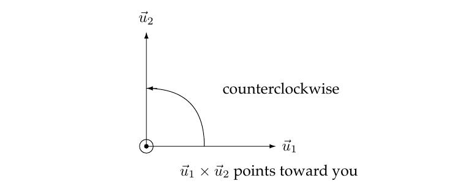
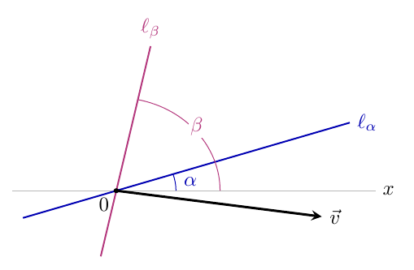



# Homework 9: Orthogonality and Least Squares

**due** Tuesday, November 24th at 11:59PM

{: .yellow }

Write your solutions to the following problems either by writing them on a piece of paper or on a tablet and scanning your answers as a PDF. Note that you are not allowed to use LaTeX, Google Docs, or any other digital document creation software to type your answers. Homeworks are due to Pensive by 11:59PM on the due date. See the [syllabus](https://math124.org/syllabus/#homework) for details on the slip day policy.

Homework will be evaluated not only on the correctness of your answers, but on your ability to present your ideas clearly and logically. You should always explain and justify your conclusions, using sound reasoning. Your goal should be to convince the reader of your assertions. If a question does not require explanation, it will be explicitly stated.

Before proceeding, make sure you're familiar with the [collaboration policy](https://math124.org/syllabus/#collaboration-and-generative-ai-policy).

---

## Problems

- [Problem 1: Midterm 2 Reflection](#problem-1-midterm-2-reflection-6-pts)
- [Problem 2: Complete the QR factorization](#problem-2-complete-the-qr-factorization-8-pts)
- [Problem 3: Completing an orthogonal matrix](#problem-3-completing-an-orthogonal-matrix-20-pts)
- [Problem 4: The cross product and orientation](#problem-4-the-cross-product-and-orientation-16-pts)
- [Problem 5: Rotations, reflections, and their compositions](#problem-5-rotations-reflections-and-their-compositions-22-pts)
- [Problem 6: Orthonormal columns and least squares](#problem-6-orthonormal-columns-and-least-squares-16-pts)
- [Problem 7: Predicting Billy's tips: use a computer](#problem-7-predicting-billys-tips-use-a-computer-12-pts)

---

Total Points: \\(6+8+20+16+22+16+12=100\\).

---

{: .yellow }
> Using one slip day extends this homework's deadline to **Monday, November 30th at 11:59PM**. We don't recommend leaving the entire homework to the last minute, because the next homework is due **Friday, December 4th**.
>
> While working on this homework, refer to [Chapter 6](https://notes.math124.org/ch06/06-01/) and Chapter 7 (coming soon).

---

## Problem 1: Midterm 2 Reflection (6 pts)

Write a response to the following prompt and include it in your homework PDF:

> Think of one specific topic you struggled with while studying for Midterm 2. What did you do to make sense of it, and how did it go on the exam? If you were studying for Midterm 2 again, what would you do differently?

**This problem is graded on completion.** Make an honest effort to respond to the prompt, and you will receive full credit. Your explanation does not need to be polished or perfect.

---

## Problem 2: Complete the QR factorization (8 pts)

The following is a partially completed QR factorization \\(A=QR\\). Fill in every missing entry so that the columns of \\(Q\\) are orthonormal and \\(R\\) is upper triangular with positive diagonal entries.

$$
\underbrace{\begin{bmatrix}
3&3&0\\3&-5&12\\3&-5&-2\\3&3&-2
\end{bmatrix}}_A
=
\underbrace{\begin{bmatrix}
1/2&1/2&1/10\\
\boxed{\phantom{-10}}&-1/2&7/10\\
1/2&\boxed{\phantom{-10}}&-7/10\\
1/2&1/2&\boxed{\phantom{-10}}
\end{bmatrix}}_Q
\underbrace{\begin{bmatrix}
\boxed{\phantom{-10}}&\boxed{\phantom{-10}}&4\\0&8&\boxed{\phantom{-10}}\\0&0&\boxed{\phantom{-10}}
\end{bmatrix}}_R.
$$

 Explain how you found the missing entries. Check that the completed factors satisfy \\(Q^TQ=I\\) and \\(QR=A\\).

---

## Problem 3: Completing an orthogonal matrix (20 pts)

Let

$$
Q_1=\begin{bmatrix}
\frac3{13}&\frac{12}{17}\\
\frac4{13}&-\frac{12}{17}\\
\frac{12}{13}&\frac1{17}
\end{bmatrix}
=\begin{bmatrix}|&|\\\vec{u}_1&\vec{u}_2\\|&|\end{bmatrix}.
$$

a)

(3 pts) Compute \\(Q&#95;1^TQ&#95;1\\) and \\(Q&#95;1Q&#95;1^T\\) to check that \\(Q&#95;1^TQ&#95;1=I\\), but \\(Q&#95;1Q&#95;1^T\ne I\\).

b)

(5 pts) Find a third column \\(\vec{u}&#95;3\\) so that the \\(3\times3\\) matrix

$$
Q=\begin{bmatrix}|&|&|\\\vec{u}_1&\vec{u}_2&\vec{u}_3\\|&|&|\end{bmatrix}
$$

 is orthogonal. Do this by the following method:

Pick a random vector \\(\vec{v}&#95;3\\) that is not in the span of \\(\vec{u}&#95;1\\) and \\(\vec{u}&#95;2\\). Apply Gram--Schmidt to \\(\vec{u}&#95;1,\vec{u}&#95;2,\vec{v}&#95;3\\) to obtain the third column \\(\vec{u}&#95;3\\). Write down the resulting orthogonal matrix \\(Q\\).

c)

(4 pts) Now we'll use a different method. Use the methods we learned previously to find an equation for the plane spanned by \\(\vec{u}&#95;1\\) and \\(\vec{u}&#95;2\\). Use this equation to find a nonzero vector perpendicular to both columns, and normalize it to length one. Write down the resulting orthogonal matrix \\(Q\\).

d)

(1 pt) How many choices are there for the third column \\(\vec{u}&#95;3\\)? Explain your answer.

e)

(3 pts) Check that \\(QQ^T=I\\) as well. What does this tell you about the rows of \\(Q\\)? Write down the orthonormal basis of \\(\mathbb{R}^3\\) given by this relation, expressing the vectors as column vectors.

f)

(4 pts) Let

$$
\vec x=\begin{bmatrix}5\\14\\6\end{bmatrix}.
$$

 Use your completed matrix \\(Q\\) from part (b) to find scalars \\(c&#95;1,c&#95;2,c&#95;3\\) such that

$$
\vec x=c_1\vec u_1+c_2\vec u_2+c_3\vec u_3.
$$

 Explain how the fact that \\(Q\\) is orthogonal allows you to find these coordinates.

---

## Problem 4: The cross product and orientation (16 pts)

For vectors \\(\style{color:rgb(176,79,9)}{\boldsymbol{\vec a}},\style{color:rgb(29,78,216)}{\boldsymbol{\vec b}}\\) in \\(\mathbb{R}^3\\), their *cross product* is the vector

$$
\style{color:rgb(162,28,88)}{\boldsymbol{\vec c}}
=\style{color:rgb(176,79,9)}{\boldsymbol{\vec a}}\times\style{color:rgb(29,78,216)}{\boldsymbol{\vec b}}
=\begin{bmatrix}\style{color:rgb(162,28,88)}{\boldsymbol{c_1}}\\\style{color:rgb(162,28,88)}{\boldsymbol{c_2}}\\\style{color:rgb(162,28,88)}{\boldsymbol{c_3}}\end{bmatrix}
=\begin{bmatrix}
\style{color:rgb(176,79,9)}{\boldsymbol{a_2}}\style{color:rgb(29,78,216)}{\boldsymbol{b_3}}-\style{color:rgb(176,79,9)}{\boldsymbol{a_3}}\style{color:rgb(29,78,216)}{\boldsymbol{b_2}}\\
\style{color:rgb(176,79,9)}{\boldsymbol{a_3}}\style{color:rgb(29,78,216)}{\boldsymbol{b_1}}-\style{color:rgb(176,79,9)}{\boldsymbol{a_1}}\style{color:rgb(29,78,216)}{\boldsymbol{b_3}}\\
\style{color:rgb(176,79,9)}{\boldsymbol{a_1}}\style{color:rgb(29,78,216)}{\boldsymbol{b_2}}-\style{color:rgb(176,79,9)}{\boldsymbol{a_2}}\style{color:rgb(29,78,216)}{\boldsymbol{b_1}}
\end{bmatrix}.
$$

a)

(2 pts) In this part only, consider the vectors

$$
\vec u=\begin{bmatrix}7\\-4\\9\end{bmatrix},\qquad
\vec v=\begin{bmatrix}-6\\8\\5\end{bmatrix}.
$$

 Compute \\(\vec u\times\vec v\\). Then compute \\(\vec u\cdot(\vec u\times\vec v)\\) and \\(\vec v\cdot(\vec u\times\vec v)\\) to show that the cross product is orthogonal to both \\(\vec u\\) and \\(\vec v\\).

b)

(1 pt) Compute \\(\vec e&#95;1\times\vec e&#95;2\\) and \\(\vec e&#95;2\times\vec e&#95;1\\), where \\(\vec e&#95;1,\vec e&#95;2,\vec e&#95;3\\) are the standard basis vectors. What happens when you reverse the order?

For the rest of this problem, let's consider the arbitrary vectors

$$
\style{color:rgb(176,79,9)}{\boldsymbol{\vec a}}=\begin{bmatrix}\style{color:rgb(176,79,9)}{\boldsymbol{a_1}}\\\style{color:rgb(176,79,9)}{\boldsymbol{a_2}}\\\style{color:rgb(176,79,9)}{\boldsymbol{a_3}}\end{bmatrix},\qquad
\style{color:rgb(29,78,216)}{\boldsymbol{\vec b}}=\begin{bmatrix}\style{color:rgb(29,78,216)}{\boldsymbol{b_1}}\\\style{color:rgb(29,78,216)}{\boldsymbol{b_2}}\\\style{color:rgb(29,78,216)}{\boldsymbol{b_3}}\end{bmatrix}.
$$

c)

(3 pts) Verify directly from the formula that

$$
\vec a\cdot(\vec a\times\vec b)=0,\qquad
\vec b\cdot(\vec a\times\vec b)=0.
$$

 Thus the cross product is perpendicular to both input vectors.

d)

(4 pts) Verify that

$$
\|\vec a\times\vec b\|^2
=\|\vec a\|^2\|\vec b\|^2-(\vec a\cdot\vec b)^2.
$$

 <em>Hint: Expand both sides and collect terms.</em>

e)

(3 pts) For nonzero vectors \\(\vec a,\vec b\\), let \\(\theta\\) be the angle between them. Deduce that

$$
\|\vec a\times\vec b\|=\|\vec a\|\,\|\vec b\|\sin\theta.
$$

 <em>Hint: Use \\(\vec a\cdot\vec b=\|\vec a\|\|\vec b\|\cos\theta\\) and \\(1-\cos^2\theta=\sin^2\theta\\).</em>

Explain why this is the area of the parallelogram with sides \\(\vec a,\vec b\\). In particular, what is the length of their cross product if they are perpendicular unit vectors?

f)

(1 pt) Its direction follows the *right-hand rule*: curl the fingers of your right hand from the first vector toward the second through the smaller angle; your thumb points along their cross product. In particular,

$$
\vec u_1,\quad\vec u_2,\quad\vec u_1\times\vec u_2
$$

 form a *right-handed orthonormal basis* when \\(\vec u&#95;1,\vec u&#95;2\\) are perpendicular unit vectors. Replacing the third vector by its negative gives a *left-handed* basis.

The picture is viewed from the tip of the third vector toward the origin; the circled dot means that vector points out of the page. In a right-handed basis the turn from the first vector to the second is counterclockwise in this view.

Using your answers to (b), classify the ordered bases \\((\vec e&#95;1,\vec e&#95;2,\vec e&#95;3)\\) and \\((\vec e&#95;2,\vec e&#95;1,\vec e&#95;3)\\) as right-handed or left-handed.

g)

(2 pts) Compute \\(\vec u&#95;1\times\vec u&#95;2\\) for the two columns of \\(Q&#95;1\\) in Problem 3. Compare this with your two possible third columns. Which choice makes the columns of the completed matrix \\(Q\\) a right-handed orthonormal basis?

---

## Problem 5: Rotations, reflections, and their compositions (22 pts)

In this problem, we will explore the compositions of rotations and reflections, two types of linear transformations we have already studied earlier in the semester.

a)

(5 pts) Recall that the matrix representing counterclockwise rotation by \\(\theta\\) is

$$
R_\theta=\begin{bmatrix}\cos\theta&-\sin\theta\\\sin\theta&\cos\theta\end{bmatrix}.
$$

 Let's use the fact that rotating by \\(\alpha\\) and then by \\(\beta\\) is the same as rotating by \\(\alpha+\beta\\) to recover the trigonometric identities you learned about in high school.

Let \\(R&#95;\alpha\\) and \\(R&#95;\beta\\) be matrices that represent counterclockwise rotations by \\(\alpha\\) and \\(\beta\\), respectively. Find \\(R&#95;\beta R&#95;\alpha\\), and use it to find formulas for \\(\cos(\alpha+\beta)\\) and \\(\sin(\alpha+\beta)\\).

b)

(5 pts) Reflecting a vector across a line means reflecting its tip across that line while keeping its tail at the origin. Let \\(H&#95;\alpha\\) represent reflection across the line through the origin making angle \\(\alpha\\) with the positive \\(x\\)-axis.

Use geometry to show that

$$
H_\alpha=\begin{bmatrix}\cos(2\alpha)&\sin(2\alpha)\\\sin(2\alpha)&-\cos(2\alpha)\end{bmatrix}.
$$

<ol class="assignment-enumeration" markdown="1">
<li markdown="1">

(i)

Draw the line, the standard basis vectors \\(\vec e&#95;1\\) and \\(\vec e&#95;2\\), and their reflections. Label the relevant angles.

</li>
<li markdown="1">

(ii)

Find the coordinates of the two reflected vectors, then use them as the columns of \\(H&#95;\alpha\\).

</li>
</ol>

c)

(6 pts) The lines \\(\ell&#95;\alpha\\) and \\(\ell&#95;\beta\\) below pass through the origin and make angles \\(\alpha\\) and \\(\beta\\) with the positive \\(x\\)-axis. Consider \\(H&#95;\beta H&#95;\alpha\\): first reflect across \\(\ell&#95;\alpha\\), then across \\(\ell&#95;\beta\\).

Do not use matrix multiplication in this part.

<ol class="assignment-enumeration" markdown="1">
<li markdown="1">

(i)

Draw \\(\vec v\\), the vector obtained after the first reflection, and the vector obtained after the second reflection. Label the relevant angles.

</li>
<li markdown="1">

(ii)

Use your picture to show that the composition is a rotation and find its angle.

</li>
<li markdown="1">

(iii)

Express your answer as \\(H&#95;\beta H&#95;\alpha=R&#95;{?}\\).

</li>
</ol>

d)

(6 pts) Now recover your answer to part (c) algebraically. Multiply the matrices in \\(H&#95;\beta H&#95;\alpha\\), simplify the entries using trigonometric identities, and identify the resulting rotation and its angle.

---

## Problem 6: Orthonormal columns and least squares (16 pts)

Consider the matrix \\(A\\) and vector \\(\vec b\\) below:

$$
A=\begin{bmatrix}1&3\\2&1\\2&6\\4&2\end{bmatrix},\qquad
\vec b=\begin{bmatrix}7\\6\\4\\7\end{bmatrix}.
$$

a)

(4 pts) Find the least-squares solution \\(\vec x^{\ast}\\) to \\(A\vec x=\vec b\\).

b)

(3 pts) Find the projection \\(\vec p\\) of \\(\vec b\\) onto the column space of \\(A\\).

c)

(5 pts) Applying Gram--Schmidt to the columns of \\(A\\) gives the following matrix with orthonormal columns:

$$
G=\frac15\begin{bmatrix}1&2\\2&-1\\2&4\\4&-2\end{bmatrix}.
$$

 Find the least-squares solution \\(\vec x&#95;G^{\ast}\\) to \\(G\vec x=\vec b\\), and compute \\(\vec p&#95;G=G\vec x&#95;G^{\ast}\\).

d)

(4 pts) Why was it easier to find the least-squares solution in part (c) than in part (a)? Explain why the projection vectors are the same even though \\(\vec x^{\ast}\\) and \\(\vec x&#95;G^{\ast}\\) are different.

---

## Problem 7: Predicting Billy's tips: use a computer (12 pts)

Before proceeding, open the supplemental Jupyter Notebook. To open the notebook for Homework 9, click [**this link**](https://colab.research.google.com/github/math-124/fa26-code/blob/main/homeworks/hw09/hw09.ipynb). Instructions on how to use Google Colab are at [math124.org/running-code](https://math124.org/running-code).

You will fit a line \\(y=c+mt\\), where \\(t\\) is the total bill and \\(y\\) is the predicted tip. The notebook provides the data, setup, and most of the code.

Complete Tasks 1-6 in the notebook. Include the requested code, output, and written responses in your homework PDF.

<ol class="assignment-enumeration" markdown="1">
<li class="assignment-task" markdown="1">

<strong>Task 1.</strong>

(3 points) Fit the line by solving the normal equations with `np.linalg.solve`.

</li>
<li class="assignment-task" markdown="1">

<strong>Task 2.</strong>

(1 point) Interpret the slope \\(m\\).

</li>
<li class="assignment-task" markdown="1">

<strong>Task 3.</strong>

(2 points) Complete `predict_tip` and predict the tip for a $38.50 bill.

</li>
<li class="assignment-task" markdown="1">

<strong>Task 4.</strong>

(2 points) Assess whether the prediction for a $3,000 bill is accurate.

</li>
<li class="assignment-task" markdown="1">

<strong>Task 5.</strong>

(2 points) Complete `compute_mse` and find the fitted line's mean squared error.

</li>
<li class="assignment-task" markdown="1">

<strong>Task 6.</strong>

(2 points) Use the sliders to compare another line with the least-squares line.

</li>
</ol>


