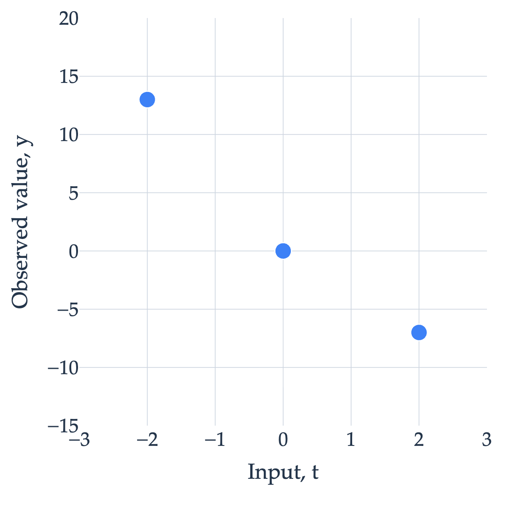



# Lab 12: Projecting onto the Column Space

**due** by the end of class on Wednesday, November 18, 2026

<a class="btn btn-info assignment-pdf-button" href="/resources/labs/lab12/lab12.pdf" target="_blank">View as PDF ✏️</a>
<a class="btn btn-info assignment-pdf-button" href="/resources/labs/lab12/lab12-solutions.pdf" target="_blank">Solutions PDF ✅</a>

{: .yellow }

Each lab worksheet will contain several activities, most of which will involve writing math on paper, and some of which will involve running code in a Jupyter Notebook. Lab activities are meant to last an hour, and the second hour of lab is dedicated to starting the homework assignment. To receive credit for a lab, you must show your lab TA your work on both the lab worksheet and homework assignment.

While you must get checked off by your lab TA **individually**, we encourage you to form groups with 1-2 other students to complete the activities together.

---

## Activities

- [Activity 1: Two approaches](#activity-1-two-approaches)
- [Activity 2: Fitting a line](#activity-2-fitting-a-line)

---

## Activity 1: Two approaches

Consider the matrix \\(A\\) and vector \\(\vec b\\):

$$
A=\begin{bmatrix}1&2\\1&-2\\1&0\end{bmatrix},\qquad
\vec b=\begin{bmatrix}-7\\13\\0\end{bmatrix}.
$$

 The columns of \\(A\\) span a plane in \\(\mathbb R^3\\). Our goal is to find the vector \\(\vec p\\) in this plane that is closest to \\(\vec b\\). This was the focus of yesterday's lecture, though it turns out that you have already learned how to project onto planes in \\(\mathbb R^3\\)!

a)

Find a nonzero vector \\(\vec n\\) perpendicular to both columns of \\(A\\). Use it to write an equation for the plane \\(\operatorname{colsp}(A)\\). Is \\(\vec b\\) in this plane?

Solution

Take \\(\vec n=(1,1,-2)^T\\). Its dot products with the columns of \\(A\\) are \\(1+1-2=0\\) and \\(2-2+0=0\\). The columns are independent, so their span is the plane normal to \\(\vec n\\):

$$
\operatorname{colsp}(A)=\left\{\begin{bmatrix}x\\y\\z\end{bmatrix}:x+y-2z=0\right\}.
$$

For \\(\vec b\\), the left-hand side is \\(-7+13-2(0)=6\\), so \\(\vec b\\) does not lie in the plane.

b)

Project \\(\vec b\\) onto the line spanned by \\(\vec n\\). Subtract this projection from \\(\vec b\\) to find \\(\vec p\\). Explain why subtracting the normal component gives the closest vector in the plane.

Solution

The component of \\(\vec b\\) along the normal is

$$
\operatorname{proj}_{\operatorname{span}\{\vec n\}}(\vec b)
=\frac{\vec b\cdot\vec n}{\vec n\cdot\vec n}\vec n
=\frac{6}{6}\vec n=\begin{bmatrix}1\\1\\-2\end{bmatrix}.
$$

Subtracting it gives

$$
\vec p=\begin{bmatrix}-7\\13\\0\end{bmatrix}
-\begin{bmatrix}1\\1\\-2\end{bmatrix}
=\begin{bmatrix}-8\\12\\2\end{bmatrix}.
$$

The result lies in the plane because \\(-8+12-2(2)=0\\). The residual \\(\vec b-\vec p=\vec n\\) is perpendicular to the plane. Moving from \\(\vec p\\) to any other point in the plane adds a nonzero perpendicular leg to that residual, increasing the distance by the Pythagorean theorem.

c)

Find \\(\vec x^{\ast}\\) that satisfies \\(A^TA\vec x^{\ast}=A^T\vec b\\).

Solution

The residual \\(\vec b-A\vec x^\ast\\) must be perpendicular to both columns, so \\(A^T(\vec b-A\vec x^\ast)=\vec 0\\). The normal equations are

$$
A^TA=\begin{bmatrix}3&0\\0&8\end{bmatrix},\qquad
A^T\vec b=\begin{bmatrix}6\\-40\end{bmatrix}.
$$

Solving \\(3x&#95;1^\ast=6\\) and \\(8x&#95;2^\ast=-40\\) gives \\(\vec x^\ast=(2,-5)^T\\).

d)

Compute \\(A\vec x^{\ast}\\) and verify that it equals the vector \\(\vec p\\) you found geometrically. How many entries does each vector have? Explain how the entries of \\(\vec x^{\ast}\\) combine the columns of \\(A\\) to produce \\(\vec p\\).

Solution

$$
A\vec x^\ast=2\vec a_1-5\vec a_2
=2\begin{bmatrix}1\\1\\1\end{bmatrix}
-5\begin{bmatrix}2\\-2\\0\end{bmatrix}
=\begin{bmatrix}-8\\12\\2\end{bmatrix}=\vec p.
$$

The two entries of \\(\vec x^\ast\\) weight the two columns of \\(A\\). The three entries of \\(\vec p\\) are the coordinates of their weighted sum in \\(\mathbb R^3\\).

e)

Keep \\(A\\) fixed. Can \\(\vec p\\) be viewed as a linear transformation of \\(\vec b\\)? Find the corresponding matrix \\(P\\) in terms of \\(A\\). State its shape. You may leave \\(P\\) as a product of matrices. Explain the difference between \\(\vec x^{\ast}\\), \\(\vec p\\), and \\(P\\).

Solution

Yes. The columns are independent, so \\(A^TA\\) is invertible. Substituting the solution of the normal equations into \\(\vec p=A\vec x^\ast\\) gives

$$
\vec x^\ast=(A^TA)^{-1}A^T\vec b,\qquad
\vec p=P\vec b,\qquad P=A(A^TA)^{-1}A^T.
$$

The factors have shapes \\((3\times2)(2\times2)(2\times3)\\), so \\(P\\) is \\(3\times3\\). The vector \\(\vec x^\ast\\) gives coefficients, \\(\vec p\\) is the projected vector for this input, and \\(P\\) projects any input onto the same plane.

f)

Let \\(\vec a&#95;1\\) and \\(\vec a&#95;2\\) be the columns of \\(A\\). Suppose we add a third column equal to \\(\vec a&#95;1+\vec a&#95;2\\), forming

$$
\widetilde A=\begin{bmatrix}1&2&3\\1&-2&-1\\1&0&1\end{bmatrix}.
$$

 Without doing any new matrix calculations, explain whether this changes the column space, the closest vector to \\(\vec b\\), or the minimum possible distance to \\(\vec b\\).

Solution

The new column is already a linear combination of the first two, so it adds no new direction and the original columns still span the plane. Thus \\(\operatorname{colsp}(\widetilde A)=\operatorname{colsp}(A)\\). With the same plane and the same \\(\vec b\\), the closest vector and minimum distance are unchanged.

---

## Activity 2: Fitting a line

Consider the dataset below. Find the line \\(y=c+mt\\) that best fits the data, meaning its sum of squared errors is minimized. Draw the line on the plot below.

<em>Hint: You have already done most of the work for this.</em>

<table>
<thead>
<tr>
<th style="text-align: center;">\(t\)</th>
<th style="text-align: center;">\(y\)</th>
</tr>
</thead>
<tbody>
<tr>
<td style="text-align: center;">\(2\)</td>
<td style="text-align: center;">\(-7\)</td>
</tr>
<tr>
<td style="text-align: center;">\(-2\)</td>
<td style="text-align: center;">\(13\)</td>
</tr>
<tr>
<td style="text-align: center;">\(0\)</td>
<td style="text-align: center;">\(0\)</td>
</tr>
</tbody>
</table>

Solution

An exact fit would give the equations \\(c+2m=-7\\), \\(c-2m=13\\), and \\(c=0\\). With \\(\vec x=(c,m)^T\\), this is the same system \\(A\vec x=\vec b\\) as in Activity 1. Minimizing the sum of squared errors means minimizing \\(\|\vec b-A\vec x\|^2\\). Activity 1(c) gave \\(\vec x^\ast=(2,-5)^T\\), so the best-fit line is \\(y=2-5t\\).

The predictions, in table order, are \\(-8,12,2\\), the entries of \\(\vec p\\). To draw the line, connect \\((0,2)\\) and \\((2,-8)\\).

<svg xmlns="http://www.w3.org/2000/svg" viewBox="0 0 320 245" width="400" style="max-width:100%;height:auto" role="img" aria-label="Scatter plot with data points at (−2, 13), (0, 0), and (2, −7), and the least-squares line y equals 2 minus 5t">
<path d="M34 128H293 M160 20V212" fill="none" stroke="currentColor"/>
<path d="M80 124v8 M240 124v8 M156 58h8 M156 198h8" fill="none" stroke="currentColor"/>
<g fill="currentColor" font-size="12"><text x="294" y="124">t</text><text x="168" y="24">y</text><text x="72" y="146">−2</text><text x="237" y="146">2</text><text x="137" y="62">10</text><text x="128" y="202">−10</text></g>
<path d="M50 17.75L270 210.25" fill="none" stroke="#a64b16" stroke-width="3"/>
<g fill="currentColor"><circle cx="80" cy="37" r="4"/><circle cx="160" cy="128" r="4"/><circle cx="240" cy="177" r="4"/></g>
<path d="M39 230h24" fill="none" stroke="#a64b16" stroke-width="3"/><text x="69" y="234" fill="currentColor" font-size="13">y = 2 − 5t</text>
</svg>


